# B3-1 · 내가 만든 웹사이트를 인터넷에 올려 누구나 쓰게 하기

| 분야 | 구분 | 학습시간 | 필수/선택 |
|---|---|---|---|
| AI/SW 기초 | 클라우드와 AI API | 40시간 | 필수 |

> **AWS 서울 리전에 네트워크(VPC)를 직접 만들고, 서버(EC2)의 웹 서버(Nginx)를 외부에서 접속할 수 있게 한 뒤, 근거를 남기고 깨끗이 치우는 과제입니다.**
> AWS 콘솔에서 직접 구성 · 필수 요구사항만 (보너스 제외)
>
> **평가하는 방법**: [3장](#3-과제-요구사항-확인) 표로 요구사항과 근거를 확인하고, [4장 과정 따라보기](#4-과정-따라보기)를 위에서 아래로 내리며 단계별로 무엇을·왜·어떻게 했는지 스크린샷과 함께 봅니다.

## 1. 한눈에 보기

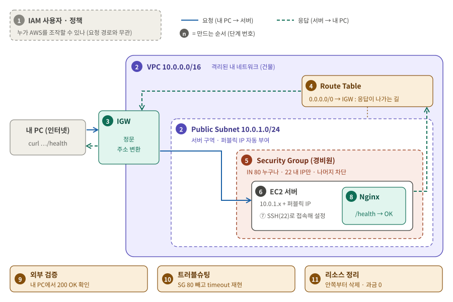

**그림 읽는 법**: 왼쪽에서 오른쪽(①→⑤)이 **요청**, 오른쪽에서 왼쪽(⑤→⑨)이 **응답**입니다. 칸마다 그 지점에서 **무슨 처리를 하는지**, 맨 아랫줄은 그 지점이 **막히면 나오는 증상**입니다. 뒤 배경은 어디까지가 VPC, Subnet, SG 범위인지를 보여줍니다.

아래 표는 이 길을 **만드는 순서**입니다. 단계가 쌓이면서 외부 요청 결과가 바뀝니다.

| 단계 | 만드는 것 | 하는 일 | 이 단계 후 외부 요청 결과 |
|---|---|---|---|
| 1 | IAM 사용자, 정책 | 누가 AWS를 조작할 수 있는지 제한 | 서버 없음 |
| 2 | VPC, Subnet | 격리된 내 네트워크와 서버 구역. 서버에 퍼블릭 IP 자동 부여 | 서버 없음 |
| 3 | Internet Gateway | 인터넷과 연결되는 정문. 퍼블릭 ↔ 프라이빗 주소 변환 | 서버 없음 |
| 4 | Route Table | VPC 밖으로 가는 트래픽(응답)을 IGW로 보냄 | 서버 없음 |
| 5 | Security Group | 80은 누구나, 22는 내 IP만 들어오게 함 | 서버 없음 |
| 6 | EC2 | 길 끝에 놓인 서버 | **refused** (받을 프로그램 없음) |
| 7 | SSH 접속 | 내 PC에서 서버에 들어가 설정 | refused |
| 8 | Nginx, `/health` | 80에서 요청을 받아 `OK` 응답 | **200 OK** ✔ |
| 9 | 외부 검증 | 내 PC에서 전체 경로가 열렸음을 증명 | 200 OK (📸 증빙) |
| 10 | 트러블슈팅 | 실제로 겪은 장애(휴대폰 Chrome만 timeout)를 근거로 진단 | 서버는 계속 200 OK |
| 11 | 리소스 정리 | 안쪽부터 삭제해 과금 요인 제거 | 응답 없음 |

> **refused**는 요청이 서버까지 **왔지만** 받을 프로그램이 없는 것(6단계), **timeout**은 응답이 **아예 오지 않은** 것([트러블슈팅](docs/troubleshooting.md))입니다. 그래서 장애가 나면 timeout은 바깥(라우팅, SG, 퍼블릭 IP)부터, refused는 서버 안(Nginx)부터 봅니다.

단계별 자세한 방법은 [실습 가이드](docs/guide.md)에 있습니다.

## 2. 외부 접속 검증

| 항목 | 내용 |
|---|---|
| 선택한 방식 | **(B) `GET http://<퍼블릭IP>/health`** |
| 접속 정보 | `http://52.79.204.114/health` (실습 당시 퍼블릭 IP. 리소스 정리 후에는 접속되지 않음) |
| 확인 일시 | 2026-10-20 10:31 (KST) |
| 결과 | `HTTP/1.1 200 OK`, 본문 `OK` |
| 증빙 | 📸 [10-external-health.png](docs/images/10-external-health.png) (내 PC 터미널), [10b-external-browser.png](docs/images/10b-external-browser.png) (브라우저) |

## 3. 과제 요구사항 확인

| 요구 | 어떻게 했나 | 근거 | 상태 |
|---|---|---|---|
| VPC, Public Subnet | `10.0.0.0/16`, `10.0.1.0/24`, 퍼블릭 IP 자동 할당, `0.0.0.0/0 → IGW` 테이블 연결 | 📸 02, 04 | ✅ |
| IGW를 VPC에 연결 | `b3-1-igw` Attached | 📸 03 | ✅ |
| Route Table `0.0.0.0/0 → IGW` | `b3-1-rt-public`을 서브넷에 연결 | 📸 04 | ✅ |
| 인스턴스 아웃바운드 | EC2에서 `curl -I https://example.com` → `HTTP/2 200` | 📸 08 | ✅ |
| EC2 1대, SSH 접속 | t3.micro, 내 IP에서 키로 접속 | 📸 06, 07 | ✅ |
| 웹 서버 실행, `curl localhost` 200 | Nginx `active (running)`, `curl -i http://localhost/health` → `200 OK` | 📸 09 | ✅ |
| SG 필요 포트만 | 80 ← `0.0.0.0/0`, 22 ← 내 IP `/32`, 전체 포트 규칙 없음 | 📸 05 | ✅ |
| IAM 최소 권한 | EC2 액션만, 생성·삭제는 서울 리전만, S3/RDS·관리자 권한 없음 | 📸 01, [iam-policy.json](docs/iam-policy.json) | ✅ |
| 외부 접속 검증 (B) | `/health` → 200 OK, `OK` | 📸 10, 위 2장 | ✅ |
| 아키텍처 다이어그램 | VPC, Subnet, IGW, Route Table, SG, EC2, 요청 흐름 | [architecture.png](docs/architecture.png) | ✅ |
| 트러블슈팅 보고서 | 휴대폰 Chrome만 timeout → 가설 3개 → Mac `curl`·LTE·다른 브라우저로 하나씩 제외 → Chrome 문제로 확정, 443은 열지 않음 | 📸 11, [troubleshooting.md](docs/troubleshooting.md) | ✅ |
| 리소스 정리 5종 | EC2, EBS, Elastic IP(할당 안 함), IGW, VPC | 📸 13a~, [cleanup-checklist.md](docs/cleanup-checklist.md) | 🟡 |
| 제약: 루트 미사용, 서울 리전, 프리 티어 | 루트는 IAM 사용자 생성까지만, t3.micro(크레딧 Standard), EIP·NAT·ALB 만들지 않음 | 📸 01, 06, 06b | ✅ |

## 4. 과정 따라보기

> 아래로 내리면서 과제 전체를 확인하는 구간입니다. 단계마다 **무엇을 · 왜 · 어떻게** 했는지와 대표 스크린샷을 하나씩 두었습니다. 콘솔 화면은 핵심 부분만 잘라 보였고, 전체 화면(오른쪽 위 `b3-1-user`·서울 리전 포함)과 막혔던 점은 각 단계의 **자세히** 링크에 있습니다.

### 1단계. 계정 준비 · [자세히](docs/steps/01-account.md)

- **무엇을**: 루트 계정에 MFA와 제로 지출 예산(비용 알림)을 걸고, 실습 전용 IAM 사용자 `b3-1-user`를 만들었다
- **왜**: 루트는 모든 권한을 가져 사고가 나면 피해가 크다. 필요한 권한만 가진 사용자로 작업한다(**최소 권한**)
- **어떻게**: 정책 `b3-1-policy` 하나만 연결. EC2 액션만 허용하고, 생성·삭제는 서울 리전만. AdministratorAccess·S3·RDS 없음 ([iam-policy.json](docs/iam-policy.json))

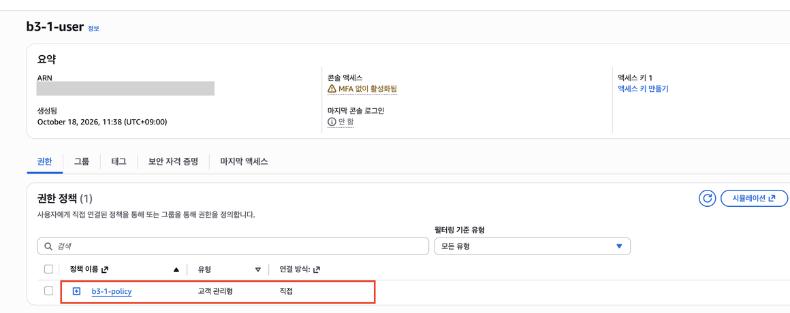

### 2단계. VPC와 Subnet · [자세히](docs/steps/02-vpc-subnet.md)

- **무엇을**: VPC `b3-1-vpc` `10.0.0.0/16`, 그 안에 서브넷 `b3-1-subnet-public` `10.0.1.0/24` (`ap-northeast-2a`)
- **왜**: 서버를 놓을 **격리된 내 네트워크**와 그 안의 구역이 먼저 있어야 한다. 서브넷의 "퍼블릭 IPv4 자동 할당"을 켜야 서버가 바깥 주소를 받는다
- **어떻게**: "VPC만"으로 생성 → 서브넷 생성 → 서브넷 설정 편집에서 자동 할당 활성화. CIDR 뜻은 [그림](docs/concepts.md#cidr-그림으로-보기-1000016) 참고

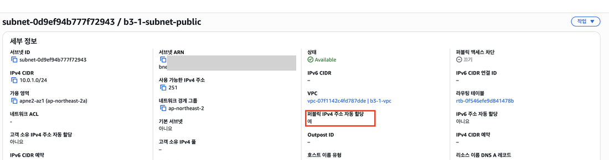

### 3단계. Internet Gateway · [자세히](docs/steps/03-igw.md)

- **무엇을**: `b3-1-igw`를 만들어 `b3-1-vpc`에 연결(Attached)
- **왜**: VPC와 인터넷을 잇는 **정문**. 퍼블릭 IP와 프라이빗 IP를 서로 바꿔 준다
- **어떻게**: 생성 직후 Detached → 작업 → VPC에 연결

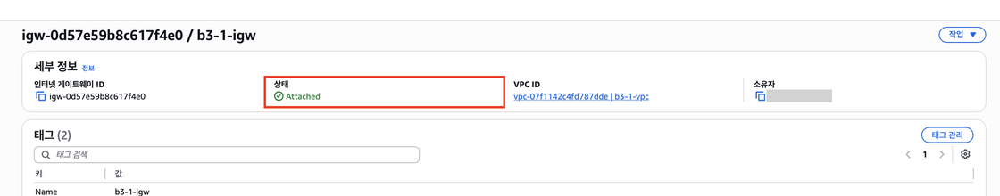

### 4단계. Route Table · [자세히](docs/steps/04-route-table.md)

- **무엇을**: `b3-1-rt-public`에 `0.0.0.0/0 → b3-1-igw` 경로를 넣고 서브넷에 연결
- **왜**: VPC 밖으로 가는 패킷(서버의 **응답**)을 정문으로 안내한다. 이 경로가 연결된 서브넷이 **퍼블릭 서브넷**이다. 기본 라우팅 테이블은 연결 안 된 모든 서브넷에 적용되므로 고치지 않고 전용 테이블을 만들었다
- **어떻게**: 라우팅 편집(경로 내용) → 서브넷 연결 편집(어느 서브넷에 적용할지)

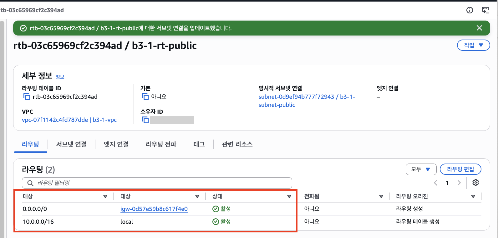

### 5단계. Security Group · [자세히](docs/steps/05-security-group.md)

- **무엇을**: `b3-1-sg-web` 인바운드 2개. HTTP 80 ← `0.0.0.0/0`, SSH 22 ← 내 IP `/32`
- **왜**: 웹은 **누구나**, 관리(SSH)는 **나만**. 그 밖의 포트는 모두 막힌다. SG는 **stateful**이라 들어온 요청의 응답은 자동으로 나간다
- **어떻게**: VPC를 `b3-1-vpc`로 바꿔 생성. 아웃바운드는 기본값 유지

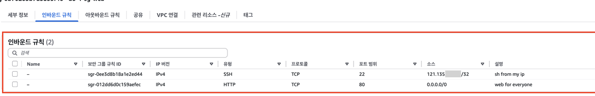

### 6단계. EC2 · [자세히](docs/steps/06-ec2.md)

- **무엇을**: `b3-1-ec2-web` (Ubuntu 24.04, **t3.micro**), 퍼블릭 IP `52.79.204.114`, 프라이빗 IP `10.0.1.49`
- **왜**: 길(2~5단계) 끝에 놓을 서버. 크레딧을 **표준**으로 바꿔 추가 과금을 막았다
- **어떻게**: 시작 화면의 기본값(기본 VPC, SSH가 전체에 열린 새 보안 그룹, 무제한 크레딧)을 **편집**해 `b3-1-vpc` / `b3-1-subnet-public` / 기존 `b3-1-sg-web` / 표준으로 변경

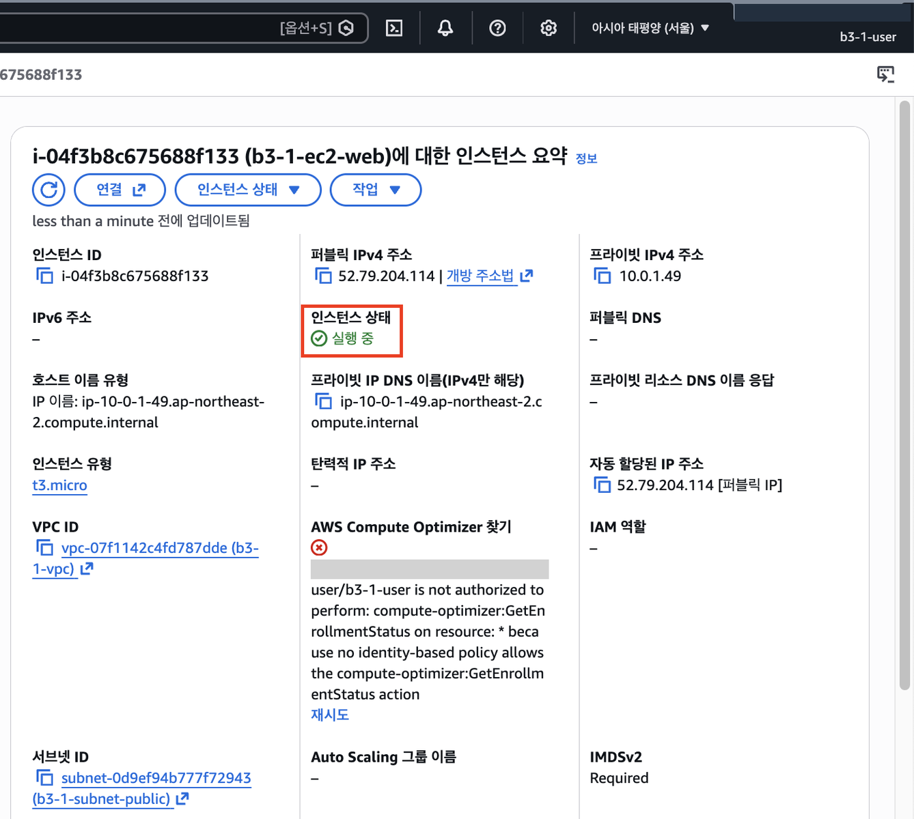

### 7단계. SSH 접속과 아웃바운드 · [자세히](docs/steps/07-ssh.md)

- **무엇을**: 내 PC에서 키로 SSH 접속, 서버 안에서 `curl -I https://example.com` → `HTTP/2 200`
- **왜**: 서버를 설정하려면 들어가야 하고, 패키지를 설치하려면 서버가 **밖으로 나갈 수** 있어야 한다
- **어떻게**: `.pem`을 레포 밖에 두고 `chmod 400` → `ssh -i ~/keys/b3-1-key.pem ubuntu@52.79.204.114`

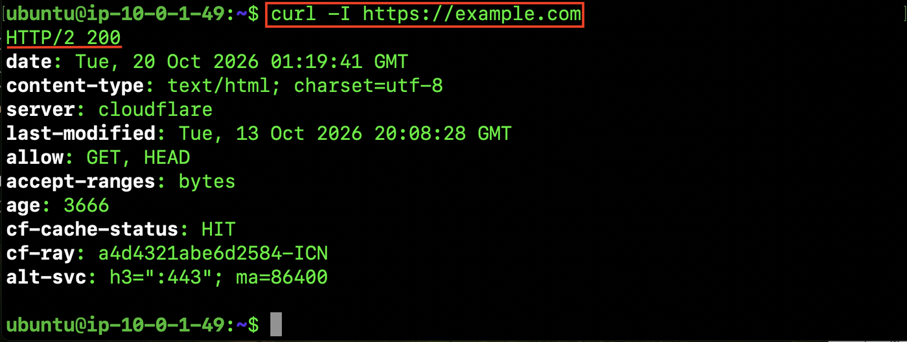

### 8단계. Nginx와 `/health` · [자세히](docs/steps/08-nginx.md)

- **무엇을**: Nginx 설치, `location = /health { return 200 "OK\n"; }` 추가
- **왜**: 80 포트에서 요청을 받을 프로그램이 필요하다. `/health`는 항상 같은 응답을 주는 **헬스 체크** 주소라 외부 검증(B)에 쓴다
- **어떻게**: `nginx -t`로 문법 검사 → `reload` → 서버 안에서 `curl -i http://localhost/health` → `200 OK`. 설치 전 밖에서는 **refused**였다([09a](docs/images/09a-refused-before-nginx.png))

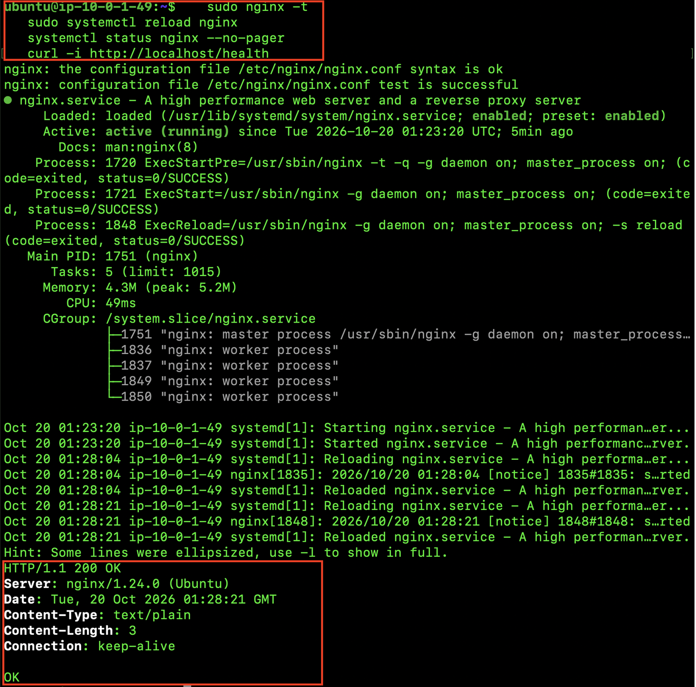

### 9단계. 외부 접속 검증 · [자세히](docs/steps/09-verify.md)

- **무엇을**: **내 PC**에서 `curl -i http://52.79.204.114/health` → `HTTP/1.1 200 OK`, `OK`
- **왜**: 서버 안 확인(8단계)과 달리 **내 PC → 인터넷 → IGW → 서브넷 → SG → EC2 → Nginx** 전체 경로가 열렸다는 증거
- **어떻게**: 터미널과 브라우저([10b](docs/images/10b-external-browser.png)) 두 가지로 확인

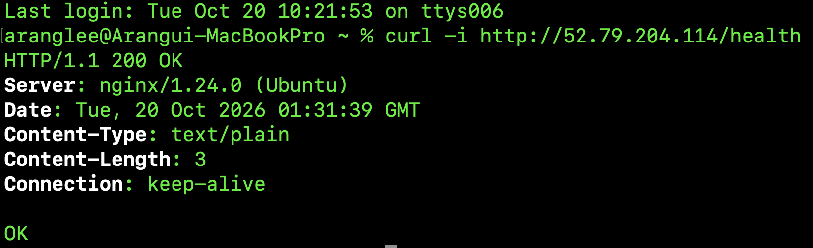

### 10단계. 트러블슈팅 · [자세히](docs/troubleshooting.md)

- **무엇을**: 외부 검증 직후 **휴대폰 Chrome에서만** timeout이 난 실제 장애를 진단
- **왜**: 서버를 함부로 고치지 않고 근거로 원인 범위를 좁히기 위해
- **어떻게**: Mac `curl` 200(서버 정상) → LTE로도 실패(네트워크 아님) → 삼성 인터넷 OK(**Chrome 문제** 확정). 해결을 위해 443을 열지 않았다

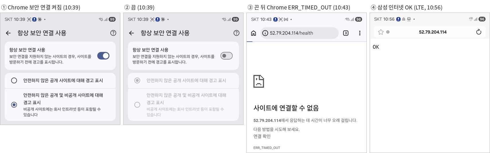

### 11단계. 리소스 정리 · [자세히](docs/steps/11-cleanup.md)

- **무엇을**: 만든 리소스를 **안쪽부터** 삭제 (EC2 → 키 페어 → SG → 서브넷·라우팅 테이블 → IGW → VPC)
- **왜**: 남은 EC2·EBS·Elastic IP 등은 비용이 나간다
- **어떻게**: [정리 체크리스트](docs/cleanup-checklist.md)의 ID 목록대로 지우고 확인 (🟡 진행 중: EC2·EBS·탄력적 IP·키 페어·보안 그룹 완료)

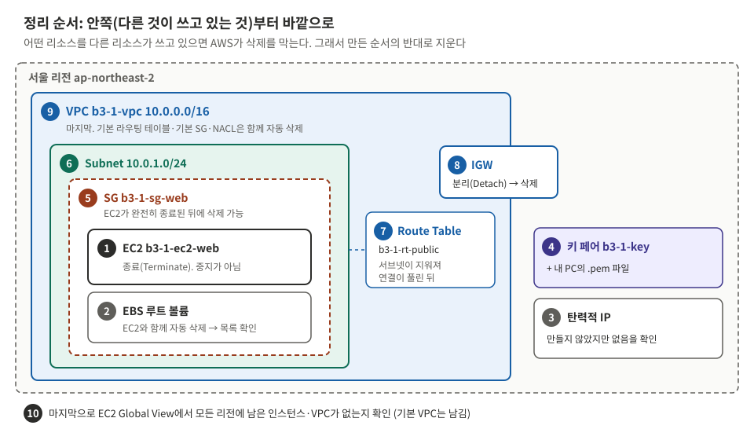

## 5. 문서

| 문서 | 언제 보나 |
|---|---|
| [docs/guide.md](docs/guide.md) | **실습할 때**: 단계 목록과 진행 상태. 단계마다 할 일과 실제 기록(스크린샷) |
| [docs/design.md](docs/design.md) | 설계 이유, 요청·응답 왕복 |
| [docs/architecture.png](docs/architecture.png) | 제출물: 아키텍처 다이어그램 |
| [docs/troubleshooting.md](docs/troubleshooting.md) | 제출물: 트러블슈팅 보고서 |
| [docs/cleanup-checklist.md](docs/cleanup-checklist.md) | 제출물: 리소스 정리 체크리스트 |
| [docs/concepts.md](docs/concepts.md) | 개념 공부: VPC, 포트, SG, IAM 등 |
| [docs/evaluation.md](docs/evaluation.md) | 평가 준비: 질문별 답변 |
| [docs/images/](docs/images/README.md) | 스크린샷 목록 (`focus/`는 README용 확대 이미지) |
