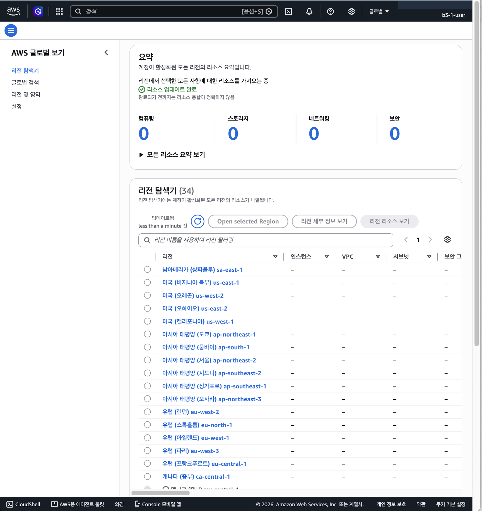

# B3-1 · 내가 만든 웹사이트를 인터넷에 올려 누구나 쓰게 하기

| 분야 | 구분 | 학습시간 | 필수/선택 |
|---|---|---|---|
| AI/SW 기초 | 클라우드와 AI API | 40시간 | 필수 |

> **AWS 서울 리전에 네트워크(VPC)를 직접 만들고, 서버(EC2)의 웹 서버(Nginx)를 외부에서 접속할 수 있게 한 뒤, 근거를 남기고 깨끗이 치우는 과제입니다.**
> AWS 콘솔에서 직접 구성 · 필수 요구사항만 (보너스 제외)
>
> **평가하는 방법**: [3장](#3-과제-요구사항-확인) 표로 요구사항과 근거를 확인하고, [4장 과정 따라보기](#4-과정-따라보기)를 위에서 아래로 내리며 단계별로 무엇을·왜·어떻게 했는지 스크린샷과 함께 봅니다.

## 1. 한눈에 보기

### 1-1. 요청 하나가 오가는 길


**그림 읽는 법**: 왼쪽에서 오른쪽(①→⑤)이 **요청**, 오른쪽에서 왼쪽(⑤→⑨)이 **응답**입니다. 맨 아랫줄은 그 지점이 **막히면 나오는 증상**입니다.

인터넷에서 오가는 데이터는 모두 **송장이 붙은 택배 상자(패킷)**라고 생각하면 쉽습니다. 송장에는 항상 네 가지가 적혀 있습니다.

| 송장 칸 | 뜻 | 이 과제의 예 |
|---|---|---|
| 보내는 주소 | 누가 보냈나 (IP) | 내 PC `121.135.x.x` |
| 보내는 문 번호 | 답장을 받을 문 (포트) | `51234` (내 PC가 그때그때 아무 번호나 고름) |
| 받는 주소 | 누구에게 가나 (IP) | 서버 `52.79.204.114` |
| 받는 문 번호 | 서버의 어느 프로그램에게 가나 (포트) | `80` (웹 서버의 문) |

상자 안의 내용물은 "**`/health` 페이지 주세요**"(`GET /health`)입니다. 그림의 번호대로, 누가 상자를 받아 무엇을 하는지는 다음과 같습니다.

| # | 누가 | 하는 일 | 송장 변화 |
|---|---|---|---|
| ① | 내 PC → 인터넷 | 요청 상자를 만들어 보냄. 인터넷이 AWS 서울까지 배달 | `121.135.x.x:51234 → 52.79.204.114:80` |
| ② | IGW (정문) | 받는 주소를 건물 안 주소로 고쳐 씀 | 받는 곳 → `10.0.1.49:80` |
| ③ | Route Table (안내판) | `10.0.0.0/16 → local` 줄을 보고 서브넷으로 | — |
| ④ | SG (경비원) | 80번은 누구나 허용 → 통과. **이 연결을 수첩에 기록** | — |
| ⑤ | EC2 → Nginx | `/health`를 보고 `200 OK`, `OK` 답장을 만듦 | `10.0.1.49:80 → 121.135.x.x:51234` |
| ⑥ | SG | 수첩에 있는 연결의 답장 → 규칙을 보지 않고 통과 (**stateful**) | — |
| ⑦ | Route Table | 받는 곳이 VPC 밖 → **`0.0.0.0/0 → IGW`** 줄로 정문에 | — |
| ⑧ | IGW | 보내는 주소를 바깥 주소로 고쳐 씀 | 보내는 곳 → `52.79.204.114:80` |
| ⑨ | 내 PC | `HTTP/1.1 200 OK`, `OK` 표시 ✔ | — |

<details>
<summary><b>번호별 자세히 보기</b> (클릭해서 펼치기)</summary>

**① 내 PC가 상자를 만들어 보낸다**
- **누가**: 내 PC의 `curl`(또는 브라우저), 그리고 인터넷의 라우터들(우체국)
- **무엇을**: 주소 `http://52.79.204.114/health`를 보고 상자를 만듭니다. `http://`는 "80번 문으로 보내라"는 뜻이고, 내 PC는 답장을 받을 문으로 `51234`를 열어 둡니다. 인터넷은 받는 주소 `52.79…`가 AWS 서울 데이터센터 것임을 알고 그쪽으로 배달합니다. 상자 내용은 열어 보지 않습니다.
- **송장**: `121.135.x.x:51234 → 52.79.204.114:80`

**② IGW(정문)가 받는 주소를 안쪽 주소로 바꾼다**
- **누가**: 인터넷 게이트웨이 `b3-1-igw`. VPC 건물의 정문
- **무엇을**: 바깥 주소 `52.79.204.114`는 건물 안에서 통하지 않습니다. 건물 안의 방은 **내선 번호**(프라이빗 IP)로만 불리기 때문입니다. 정문은 "`52.79.204.114`는 우리 건물 `10.0.1.49`번 방"이라는 대응표를 보고 **받는 주소를 고쳐 씁니다.**
- **송장**: 받는 곳 `52.79.204.114:80` → **`10.0.1.49:80`**
- **없으면**: 건물 입구가 없어 상자가 못 들어옴 → timeout

**③ Route Table(안내판)이 방향을 정한다**
- **누가**: 라우팅 테이블 `b3-1-rt-public`
- **무엇을**: 받는 주소 `10.0.1.49`에 맞는 줄을 찾습니다.
  - `10.0.0.0/16 → local`: "`10.0.x.x`는 건물 안이니 안에서 바로 전달" ← **이 줄을 탐**
  - `0.0.0.0/0 → IGW`: "그 밖은 정문으로" (⑦에서 씀)
- **결과**: 상자가 1층 매장 구역(서브넷 `10.0.1.0/24`)으로 갑니다.

**④ SG(경비원)가 들여보낼지 정한다**
- **누가**: 보안 그룹 `b3-1-sg-web`. 서버 방 문 앞의 경비원
- **무엇을**: 받는 문 번호를 봅니다. **80번**이고 규칙표에 "80번은 누구나(`0.0.0.0/0`)"라고 적혀 있으니 통과시킵니다. 22번이었다면 보내는 주소가 내 IP인지까지 확인합니다.
- **그리고**: 수첩에 "**`121.135.x.x:51234` 손님을 80번으로 들여보냄**"이라고 적어 둡니다. ⑥에서 씁니다.
- **막으면**: 규칙에 없는 상자는 거절 통보 없이 **조용히 버림** → 내 PC는 답을 못 받고 timeout

**⑤ 서버 안에서 Nginx가 답장을 만든다**
- **누가**: EC2 `b3-1-ec2-web`(Ubuntu) → 그 안의 **Nginx**
- **무엇을**:
  1. EC2가 상자를 받아 "80번 문은 누가 지키고 있지?"를 봅니다. Nginx가 80번에서 기다리고 있으니 Nginx에게 넘깁니다.
  2. Nginx가 상자를 열어 `GET /health`를 읽습니다.
  3. 설정의 `location = /health`, 즉 "주소가 **정확히** `/health`면 파일을 찾지 말고 바로 `200`과 `OK`로 답하라"는 줄을 찾습니다.
  4. 답장 상자를 만듭니다. 내용물은 `HTTP/1.1 200 OK` + 본문 `OK`
- **답장 송장**: 받은 송장을 뒤집은 것 `10.0.1.49:80 → 121.135.x.x:51234`
- **Nginx가 없으면**: 80번 문에 아무도 없어 EC2가 즉시 "**받을 사람 없음**"으로 돌려보냄 → **refused**. Nginx 설치 전 실제로 8 ms 만에 거절됨 ([09a](docs/images/09a-refused-before-nginx.png))

**⑥ SG가 답장을 내보낸다**
- **누가**: 같은 경비원 `b3-1-sg-web`
- **무엇을**: 수첩을 보고 "아까 들여보낸 `121.135.x.x:51234` 손님에게 가는 답장"인 걸 확인하면 **규칙표를 보지 않고 바로 내보냅니다.**
- **이게 stateful**: 들어올 때 기록해 두었기 때문에 나가는 규칙을 따로 만들 필요가 없습니다.

**⑦ Route Table이 정문 쪽으로 안내한다**
- **누가**: 안내판 `b3-1-rt-public`
- **무엇을**: 받는 주소 `121.135.x.x`는 `10.0.x.x`가 아니니 건물 밖 → **`0.0.0.0/0 → IGW`** 줄을 따라 정문으로 보냅니다.
- **없으면**: 요청은 들어왔는데 답장이 나갈 길을 몰라 건물 안에서 멈춤 → timeout. 그래서 이 줄은 **응답을 위해** 꼭 필요합니다.

**⑧ IGW가 보내는 주소를 바깥 주소로 바꾼다**
- **누가**: 정문 `b3-1-igw`
- **무엇을**: ②를 거꾸로 합니다. 보내는 주소 `10.0.1.49`(내선 번호)를 바깥에서 통하는 `52.79.204.114`로 고쳐 씁니다. 그래야 내 PC가 "내가 요청한 그 서버의 답장"으로 알아봅니다.
- **송장**: 보내는 곳 `10.0.1.49:80` → **`52.79.204.114:80`**

**⑨ 내 PC가 답장을 받는다**
- **누가**: 문 `51234`를 열고 기다리던 `curl`
- **무엇을**: 답장을 열어 화면에 보여 줍니다. 이 화면이 과제의 외부 접속 증빙입니다 ([📸 10](docs/images/10-external-health.png)).

```text
HTTP/1.1 200 OK
Server: nginx/1.24.0 (Ubuntu)
Content-Type: text/plain

OK
```

</details>

**어디서 막히면 무엇이 보이나**

| 막힌 곳 | 일어나는 일 | 내 PC에 보이는 것 |
|---|---|---|
| ② IGW 없음 · ④ SG에 80 없음 · ⑦ `0.0.0.0/0` 없음 | 상자가 중간에서 **말없이 사라짐** | **timeout** (기다리다 포기) |
| ⑤ Nginx 없음 | 서버까지 왔지만 **받을 사람이 없어 바로 반송** | **refused** (즉시 거절) |

그래서 timeout이면 **바깥(②③④⑦)**부터, refused면 **서버 안(⑤)**부터 봅니다.

### 1-2. 이 길을 만드는 순서

아래 표는 위의 길을 **만드는 순서**입니다. 단계가 쌓이면서 외부 요청 결과가 바뀝니다.

| 단계 | 만드는 것 | 하는 일 | 이 단계 후 외부 요청 결과 |
|---|---|---|---|
| 1 | IAM 사용자, 정책 | 누가 AWS를 조작할 수 있는지 제한 | 서버 없음 |
| 2 | VPC, Subnet | 격리된 내 네트워크와 서버 구역. 서버에 퍼블릭 IP 자동 부여 | 서버 없음 |
| 3 | Internet Gateway | 인터넷과 연결되는 정문. 퍼블릭 ↔ 프라이빗 주소 변환 | 서버 없음 |
| 4 | Route Table | VPC 밖으로 가는 트래픽(응답)을 IGW로 보냄 | 서버 없음 |
| 5 | Security Group | 80은 누구나, 22는 내 IP만 들어오게 함 | 서버 없음 |
| 6 | EC2 | 길 끝에 놓인 서버 | **refused** (받을 프로그램 없음) |
| 7 | SSH 접속 | 내 PC에서 서버에 들어가 설정 | refused |
| 8 | Nginx, `/health` | 80에서 요청을 받아 `OK` 응답 | **200 OK** ✔ |
| 9 | 외부 검증 | 내 PC에서 전체 경로가 열렸음을 증명 | 200 OK (📸 증빙) |
| 10 | 트러블슈팅 | 실제로 겪은 장애(휴대폰 Chrome만 timeout)를 근거로 진단 | 서버는 계속 200 OK |
| 11 | 리소스 정리 | 안쪽부터 삭제해 과금 요인 제거 | 응답 없음 |

단계별 자세한 방법은 [실습 가이드](docs/guide.md)에 있습니다.

## 2. 외부 접속 검증

| 항목 | 내용 |
|---|---|
| 선택한 방식 | **(B) `GET http://<퍼블릭IP>/health`** |
| 접속 정보 | `http://52.79.204.114/health` (실습 당시 퍼블릭 IP. 리소스 정리 후에는 접속되지 않음) |
| 확인 일시 | 2026-10-20 10:31 (KST) |
| 결과 | `HTTP/1.1 200 OK`, 본문 `OK` |
| 증빙 | 📸 [10-external-health.png](docs/images/10-external-health.png) (내 PC 터미널), [10b-external-browser.png](docs/images/10b-external-browser.png) (브라우저) |

## 3. 과제 요구사항 확인

| 요구 | 어떻게 했나 | 근거 | 상태 |
|---|---|---|---|
| VPC, Public Subnet | `10.0.0.0/16`, `10.0.1.0/24`, 퍼블릭 IP 자동 할당, `0.0.0.0/0 → IGW` 테이블 연결 | 📸 02, 04 | ✅ |
| IGW를 VPC에 연결 | `b3-1-igw` Attached | 📸 03 | ✅ |
| Route Table `0.0.0.0/0 → IGW` | `b3-1-rt-public`을 서브넷에 연결 | 📸 04 | ✅ |
| 인스턴스 아웃바운드 | EC2에서 `curl -I https://example.com` → `HTTP/2 200` | 📸 08 | ✅ |
| EC2 1대, SSH 접속 | t3.micro, 내 IP에서 키로 접속 | 📸 06, 07 | ✅ |
| 웹 서버 실행, `curl localhost` 200 | Nginx `active (running)`, `curl -i http://localhost/health` → `200 OK` | 📸 09 | ✅ |
| SG 필요 포트만 | 80 ← `0.0.0.0/0`, 22 ← 내 IP `/32`, 전체 포트 규칙 없음 | 📸 05 | ✅ |
| IAM 최소 권한 | EC2 액션만, 생성·삭제는 서울 리전만, S3/RDS·관리자 권한 없음 | 📸 01, [iam-policy.json](docs/iam-policy.json) | ✅ |
| 외부 접속 검증 (B) | `/health` → 200 OK, `OK` | 📸 10, 위 2장 | ✅ |
| 아키텍처 다이어그램 | VPC, Subnet, IGW, Route Table, SG, EC2, 요청 흐름 | [architecture.png](docs/architecture.png) | ✅ |
| 트러블슈팅 보고서 | 휴대폰 Chrome만 timeout → 가설 3개 → Mac `curl`·LTE·다른 브라우저로 하나씩 제외 → Chrome 문제로 확정, 443은 열지 않음 | 📸 11, [troubleshooting.md](docs/troubleshooting.md) | ✅ |
| 리소스 정리 5종 | EC2 종료, EBS 자동 삭제, Elastic IP 없음 확인, IGW 분리 후 삭제, VPC 삭제 → 글로벌 보기에서 모든 리전 확인 | 📸 13a~13s, [cleanup-checklist.md](docs/cleanup-checklist.md) | ✅ |
| 제약: 루트 미사용, 서울 리전, 프리 티어 | 루트는 IAM 사용자 생성까지만, t3.micro(크레딧 Standard), EIP·NAT·ALB 만들지 않음 | 📸 01, 06, 06b | ✅ |

## 4. 과정 따라보기

> 아래로 내리면서 과제 전체를 확인하는 구간입니다. 단계마다 **무엇을 · 왜 · 어떻게** 했는지와 대표 스크린샷을 하나씩 두었습니다. 콘솔 화면은 핵심 부분만 잘라 보였고, 전체 화면(오른쪽 위 `b3-1-user`·서울 리전 포함)과 막혔던 점은 각 단계의 **자세히** 링크에 있습니다.

### 1단계. 계정 준비 · [자세히](docs/steps/01-account.md)

- **무엇을**: 루트 계정에 MFA와 제로 지출 예산(비용 알림)을 걸고, 실습 전용 IAM 사용자 `b3-1-user`를 만들었다
- **왜**: 루트는 모든 권한을 가져 사고가 나면 피해가 크다. 필요한 권한만 가진 사용자로 작업한다(**최소 권한**)
- **어떻게**: 정책 `b3-1-policy` 하나만 연결. EC2 액션만 허용하고, 생성·삭제는 서울 리전만. AdministratorAccess·S3·RDS 없음 ([iam-policy.json](docs/iam-policy.json))


### 2단계. VPC와 Subnet · [자세히](docs/steps/02-vpc-subnet.md)

- **무엇을**: VPC `b3-1-vpc` `10.0.0.0/16`, 그 안에 서브넷 `b3-1-subnet-public` `10.0.1.0/24` (`ap-northeast-2a`)
- **왜**: 서버를 놓을 **격리된 내 네트워크**와 그 안의 구역이 먼저 있어야 한다. 서브넷의 "퍼블릭 IPv4 자동 할당"을 켜야 서버가 바깥 주소를 받는다
- **어떻게**: "VPC만"으로 생성 → 서브넷 생성 → 서브넷 설정 편집에서 자동 할당 활성화. CIDR 뜻은 [그림](docs/concepts.md#cidr-그림으로-보기-1000016) 참고


### 3단계. Internet Gateway · [자세히](docs/steps/03-igw.md)

- **무엇을**: `b3-1-igw`를 만들어 `b3-1-vpc`에 연결(Attached)
- **왜**: VPC와 인터넷을 잇는 **정문**. 퍼블릭 IP와 프라이빗 IP를 서로 바꿔 준다
- **어떻게**: 생성 직후 Detached → 작업 → VPC에 연결


### 4단계. Route Table · [자세히](docs/steps/04-route-table.md)

- **무엇을**: `b3-1-rt-public`에 `0.0.0.0/0 → b3-1-igw` 경로를 넣고 서브넷에 연결
- **왜**: VPC 밖으로 가는 패킷(서버의 **응답**)을 정문으로 안내한다. 이 경로가 연결된 서브넷이 **퍼블릭 서브넷**이다. 기본 라우팅 테이블은 연결 안 된 모든 서브넷에 적용되므로 고치지 않고 전용 테이블을 만들었다
- **어떻게**: 라우팅 편집(경로 내용) → 서브넷 연결 편집(어느 서브넷에 적용할지)


### 5단계. Security Group · [자세히](docs/steps/05-security-group.md)

- **무엇을**: `b3-1-sg-web` 인바운드 2개. HTTP 80 ← `0.0.0.0/0`, SSH 22 ← 내 IP `/32`
- **왜**: 웹은 **누구나**, 관리(SSH)는 **나만**. 그 밖의 포트는 모두 막힌다. SG는 **stateful**이라 들어온 요청의 응답은 자동으로 나간다
- **어떻게**: VPC를 `b3-1-vpc`로 바꿔 생성. 아웃바운드는 기본값 유지


### 6단계. EC2 · [자세히](docs/steps/06-ec2.md)

- **무엇을**: `b3-1-ec2-web` (Ubuntu 24.04, **t3.micro**), 퍼블릭 IP `52.79.204.114`, 프라이빗 IP `10.0.1.49`
- **왜**: 길(2~5단계) 끝에 놓을 서버. 크레딧을 **표준**으로 바꿔 추가 과금을 막았다
- **어떻게**: 시작 화면의 기본값(기본 VPC, SSH가 전체에 열린 새 보안 그룹, 무제한 크레딧)을 **편집**해 `b3-1-vpc` / `b3-1-subnet-public` / 기존 `b3-1-sg-web` / 표준으로 변경


### 7단계. SSH 접속과 아웃바운드 · [자세히](docs/steps/07-ssh.md)

- **무엇을**: 내 PC에서 키로 SSH 접속, 서버 안에서 `curl -I https://example.com` → `HTTP/2 200`
- **왜**: 서버를 설정하려면 들어가야 하고, 패키지를 설치하려면 서버가 **밖으로 나갈 수** 있어야 한다
- **어떻게**: `.pem`을 레포 밖에 두고 `chmod 400` → `ssh -i ~/keys/b3-1-key.pem ubuntu@52.79.204.114`


### 8단계. Nginx와 `/health` · [자세히](docs/steps/08-nginx.md)

- **무엇을**: Nginx 설치, `location = /health { return 200 "OK\n"; }` 추가
- **왜**: 80 포트에서 요청을 받을 프로그램이 필요하다. `/health`는 항상 같은 응답을 주는 **헬스 체크** 주소라 외부 검증(B)에 쓴다
- **어떻게**: `nginx -t`로 문법 검사 → `reload` → 서버 안에서 `curl -i http://localhost/health` → `200 OK`. 설치 전 밖에서는 **refused**였다([09a](docs/images/09a-refused-before-nginx.png))


### 9단계. 외부 접속 검증 · [자세히](docs/steps/09-verify.md)

- **무엇을**: **내 PC**에서 `curl -i http://52.79.204.114/health` → `HTTP/1.1 200 OK`, `OK`
- **왜**: 서버 안 확인(8단계)과 달리 **내 PC → 인터넷 → IGW → 서브넷 → SG → EC2 → Nginx** 전체 경로가 열렸다는 증거
- **어떻게**: 터미널과 브라우저([10b](docs/images/10b-external-browser.png)) 두 가지로 확인


### 10단계. 트러블슈팅 · [자세히](docs/troubleshooting.md)

- **무엇을**: 외부 검증 직후 **휴대폰 Chrome에서만** timeout이 난 실제 장애를 진단
- **왜**: 서버를 함부로 고치지 않고 근거로 원인 범위를 좁히기 위해
- **어떻게**: Mac `curl` 200(서버 정상) → LTE로도 실패(네트워크 아님) → 삼성 인터넷 OK(**Chrome 문제** 확정). 해결을 위해 443을 열지 않았다


### 11단계. 리소스 정리 · [자세히](docs/steps/11-cleanup.md)

- **무엇을**: 만든 리소스를 **안쪽부터** 삭제 (EC2 → 키 페어 → SG → 서브넷·라우팅 테이블 → IGW → VPC)
- **왜**: 남은 EC2·EBS·Elastic IP 등은 비용이 나간다
- **어떻게**: [정리 체크리스트](docs/cleanup-checklist.md)의 ID 목록대로 아래 그림의 번호 순서로 지우고, 마지막에 **AWS 글로벌 보기**로 모든 리전에 남은 것이 없음을 확인 (남은 과금 리소스 없음)




## 5. 문서

| 문서 | 언제 보나 |
|---|---|
| [docs/guide.md](docs/guide.md) | **실습할 때**: 단계 목록과 진행 상태. 단계마다 할 일과 실제 기록(스크린샷) |
| [docs/design.md](docs/design.md) | 설계 이유, 요청·응답 왕복 |
| [docs/architecture.png](docs/architecture.png) | 제출물: 아키텍처 다이어그램 |
| [docs/troubleshooting.md](docs/troubleshooting.md) | 제출물: 트러블슈팅 보고서 |
| [docs/cleanup-checklist.md](docs/cleanup-checklist.md) | 제출물: 리소스 정리 체크리스트 |
| [docs/concepts.md](docs/concepts.md) | 개념 공부: VPC, 포트, SG, IAM 등 |
| [docs/evaluation.md](docs/evaluation.md) | 평가 준비: 질문별 답변 |
| [docs/images/](docs/images/README.md) | 스크린샷 목록 (`focus/`는 README용 확대 이미지) |
