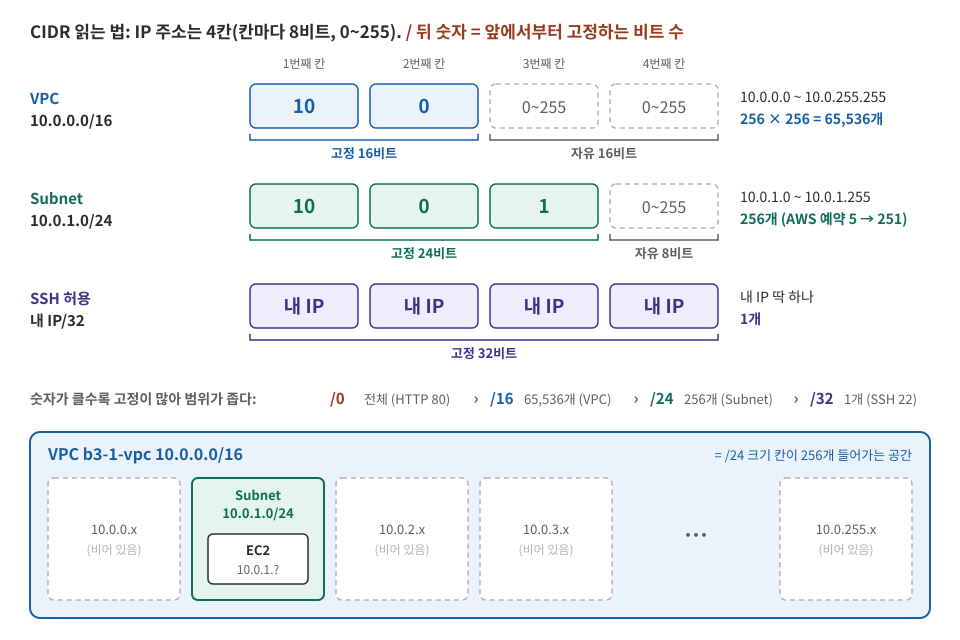

# B3-1 개념 정리

용어 하나를 **한 줄**로 정리했다. 비유는 "상가 건물에 가게 하나 열기"다.

## 1. 네트워크: 길과 주소

| 개념 | 비유 | 한 줄 설명 | 이 과제에서 |
|---|---|---|---|
| Region / AZ | 도시 / 동네 | Region은 지역(서울 `ap-northeast-2`), AZ는 그 안의 데이터센터 묶음 | 모두 서울 리전, 서브넷은 `ap-northeast-2a` |
| CIDR | 주소 범위 | `/` 뒤 숫자가 클수록 좁음. `/16` 약 65,000개, `/24` 256개, `/32` 1개, `0.0.0.0/0` 전체 | VPC `/16`, 서브넷 `/24`, SSH는 내 IP `/32` |
| VPC | 임대한 건물 | 다른 네트워크와 격리된 나만의 네트워크 | `10.0.0.0/16` |
| Subnet | 1층 매장 구역 | VPC를 나눈 구역. 서버가 실제로 놓이는 곳 | `10.0.1.0/24`, 퍼블릭 IP 자동 할당 켬 |
| Public Subnet | 길가에 면한 구역 | 따로 있는 속성이 아니라, Route Table에 `0.0.0.0/0 → IGW`가 있으면 퍼블릭 | 위 서브넷 |
| Internet Gateway | 정문 | VPC와 인터넷을 연결. 퍼블릭 IP ↔ 프라이빗 IP 변환 | VPC에 Attach |
| Route Table | 안내판 | 목적지별로 어디로 보낼지 정함. 서브넷에 연결해야 적용 | `local` + `0.0.0.0/0 → IGW` |
| Public / Private IP | 도로명 주소 / 내선 번호 | 바깥에서는 퍼블릭 IP만, VPC 안에서는 프라이빗 IP만 보임 | 퍼블릭 IP는 Stop/Start하면 바뀜 |
| Elastic IP | 고정 주소 | 바뀌지 않는 퍼블릭 IP. 인스턴스에 안 붙어 있으면 과금 | **만들지 않음** |
| NACL | 층 검문소 | 서브넷 단위 방화벽. 기억하지 않아(stateless) 오가는 방향 모두 규칙 필요 | 기본값(전체 허용) 유지 |

### CIDR 그림으로 보기: `10.0.0.0/16`

| 읽는 순서 | `10.0.0.0/16` (VPC) | `10.0.1.0/24` (Subnet) |
|---|---|---|
| ① IP 주소는 4칸, 칸마다 0~255 (8비트) | `10` . `0` . `0` . `0` | `10` . `0` . `1` . `0` |
| ② `/` 뒤 숫자만큼 **앞에서부터 고정** | 16비트 = 앞 2칸 `10.0` 고정 | 24비트 = 앞 3칸 `10.0.1` 고정 |
| ③ 나머지 칸은 자유 | 뒤 2칸 → 256 × 256 = **65,536개** | 뒤 1칸 → **256개** (AWS 예약 5개 빼면 251개) |
| ④ 범위 | `10.0.0.0` ~ `10.0.255.255` | `10.0.1.0` ~ `10.0.1.255` |

- **포함 관계**: 서브넷은 VPC 범위 **안에서** 잘라 써야 한다. `10.0.1.x`는 `10.0.x.x` 안에 있으므로 가능하다. VPC에는 이런 `/24` 칸이 256개 들어가고, 이번 과제는 그중 1칸만 쓴다.
- **왜 `10`인가**: `10.x.x.x`는 인터넷에서 쓰지 않는 **사설 대역**이다. EC2는 여기서 프라이빗 IP(`10.0.1.?`)를 받고, 바깥에서 쓰는 퍼블릭 IP는 따로 붙는다. 계정에 원래 있던 기본 VPC는 다른 사설 대역 `172.31.0.0/16`을 쓴다.
- **왜 `/16`인가**: AWS VPC는 `/16`(가장 큼)부터 `/28`(가장 작음)까지 만들 수 있다. 크게 잡아도 비용이 없고, 서브넷을 더 나눌 여유가 남는다.

> **평가에서 한 줄로**: "VPC가 쓸 사설 IP 범위입니다. 앞 16비트 `10.0`을 고정해 `10.0.0.0`부터 `10.0.255.255`까지 약 6.5만 개를 쓰고, 서브넷 `10.0.1.0/24`는 그 안에서 256개를 잘라 쓴 구역입니다."

> Route Table의 `0.0.0.0/0 → IGW`는 **응답이 VPC 밖으로 나갈 때** 쓰인다. 들어오는 요청은 VPC 내부 경로(`local`)로 EC2까지 간다. 그림은 [guide.md](design.md#외부에서-접속할-때의-흐름-요청과-응답-왕복)를 본다.

## 2. 보안: 문과 열쇠

| 개념 | 비유 | 한 줄 설명 | 이 과제에서 |
|---|---|---|---|
| Port | 호수 | 한 서버 안에서 어느 프로그램에게 갈지 구분하는 번호 | 80(웹), 22(SSH) |
| Security Group | 경비원 | 인스턴스 앞 방화벽. 허용 규칙만 있고 나머지는 차단 | 80 ← 누구나, 22 ← 내 IP만 |
| stateful | 출입 기록 수첩 | SG는 들어온 요청을 기억해, 그 응답은 규칙과 관계없이 내보냄 | 인바운드 80만 열어도 응답이 나감 |
| IAM | 건물 관리 열쇠 | 누가 AWS API(리소스 생성·삭제)를 쓸 수 있는지 정함 | `b3-1-user` + 최소 권한 정책 |
| 최소 권한 | 필요한 방 열쇠만 | 필요한 권한만 줘서 사고 피해를 줄임 | EC2 액션만, 생성·삭제는 서울만 |
| Key Pair | 열쇠와 자물쇠 | 공개키(자물쇠)는 서버에, 개인키(`.pem`, 열쇠)는 내가 보관. 재발급 안 됨 ([아래 그림](#키-페어-쉽게-보기)) | `chmod 400`, 레포에 올리지 않음 |

| 구분 | Security Group | IAM |
|---|---|---|
| 막는 것 | 서버로 오는 **패킷** | AWS **API 호출** |
| 질문 | 누가 서버에 **접속**할 수 있나? | 누가 AWS를 **조작**할 수 있나? |

| 포트 | 용도 | 허용 | 이유 |
|---|---|---|---|
| 80 | HTTP | `0.0.0.0/0` | 누구나 웹에 접속해야 함 |
| 22 | SSH | 내 IP `/32` | 전체에 열면 무차별 대입 공격 대상 |
| 443 | HTTPS | 안 함 | HTTPS 안 씀 |
| 3306, 5432 | DB | 안 함 | DB 없음. DB는 원래 Private Subnet에 둠 |

## 3. 서버

| 개념 | 한 줄 설명 | 이 과제에서 |
|---|---|---|
| EC2 | AWS의 가상 서버 | t3.micro 1대 |
| 크레딧 (t3) | t3는 계정 기본값이 Unlimited라 크레딧을 다 쓰면 추가 과금될 수 있음 | **Standard**로 변경 |
| AMI | 서버를 만들 때 쓰는 OS 이미지 | Ubuntu LTS |
| EBS | 서버에 붙는 **디스크**(아래 설명). Stop해도 과금 유지 | 8GiB. 종료 시 처음 붙은 볼륨만 함께 삭제됨 |
| Nginx | 80 포트에서 요청을 받아 응답하는 웹 서버 | `/health` → `OK` |
| Health check | 살아 있는지 확인하는 고정 응답 주소 | 외부 검증 방식 B |

### 키 페어 쉽게 보기

**키 페어 = SSH로 서버에 들어갈 때 쓰는 열쇠(개인키)와 자물쇠(공개키) 한 쌍**입니다. 비밀번호 대신 씁니다.

| 조각 | 어디에 있나 | 역할 |
|---|---|---|
| **개인키** `b3-1-key.pem` | **내 PC에만** (`~/keys/`) | 열쇠. "내가 주인"임을 증명. AWS도 보관하지 않아 **잃어버리면 재발급 불가** |
| **공개키** | AWS 키 페어 목록, 그리고 EC2를 만들 때 서버 안(`~/.ssh/authorized_keys`)으로 복사 | 자물쇠. 맞는 열쇠인지 확인만 함. 공개돼도 안전 |
| (기록) `~/.ssh/known_hosts` | 내 PC | 처음 접속할 때 `yes`로 저장한 **서버의 지문**. 다음에 같은 서버인지 확인용 |

- **왜 비밀번호가 아니라 키인가**: 비밀번호는 맞힐 때까지 계속 시도(무차별 대입)할 수 있지만, 개인키는 사실상 맞힐 수 없다. 그래서 22번 포트를 내 IP로 제한한 것과 함께 **이중으로** 지킨다.
- **왜 `chmod 400`인가**: 열쇠 파일을 나만 읽게 해야 한다. 권한이 넓으면 ssh가 "보호되지 않은 개인키"라며 사용을 거부한다.
- **과금**: 키 페어 자체는 **무료**다. 그래도 정리하는 이유는 **보안**이다. 쓸 곳 없는 열쇠와 자물쇠를 남겨 두면 나중에 실수로 재사용하거나, `.pem` 파일이 유출될 수 있다.

**정리할 때 지우는 곳**

| 무엇 | 어떻게 | 이유 |
|---|---|---|
| AWS 키 페어 `b3-1-key` | EC2 → 키 페어 → 작업 → 삭제 | 다른 서버를 만들 때 재사용되지 않게 |
| 내 PC `b3-1-key.pem` | `rm -f ~/keys/b3-1-key.pem` | 서버가 없으니 쓸 곳 없는 비밀 파일 |
| `known_hosts`의 `52.79.204.114` 기록 | `ssh-keygen -R 52.79.204.114` | 퍼블릭 IP는 AWS에 반납되어 다른 사람 서버가 받을 수 있음. 옛 지문이 남아 있으면 나중에 경고가 남 (선택) |

### EBS 볼륨 쉽게 보기

**EBS(Elastic Block Store) 볼륨 = EC2에 꽂는 외장 하드디스크**입니다.

| 비유 | AWS |
|---|---|
| 컴퓨터 본체 (CPU, 메모리) | **EC2 인스턴스** |
| 본체에 꽂은 하드디스크 (OS, Nginx, 설정 파일이 저장됨) | **EBS 볼륨** (`vol-...`) |

- **왜 따로 있나**: EC2와 디스크가 **분리된 부품**이라, 서버를 꺼도(Stop) 디스크의 내용이 남는다. 대신 디스크가 남아 있는 동안은 **용량만큼 계속 과금**된다.
- **"Elastic"의 뜻**: 크기를 나중에 늘리거나, 다른 EC2에 떼었다 붙일 수 있어서 "탄력적"이다.
- **이 과제에서**: EC2를 만들 때 8 GiB 볼륨(`vol-0fab396aa4c25564a`)이 OS 디스크(루트 볼륨)로 자동 생성됐다. "**종료 시 삭제: 예**"로 되어 있어 EC2를 **종료(Terminate)**하면 함께 삭제된다.

| EC2 상태 | 볼륨 | 과금 |
|---|---|---|
| 실행 중 | 붙어 있음 | EC2 + 볼륨 |
| **중지(Stop)** | **남아 있음** | 볼륨은 계속 과금 |
| **종료(Terminate)** | "종료 시 삭제: 예"면 **함께 삭제** | 없음 |

그래서 정리할 때는 EC2를 **중지가 아니라 종료**하고, **볼륨 목록이 비었는지** 따로 확인한다.

## 4. 확인과 정리

| `curl` 결과 | 뜻 | 먼저 볼 곳 |
|---|---|---|
| timeout | 요청이 서버까지 **오지 못함** | Route Table, SG, 퍼블릭 IP |
| connection refused | 서버엔 왔지만 **받을 프로그램이 없음** | Nginx 실행, 80 포트 |
| 200 OK | 정상 | — |

| 개념 | 한 줄 설명 |
|---|---|
| 접속 장애 점검 순서 | 라우팅 → SG → 퍼블릭 IP → 서버(Nginx 상태, `curl localhost`, 로그). 바깥에서 안으로 |
| 과금 요인 | 실행 중인 EC2, 연결 안 된 EIP, 남은 EBS·스냅샷, NAT Gateway, ALB, 다른 리전 리소스 |
| 태그 | `Project=b3-1`. 정리할 때 빠짐없이 찾기 위해 |
| 정리 순서 | 안쪽부터: EC2 → 키페어 → SG → Subnet·Route Table → IGW(분리 후 삭제) → VPC |
| Terminated 표시 | 종료한 EC2는 약 1시간만 목록에 보임. 정리 스크린샷은 바로 찍음 |
| CloudTrail | 최근 90일 AWS 작업 기록. 이번 실습 사용자에게는 권한을 주지 않음(과제 범위 밖) |

## 5. 확장 (만들지 않음, 설명용)

| 개념 | 한 줄 설명 |
|---|---|
| ALB | 요청을 여러 EC2에 나눠 보냄. **2개 이상 AZ**의 서브넷 필요. 서버를 2대로 늘릴 때 추가 |
| NAT Gateway | Private Subnet 서버가 밖으로 **나가기만** 하게 함. 시간당 과금이 큼 |
| Private Subnet | `0.0.0.0/0 → IGW`가 없는 서브넷. DB처럼 숨길 서버를 둠 |
