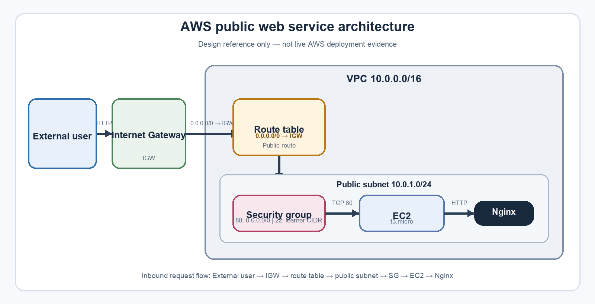
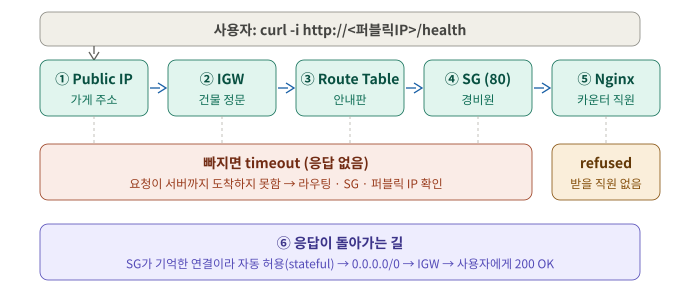

# B3-1 실습 가이드

[README](../README.md)의 "한눈에 보기"를 먼저 본 뒤, 실습할 때 이 문서를 따라갑니다.

| 순서 | 섹션 | 내용 |
|---|---|---|
| 1 | [설계: 구조와 설정 이유](#1-설계-구조와-설정-이유) | 아키텍처, 요청·응답 왕복, 왜 이렇게 정했는지 |
| 2 | [구축과 확인 11단계](#2-구축과-확인-11단계) | 단계마다 무엇을 / 왜 / 할 일 / 결과 / 📸 |

---

## 1. 설계: 구조와 설정 이유

### 아키텍처



| 화살표 | 흐름 |
|---|---|
| 파란 실선 ①~④ | 인터넷 사용자의 HTTP 80 요청 → IGW → VPC 내부 경로(local)로 Subnet → SG 통과 → EC2 Nginx |
| 주황 점선 | 관리자 PC(내 IP)의 SSH 22 접속. 같은 정문을 지나지만 SG가 내 IP만 통과시킴 |

아키텍처 그림은 **무엇이 어디에 있는지**를 보여줍니다. 요청이 들어갔다가 응답이 **돌아나오는 왕복**은 아래 그림에서 봅니다.

### 외부에서 접속할 때의 흐름 (요청과 응답 왕복)

내 PC에서 `curl -i http://<퍼블릭IP>/health`를 실행했을 때, 요청과 응답이 각 구성 요소를 어떤 순서로 지나가는지 위에서 아래로 따라가는 그림입니다. 세로 점선이 각 구성 요소이고, 회색 영역이 VPC 안입니다.



| 구간 | 단계 | 일어나는 일 | 담당 | 빠지면 |
|---|---|---|---|---|
| 요청 | ① | 내 PC가 **퍼블릭 IP**의 80 포트로 요청 | Public IP | 찾아올 주소가 없음 |
| | ② ③ | 정문에서 목적지를 EC2의 **프라이빗 IP**(`10.0.1.x`)로 바꾸고, VPC 내부 경로(`local`)로 서브넷의 EC2까지 전달 | IGW | 바깥과 연결 안 됨 → **timeout** |
| | ④ ⑤ | 인바운드 80 허용을 확인하고, 이 연결을 **기억**한 뒤 EC2로 전달 | Security Group | 조용히 막힘 → **timeout** |
| | ⑥ | Nginx가 `200 OK`, `OK` 응답 | EC2 + Nginx | 서버엔 왔지만 받을 프로그램 없음 → **connection refused** |
| 응답 | ⑦ ⑧ | 기억해 둔 연결의 응답이라 아웃바운드 규칙과 관계없이 통과 (**stateful**) | Security Group | — |
| | ⑨ ⑩ ⑪ | 목적지(내 PC)가 VPC 밖이므로 `0.0.0.0/0 → IGW` 경로를 따라 정문으로 | Route Table | 응답이 나갈 길이 없음 → **timeout** |
| | ⑫ ⑬ | 정문에서 출발지를 다시 **퍼블릭 IP**로 바꿔 내 PC에 도착 | IGW | — |

이 그림에서 볼 수 있는 핵심 세 가지입니다.

- **Route Table의 `0.0.0.0/0 → IGW`는 응답이 나갈 때 쓰입니다.** 들어오는 요청은 VPC 내부 경로(`local`)로 EC2까지 가지만, 이 경로가 없으면 응답이 VPC 밖으로 나갈 길이 없어 결국 timeout이 납니다.
- **주소는 정문(IGW)에서 바뀝니다.** EC2는 자기 프라이빗 IP만 알고, 바깥에서는 퍼블릭 IP만 보입니다.
- **timeout이면 서버 바깥**(라우팅, SG, 퍼블릭 IP), **refused면 서버 안쪽**(Nginx)을 먼저 봅니다. 이 표가 [트러블슈팅](troubleshooting.md)의 점검 순서입니다.

### 정한 것과 이유

| 정한 것 | 이유 |
|---|---|
| VPC `10.0.0.0/16`, Subnet `10.0.1.0/24` | VPC는 넉넉하게(약 65,000개 주소), 서브넷은 그 안의 한 구역(256개). 나중에 서브넷을 더 나눌 여유가 남음 |
| 콘솔에서 **"VPC만"** 선택 | "VPC 등" 마법사는 NAT Gateway 같은 과금 리소스까지 만들 수 있어, 필요한 것만 직접 만듦 |
| 서브넷의 **퍼블릭 IPv4 자동 할당** 켜기 | 꺼져 있으면 EC2에 퍼블릭 IP가 안 붙어 외부에서 찾아올 주소가 없음 |
| Route Table을 새로 만들어 서브넷에 연결 | VPC 기본 라우팅 테이블에는 `local`(VPC 내부)만 있음. `0.0.0.0/0 → IGW`가 있어야 퍼블릭 서브넷 |
| SG 인바운드는 **80, 22 두 개만** | 80은 서비스용이라 전체 공개, 22는 관리용이라 내 IP `/32`만. 443(HTTPS 미사용), DB 포트(DB 없음), 전체 포트는 열지 않음 |
| SG 아웃바운드는 기본값(전체 허용) 유지 | EC2가 `apt install`, `curl https://example.com`으로 밖에 나가야 함 |
| NACL은 기본값 유지 | 기본값이 전체 허용이고, 접근 제어는 SG 하나로 관리 |
| Elastic IP는 **할당하지 않음** | 자동 퍼블릭 IP로 충분. 인스턴스에 연결되지 않은 EIP는 과금 대상 |
| t3.micro, 크레딧 **Standard** | 프리 티어 대상. t3 기본값인 Unlimited는 크레딧을 다 쓰면 추가 과금될 수 있음 |
| EBS 8GiB gp3 | 과제 권장 범위(8~10GiB). 불필요한 증설 지양 |
| 검증 방식 **(B) `/health`** | 고정 응답이라 성공/실패를 기계적으로 판단 가능. 응답 코드(200)까지 터미널로 증빙 |
| 루트 계정은 1단계에서만 사용 | 루트는 권한을 제한할 수 없음. 실습은 최소 권한 IAM 사용자로만 진행 |
| 모든 리소스에 태그 `Project=b3-1`, 이름 `b3-1-*` | 정리할 때 실습 리소스를 빠짐없이 찾기 위해 |

---

## 2. 구축과 확인 11단계

**계정 준비 → 네트워크(바깥에서 안으로) → 서버 → 외부 검증 → 트러블슈팅 → 정리** 순서입니다.
네트워크를 바깥부터 만드는 이유는 뒤의 것이 앞의 것을 골라야 하기 때문입니다. 예를 들어 IGW가 있어야 Route Table에서 타겟으로 고를 수 있고, SG가 있어야 EC2를 만들 때 붙일 수 있습니다.
정리는 반대로 **안에 있는 것부터** 지웁니다.


**어디에서 하나요?**

| 표시 | 어디 | 단계 |
|---|---|---|
| 🖱️ | AWS 콘솔 (웹 브라우저) | 1~6, 10~11단계 |
| `$` | 내 PC 터미널 | 7단계 SSH 접속, 9~10단계 외부 확인 |
| `ubuntu@...$` | SSH로 들어간 EC2 안 | 7~8단계, 10단계 로그 확인 |

- 콘솔 작업 전에는 **우측 상단 리전이 서울(`ap-northeast-2`)인지** 매번 확인합니다.
- 리소스를 하나 만들 때마다 [cleanup-checklist.md](cleanup-checklist.md) 표에 ID를 바로 적습니다.
- 에러가 나면 **고치기 전에** 화면부터 캡처합니다 (트러블슈팅 재료).

### 1단계. 계정 준비 (루트 계정)

**무엇을**: 루트 계정을 보호하고, 실습에 쓸 최소 권한 IAM 사용자를 만듭니다.
**왜**: 과제 제약이 "루트 계정 사용 금지, IAM 사용자로만 접근"이기 때문입니다. **루트로 로그인하는 건 이번이 마지막**입니다.

| 순서 | 콘솔에서 할 일 |
|---|---|
| 1 | 우측 상단 리전을 **아시아 태평양(서울)**으로 변경 |
| 2 | 우측 상단 계정 메뉴 → 보안 자격 증명 → **MFA 할당** |
| 3 | Billing → Budgets → **Zero spend budget** 생성 (1센트라도 과금되면 메일) |
| 4 | IAM → 정책 → 정책 생성 → JSON 탭에 [docs/iam-policy.json](iam-policy.json) 붙여넣기 → 이름 `b3-1-policy` |
| 5 | IAM → 사용자 → 사용자 생성: 이름 `b3-1-user`, 콘솔 접근 허용, "다음 로그인 시 비밀번호 변경" **끄기**, 권한은 `b3-1-policy`만 직접 연결, 태그 `Project=b3-1` |
| 6 | 📸 **01** 사용자 권한 탭 (`b3-1-policy`만 있고 AdministratorAccess 없음) |
| 7 | 콘솔 로그인 URL 저장 → 로그아웃 → URL로 `b3-1-user` 로그인 |

**IAM 정책에 넣은 권한**

| 범위 | 허용 | 이유 |
|---|---|---|
| 조회 (`ec2:Describe*`, `ec2:Get*`) | 모든 리전 | 콘솔 화면 표시, 정리 때 EC2 Global View로 다른 리전 확인 |
| 생성·삭제·연결 (VPC, Subnet, IGW, Route, SG, 키페어, 인스턴스, 태그, 볼륨) | **서울 리전만** | 실습에 필요한 작업만. 다른 리전에 실수로 만드는 것도 막음 |
| S3, RDS, IAM, CloudTrail 등 다른 서비스, AdministratorAccess | **주지 않음** | 실습과 무관 (과제 요구: EC2/VPC/SG 범위로 제한) |

**결과**: 콘솔 우측 상단에 `b3-1-user`가 보이면 됩니다. 1단계 6번을 루트일 때 찍는 이유는, `b3-1-user`에게는 IAM 화면을 볼 권한이 없기 때문입니다.

### 2단계. VPC와 Subnet 만들기

**무엇을**: 나만의 네트워크(VPC)와 그 안의 구역(Subnet)을 만듭니다.
**왜**: 서버를 놓을 격리된 공간이 먼저 있어야 하기 때문입니다.

| 순서 | 콘솔에서 할 일 (VPC 서비스) |
|---|---|
| 1 | VPC 생성 → **VPC만** → 이름 `b3-1-vpc`, IPv4 CIDR `10.0.0.0/16`, 태그 `Project=b3-1` |
| 2 | 서브넷 생성 → VPC `b3-1-vpc` → 이름 `b3-1-subnet-public`, AZ `ap-northeast-2a`, CIDR `10.0.1.0/24` |
| 3 | 만든 서브넷 선택 → 작업 → 서브넷 설정 편집 → **퍼블릭 IPv4 주소 자동 할당 활성화** |

**결과**: 서브넷 상세에 `10.0.1.0/24`, `ap-northeast-2a`, "퍼블릭 IPv4 주소 자동 할당: 예"가 보입니다. 📸 **02**

### 3단계. Internet Gateway 연결하기

**무엇을**: VPC에 인터넷으로 나가는 정문을 답니다.
**왜**: IGW가 없으면 퍼블릭 IP가 있어도 VPC가 인터넷과 연결되지 않습니다.

| 순서 | 콘솔에서 할 일 |
|---|---|
| 1 | 인터넷 게이트웨이 생성 → 이름 `b3-1-igw`, 태그 `Project=b3-1` |
| 2 | 작업 → **VPC에 연결** → `b3-1-vpc` |

**결과**: 상태 `Attached`, VPC ID가 `b3-1-vpc`의 ID와 같습니다. 📸 **03**

### 4단계. Route Table 설정하기

**무엇을**: "VPC 밖으로 가는 트래픽은 IGW로"라는 경로를 만들고 서브넷에 연결합니다.
**왜**: VPC 기본 라우팅 테이블에는 `10.0.0.0/16 → local`(내부)만 있습니다. 이 상태에서는 외부 요청이 들어와도 **응답이 나갈 길이 없습니다.**

| 순서 | 콘솔에서 할 일 |
|---|---|
| 1 | 라우팅 테이블 생성 → 이름 `b3-1-rt-public`, VPC `b3-1-vpc` |
| 2 | 라우팅 탭 → 라우팅 편집 → 라우팅 추가: 대상 `0.0.0.0/0`, 타겟 **인터넷 게이트웨이** `b3-1-igw` |
| 3 | 서브넷 연결 탭 → 서브넷 연결 편집 → `b3-1-subnet-public` 선택 |

**결과**: 라우팅이 두 줄(`10.0.0.0/16 → local`, `0.0.0.0/0 → igw-...`)이고, 서브넷 연결 탭에 `b3-1-subnet-public`이 있습니다. 📸 **04** (라우팅 탭, 서브넷 연결 탭)

### 5단계. Security Group 만들기

**무엇을**: 서버 앞의 경비원 규칙을 정합니다.
**왜**: 열린 포트는 외부에서 두드릴 수 있는 문입니다. 서비스(80)와 관리(22)에 필요한 문만 엽니다.

| 순서 | 콘솔에서 할 일 (EC2 서비스 → 보안 그룹) |
|---|---|
| 1 | 보안 그룹 생성 → 이름 `b3-1-sg-web`, VPC **`b3-1-vpc`** (기본 VPC가 선택돼 있으면 바꿈) |
| 2 | 인바운드 규칙 추가: 유형 **HTTP**, 소스 `0.0.0.0/0` (Anywhere-IPv4) |
| 3 | 인바운드 규칙 추가: 유형 **SSH**, 소스 **내 IP** (`x.x.x.x/32`로 자동 입력) |
| 4 | 아웃바운드 규칙은 기본값 유지, 태그 `Project=b3-1` |

| 포트 | 소스 | 이유 |
|---|---|---|
| 80 (HTTP) | `0.0.0.0/0` | 누구나 웹 서비스에 접속해야 함 |
| 22 (SSH) | 내 IP `/32` | 서버 관리는 나만. 전체에 열면 무차별 대입 공격 대상 |
| 그 외 | 열지 않음 | 쓰지 않는 문은 닫아 둠 |

**결과**: 인바운드 규칙이 정확히 두 줄입니다. 📸 **05** (내 IP 앞부분은 가리고 `/32`는 보이게)

> 집, 학교 등 인터넷 환경이 바뀌면 내 공인 IP가 바뀌어 SSH가 안 될 수 있습니다. 그때는 22 규칙의 소스를 다시 "내 IP"로 수정합니다.

### 6단계. EC2 만들기

**무엇을**: 키페어를 만들고, Public Subnet에 서버 한 대를 띄웁니다.
**왜**: 웹 서버 프로그램을 실행할 컴퓨터가 필요합니다.

| 순서 | 콘솔에서 할 일 (EC2 서비스) |
|---|---|
| 1 | 키 페어 생성 → 이름 `b3-1-key`, RSA, `.pem` → 다운로드한 파일은 **레포 밖**에 보관 (재발급 불가) |
| 2 | 인스턴스 시작 → 이름 `b3-1-ec2-web`, AMI **Ubuntu Server LTS** (프리 티어 사용 가능 표시), 유형 **t3.micro**, 키 페어 `b3-1-key` |
| 3 | 네트워크 설정 → 편집: VPC **`b3-1-vpc`**, 서브넷 `b3-1-subnet-public`, 퍼블릭 IP 자동 할당 **활성화**, 기존 보안 그룹 `b3-1-sg-web` |
| 4 | 스토리지 8GiB gp3 |
| 5 | 고급 세부 정보 → 크레딧 사양 **Standard**, 태그 `Project=b3-1` |

**결과**: 인스턴스 상태 `실행 중`, 상태 검사 `2/2 통과`, 퍼블릭 IPv4 주소가 있습니다. 📸 **06** (서브넷, 퍼블릭 IP, 인스턴스 유형이 보이게)

> 인스턴스 시작 화면은 **기본 VPC가 미리 선택**되어 있습니다. 바꾸지 않으면 내 VPC가 아닌 곳에 서버가 생깁니다.

### 7단계. SSH 접속하고 아웃바운드 확인하기

**무엇을**: 내 PC에서 서버에 접속하고, 서버에서 인터넷으로 나갈 수 있는지 확인합니다.
**왜**: 과제 요구가 "SSH 접속 가능"과 "인스턴스에서 인터넷 아웃바운드 통신 가능"이기 때문입니다.

내 PC 터미널(`$`)에서:

```bash
chmod 400 ~/keys/b3-1-key.pem
ssh -i ~/keys/b3-1-key.pem ubuntu@<퍼블릭IP>
```

| 명령 | 하는 일 |
|---|---|
| `chmod 400` | 키 파일을 나만 읽을 수 있게 함. 권한이 넓으면 ssh가 키 사용을 거부함 |
| `ssh -i 키 ubuntu@IP` | 키로 인증해 서버에 접속. Ubuntu AMI의 기본 사용자는 `ubuntu` |

처음 접속하면 `Are you sure you want to continue connecting?`이 나옵니다. `yes`를 입력합니다.
**결과**: 프롬프트가 `ubuntu@ip-10-0-1-xx:~$`로 바뀝니다. 📸 **07**

EC2 안(`ubuntu@...$`)에서:

```bash
curl -I https://example.com
```

**결과**: 첫 줄에 `HTTP/... 200`이 보입니다. 서버 → IGW → 인터넷으로 나가는 길이 열려 있다는 뜻입니다. 📸 **08**

### 8단계. Nginx 설치하고 `/health` 만들기

**무엇을**: 웹 서버를 설치하고, 상태 확인용 주소 `/health`가 고정 응답 `OK`를 주도록 설정합니다.
**왜**: 외부 접속 검증을 (B) 방식으로 하기 때문입니다.

EC2 안(`ubuntu@...$`)에서:

```bash
sudo apt update
sudo apt install -y nginx
systemctl status nginx --no-pager
curl -i http://localhost
```

| 명령 | 하는 일 |
|---|---|
| `sudo apt update` | 설치 가능한 패키지 목록 새로고침 |
| `sudo apt install -y nginx` | Nginx 설치. 설치 직후 자동으로 실행되고 80 포트에서 대기 |
| `systemctl status nginx` | 실행 중인지 확인 (`active (running)`) |
| `curl -i http://localhost` | 서버 안에서 직접 요청. `HTTP/1.1 200 OK` |

이어서 설정 파일을 엽니다.

```bash
sudo nano /etc/nginx/sites-available/default
```

`server {` 블록 안, `server_name _;` 줄 아래에 추가하고 저장합니다 (`Ctrl+O`, `Enter`, `Ctrl+X`).

```nginx
location = /health {
    default_type text/plain;
    return 200 "OK\n";
}
```

```bash
sudo nginx -t
sudo systemctl reload nginx
curl -i http://localhost/health
```

| 명령 | 하는 일 |
|---|---|
| `sudo nginx -t` | 설정 문법 검사. `syntax is ok`, `test is successful`이 나와야 함 |
| `sudo systemctl reload nginx` | 서버를 끄지 않고 바뀐 설정만 다시 읽음 |
| `curl -i http://localhost/health` | `/health` 응답 확인 |

**결과**: `HTTP/1.1 200 OK`와 마지막 줄 `OK`. 📸 **09** (`systemctl status`와 `curl` 결과가 함께 보이게)

### 9단계. 외부에서 접속 검증하기 (B)

**무엇을**: 서버 바깥(내 PC)에서 `/health`를 호출합니다.
**왜**: 서버 안의 `localhost` 확인은 Nginx만 증명합니다. **외부 → IGW → Route Table → SG → Nginx** 전체 경로가 열렸는지는 바깥에서 확인해야 합니다.

내 PC 터미널(`$`, SSH 창이 아닌 **새 탭**)에서:

```bash
curl -i http://<퍼블릭IP>/health
```

**결과**

```text
HTTP/1.1 200 OK
Server: nginx/...
Content-Type: text/plain
...

OK
```

📸 **10** — 이 화면이 과제의 "외부 접속 증빙"입니다. 브라우저로 `http://<퍼블릭IP>`에 접속하면 "Welcome to nginx!"도 보입니다.

> 브라우저가 주소를 `https://`로 자동으로 바꾸면 443은 열지 않았으므로 접속되지 않습니다. 주소창에 `http://`를 직접 입력합니다.

### 10단계. 트러블슈팅 재현하기

**무엇을**: SG에서 80 규칙을 일부러 지워 장애를 만들고, 근거를 따라 원인을 찾은 뒤 복구합니다.
**왜**: 과제 제출물인 트러블슈팅 보고서에 **증상 → 가설 → 검증 → 조치 → 결과 → 재발 방지**를 실제 근거와 함께 남기기 위해서입니다.

| 순서 | 어디서 | 할 일 | 보이는 것 |
|---|---|---|---|
| 1 | 🖱️ | SG `b3-1-sg-web`에서 HTTP 80 규칙 삭제 | 인바운드에 22만 남음 |
| 2 | `$` | `curl -v --max-time 10 http://<퍼블릭IP>/health` | 응답 없이 timeout → 📸 **11** |
| 3 | `ubuntu@...$` | `curl -i http://localhost/health` | 200 OK → Nginx는 정상 |
| 4 | `ubuntu@...$` | `sudo tail -n 5 /var/log/nginx/access.log` | 내 PC의 요청 기록이 **없음** → 요청이 서버에 오지 않음 |
| 5 | 🖱️ | Route Table, SG 차례로 확인 | 경로는 정상, SG에 80 없음 → 원인 확정 |
| 6 | 🖱️ | 80 규칙 하나만 다시 추가 | — |
| 7 | `$` | 같은 명령 다시 실행 | 200 OK, `access.log`에 내 IP 기록 → 📸 **12** |

**결과**: 기록은 [docs/troubleshooting.md](troubleshooting.md) 사례 1에 남깁니다. 실습 중 다른 에러(권한 부족, SSH 거부 등)가 났다면 사례 2로 추가합니다.

### 11단계. 리소스 정리하기

**무엇을**: 만든 리소스를 **안에 있는 것부터** 삭제합니다.
**왜**: 남은 리소스는 계속 과금됩니다. 그리고 VPC 안에 무언가 남아 있으면 VPC를 지울 수 없습니다.

| 순서 | 삭제 | 확인 |
|---|---|---|
| 0 | — | **스크린샷 01~12가 `docs/images/`에 모두 있는지** 먼저 확인 (삭제 후 다시 찍을 수 없음) |
| 1 | EC2 종료(Terminate) | 상태 `종료됨`. 약 1시간만 보이므로 **바로** 📸 **13** |
| 2 | EBS | 볼륨 목록에 남은 볼륨 없음 (루트 볼륨은 종료 시 함께 삭제) |
| 3 | Elastic IP | 목록 비어 있음 (할당하지 않음) |
| 4 | 키 페어 `b3-1-key` | 내 PC의 `.pem`도 삭제 |
| 5 | 보안 그룹 `b3-1-sg-web` | — |
| 6 | 서브넷, 라우팅 테이블 | — |
| 7 | 인터넷 게이트웨이 | VPC에서 **분리(Detach)** 후 삭제 |
| 8 | VPC `b3-1-vpc` | — |
| 9 | 전체 확인 | EC2 Global View에서 다른 리전에 남은 인스턴스 없음 |

**결과**: [docs/cleanup-checklist.md](cleanup-checklist.md)의 모든 항목에 체크하고 정리 일시를 적습니다.
