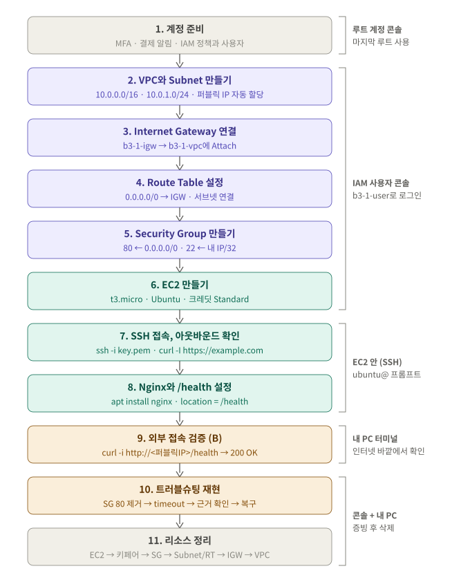

# B3-1 실습 단계

[← README](../README.md) · [설계: 구조와 설정 이유](design.md)

단계마다 파일 하나입니다. 모든 단계는 **1. 무엇을, 왜 → 2. 할 일 → 3. 확인과 📸 → 4. ✍️ 실제 기록** 순서로 되어 있습니다.

| 단계 | 문서 | 하는 일 | 📸 | 상태 |
|---|---|---|---|---|
| 1 | [계정 준비](steps/01-account.md) | MFA, 결제 알림, 최소 권한 IAM 사용자 | 00a~00m, 01 | ✅ 완료 |
| 2 | [VPC·Subnet](steps/02-vpc-subnet.md) | 격리된 네트워크와 서버 구역 | 02a~02d, 02 | ✅ 완료 |
| 3 | [Internet Gateway](steps/03-igw.md) | 인터넷과 연결되는 정문 | 03 | ✅ 완료 |
| 4 | [Route Table](steps/04-route-table.md) | `0.0.0.0/0 → IGW` 나가는 길 | 04 | ✅ 완료 |
| 5 | [Security Group](steps/05-security-group.md) | 80 누구나, 22 내 IP만 | 05 | ✅ 완료 |
| 6 | [EC2](steps/06-ec2.md) | Public Subnet에 서버 1대 | 06 | ✅ 완료 |
| 7 | [SSH·아웃바운드](steps/07-ssh.md) | 서버 접속, 서버 → 인터넷 확인 | 07, 08 | ✅ 완료 |
| 8 | [Nginx·`/health`](steps/08-nginx.md) | 웹 서버 설치, `OK` 응답 | 09a, 09b, 09 | ✅ 완료 |
| 9 | [외부 검증](steps/09-verify.md) | 내 PC에서 200 OK | 10, 10b | ✅ 완료 |
| 10 | [트러블슈팅](steps/10-troubleshoot.md) | 실제 장애(휴대폰 Chrome) 진단·기록 | 11 | ✅ 완료 |
| 11 | [정리](steps/11-cleanup.md) | 안쪽부터 삭제 | 13, 13a~ | 🟡 진행 중 (EC2·EBS·EIP·키 페어·SG 완료) |

상태: ⬜ 진행 전 · 🟡 진행 중 · ✅ 완료

## 공통 규칙

| 어디서 | 표시 |
|---|---|
| AWS 콘솔 (웹 브라우저) | 🖱️ |
| 내 PC 터미널 | `$` |
| SSH로 들어간 EC2 안 | `ubuntu@...$` |

- 콘솔 작업 전에 **오른쪽 위 리전이 서울**인지 확인합니다.
- 리소스를 만들 때마다 [cleanup-checklist.md](cleanup-checklist.md)에 ID를 적습니다.
- 에러가 나면 **고치기 전에** 화면부터 캡처합니다.
- 바깥(VPC)에서 안(EC2)으로 만들고, 정리는 안에서 바깥으로 합니다.
