# 1단계. 계정 준비

[← 단계 목록](../guide.md) · [다음: 2단계 →](./02-vpc-subnet.md)

> **한 줄 요약**: 실습을 시작하기 전에 계정을 안전하게 만들고, 실수로 돈이 나가는 것을 막고, 실습에 쓸 최소 권한 사용자를 만든다.

## 1. 무엇을, 왜

| 작업 | 하는 일 | 왜 필요한가 |
|---|---|---|
| ① 리전 서울 | 앞으로 만드는 리소스가 모두 서울 데이터센터에 생김 | 과제 제약이 "모든 리소스는 서울 리전". 리전이 섞이면 정리할 때 놓쳐서 과금됨 |
| ② MFA | 로그인할 때 비밀번호에 더해 휴대폰 앱의 6자리 코드를 요구 | 루트는 모든 권한을 가진 계정이라 비밀번호만 유출돼도 계정 전체를 잃음 |
| ③ 제로 지출 예산 | 1센트라도 비용이 생기면 이메일로 알림 | 프리 티어를 넘거나 정리를 잊은 리소스를 바로 알아챔 |
| ④ IAM 정책 | 실습에 필요한 EC2 작업만 허용하는 권한 묶음 | 과제 요구: 최소 권한, 관리자 권한 금지 |
| ⑤ IAM 사용자 | 위 정책만 가진 실습 전용 로그인 | 과제 제약: 루트 대신 IAM 사용자로 작업 |

**어디서**: 🖱️ AWS 콘솔, **루트 계정**으로 로그인한 상태 (루트로 하는 작업은 이번이 마지막)

## 2. 할 일

#### ① 리전 바꾸기

오른쪽 위 리전 이름 클릭 → **아시아 태평양(서울) ap-northeast-2**

#### ② MFA 등록

1. 오른쪽 위 계정 이름 → **보안 자격 증명** → **MFA 디바이스 할당**
2. 디바이스 이름 입력 → **인증 관리자 앱** 선택 → Next
3. 휴대폰 인증 앱으로 QR 스캔 → 연속된 코드 2개 입력 → **MFA 추가**

> 창을 새로고침하면 QR이 새로 바뀝니다. 그때는 앱의 예전 항목을 지우고 새 QR을 다시 스캔합니다.

#### ③ 제로 지출 예산

검색창 `Budgets` → **예산 생성** → **템플릿 사용(단순화)** → **제로 지출 예산** → 이메일 입력 → 생성

#### ④ IAM 정책 만들기

1. 검색창 `IAM` → 왼쪽 **정책** → **정책 생성** → **JSON** 탭
2. 기존 내용을 지우고 아래 내용을 붙여넣기 (코드 블록 오른쪽 위 복사 버튼 사용) → **다음**
3. 이름 `b3-1-policy` → **정책 생성**

```json
{
  "Version": "2012-10-17",
  "Statement": [
    {
      "Sid": "B31ReadOnlyAllRegions",
      "Effect": "Allow",
      "Action": ["ec2:Describe*", "ec2:Get*"],
      "Resource": "*"
    },
    {
      "Sid": "B31Ec2VpcSeoulOnly",
      "Effect": "Allow",
      "Action": [
        "ec2:CreateVpc", "ec2:DeleteVpc", "ec2:ModifyVpcAttribute",
        "ec2:CreateSubnet", "ec2:DeleteSubnet", "ec2:ModifySubnetAttribute",
        "ec2:CreateInternetGateway", "ec2:AttachInternetGateway",
        "ec2:DetachInternetGateway", "ec2:DeleteInternetGateway",
        "ec2:CreateRouteTable", "ec2:DeleteRouteTable",
        "ec2:CreateRoute", "ec2:DeleteRoute",
        "ec2:AssociateRouteTable", "ec2:DisassociateRouteTable",
        "ec2:CreateSecurityGroup", "ec2:DeleteSecurityGroup",
        "ec2:AuthorizeSecurityGroupIngress", "ec2:RevokeSecurityGroupIngress",
        "ec2:CreateKeyPair", "ec2:DeleteKeyPair",
        "ec2:RunInstances", "ec2:TerminateInstances",
        "ec2:StartInstances", "ec2:StopInstances",
        "ec2:ModifyInstanceCreditSpecification",
        "ec2:CreateTags", "ec2:DeleteVolume"
      ],
      "Resource": "*",
      "Condition": { "StringEquals": { "aws:RequestedRegion": "ap-northeast-2" } }
    }
  ]
}
```

| 정책 부분 | 허용 범위 | 이유 |
|---|---|---|
| 조회 (`Describe*`, `Get*`) | 모든 리전 | 콘솔 화면 표시, 정리 때 다른 리전까지 확인 |
| 만들기·지우기·연결 | **서울 리전만** | 실습에 필요한 작업만, 다른 리전에 실수로 만드는 것도 막음 |
| S3, RDS, IAM 등 다른 서비스, 관리자 권한 | **없음** | 과제 요구: EC2/VPC/SG 범위로 제한 |

#### ⑤ IAM 사용자 만들기

1. 왼쪽 **사용자** → **사용자 생성** → 이름 `b3-1-user`
2. **AWS Management Console에 대한 사용자 액세스 권한 제공** 체크 → **IAM에서 사용자 생성**
3. **사용자 지정 암호** 입력, **"다음 로그인 시 새 암호 생성" 체크 해제** → 다음
4. **직접 정책 연결** → `b3-1-policy` 체크 → 다음
5. 태그 `Project` = `b3-1` → **사용자 생성**
6. 완료 화면의 **콘솔 로그인 URL**을 메모 (`.csv` 파일은 레포에 넣지 않음)

#### ⑥ 📸 01 찍기

아래 3장 참고. **루트로 로그인한 상태에서** 찍습니다.

#### ⑦ 갈아타기

로그아웃 → 메모한 URL로 `b3-1-user` 로그인 → 리전이 서울인지 확인

## 3. 확인과 📸

| 확인할 것 | 📸 |
|---|---|
| 오른쪽 위 리전이 "아시아 태평양(서울)" | `00a-region-seoul.png` |
| MFA 유형으로 인증 관리자 앱 선택 | `00b-mfa-device-type.png` |
| QR 스캔 후 코드 2개 입력 (QR은 가림) | `00c-mfa-setup.png` |
| `b3-1-user`의 **권한** 탭에 `b3-1-policy` **하나만** 연결됨 | `01-iam-user-policy.png` |

> 01은 **루트로 로그인한 지금** 찍어야 합니다. `b3-1-user`에게는 IAM 화면을 볼 권한이 없습니다.

## 4. ✍️ 실제 기록

**상태**: 🟡 진행 중 (①~⑤ 완료, ⑥ 📸 01 · ⑦ 로그인 전환 남음)

| 항목 | 내용 |
|---|---|
| 한 날짜 | 2026-10-18 |
| 결과 | ① 리전 서울 ② MFA 디바이스 `codyssey_project` 등록 ③ 제로 지출 예산 생성 ④ 정책 `b3-1-policy` 생성 (JSON 검사: 보안 0, 오류 0, 경고 0 / 검토 화면: EC2만, 조건 `aws:RequestedRegion = ap-northeast-2`) ⑤ 사용자 `b3-1-user` 생성 (콘솔 접근 O, 사용자 지정 암호, 암호 재설정 필요 아니요, 권한 정책 `b3-1-policy` 하나). 태그는 붙이지 않음 (사용자 태그는 선택 사항) |
| 막힌 점 | MFA 등록 때 `Authentication code for device is not valid` 에러. 페이지를 새로고침해 QR(비밀키)이 바뀌었는데, 앱에는 이전 QR로 만든 항목이 남아 있어 그 코드를 넣은 것이 원인. 앱의 기존 항목을 지우고 새 QR을 다시 스캔해 해결 |
| 내 말로 한 줄 | (작성 예정) |

#### ① 리전을 서울로 선택


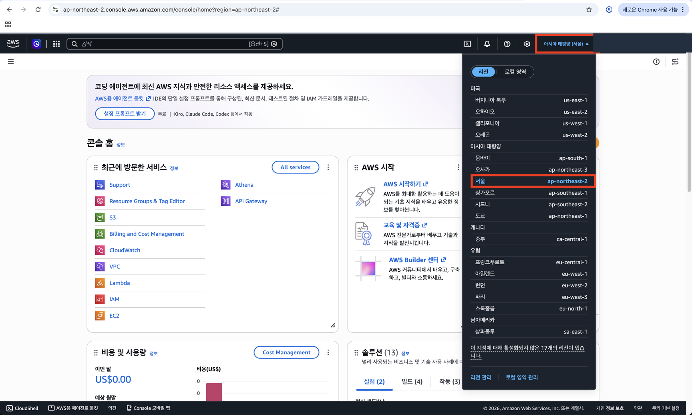

#### ② MFA 유형: 인증 관리자 앱


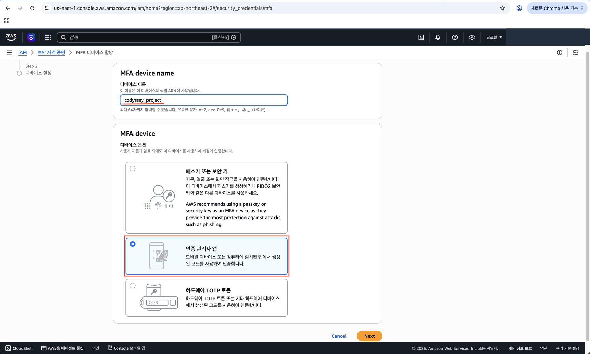

#### ② QR 스캔 후 연속 코드 2개 입력 (QR은 비밀키라 가림)

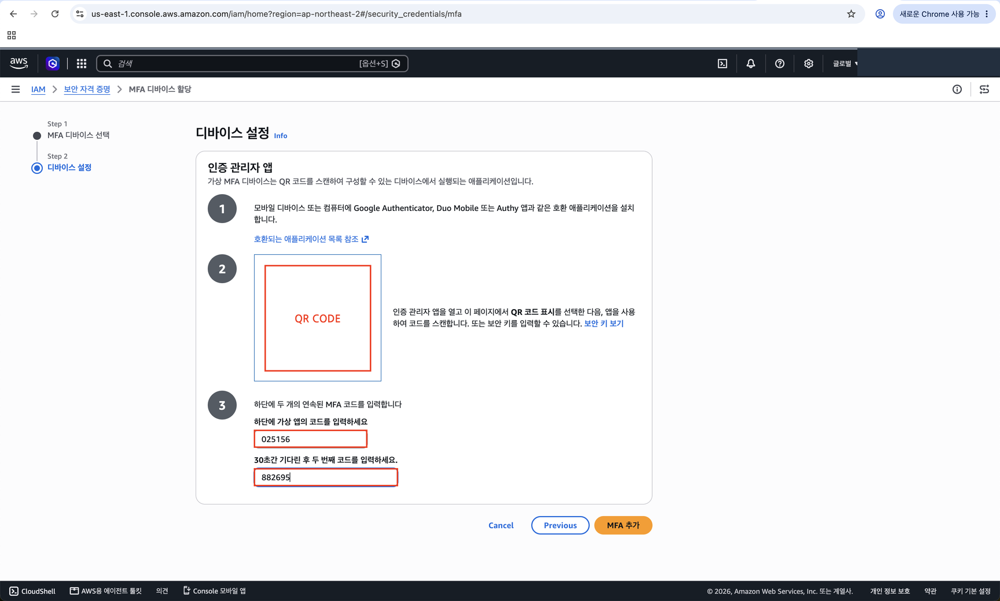

#### ④ IAM → 정책 → 정책 생성

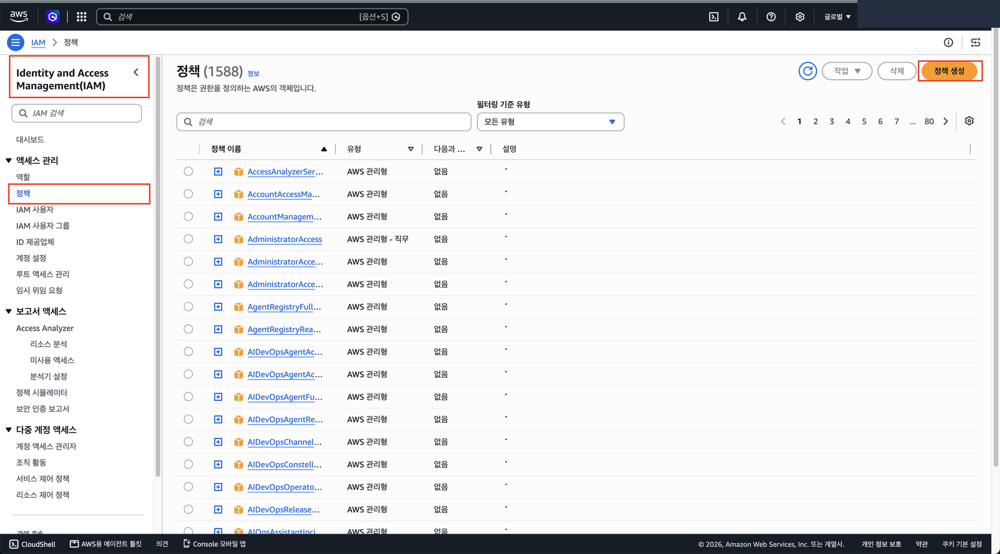

#### ④ JSON 탭에 정책 붙여넣기 (보안·오류·경고 0)

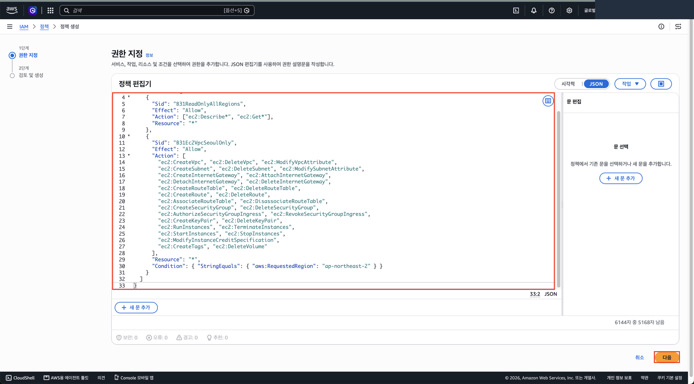

#### ④ 검토: 이름 `b3-1-policy`, 허용 서비스는 EC2 하나, 요청 조건은 서울 리전

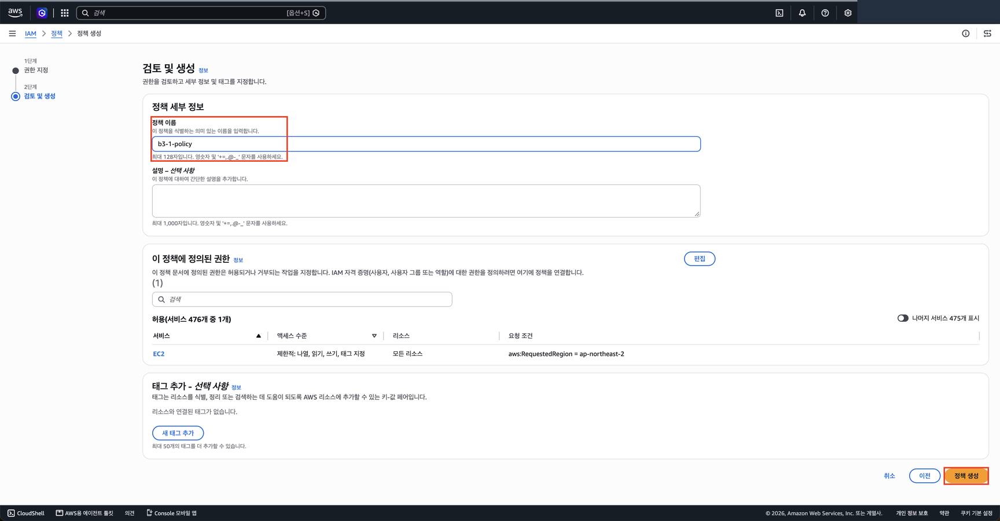

#### ⑤ IAM 사용자 목록 (처음에는 0명) → 사용자 생성

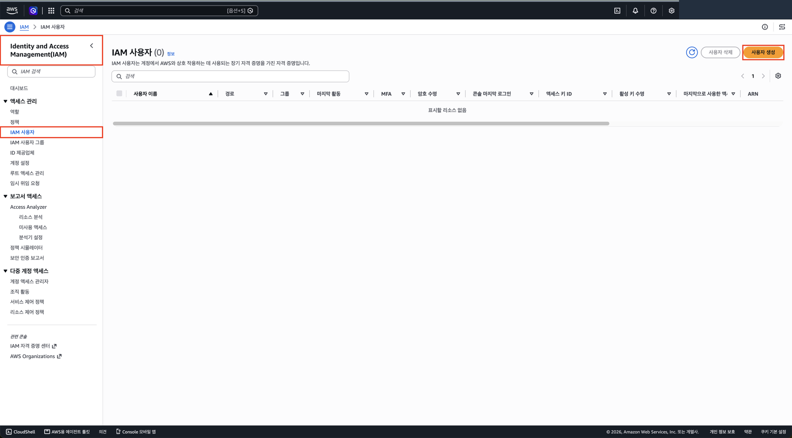

#### ⑤ 사용자 세부 정보: 이름, 콘솔 접근, 사용자 지정 암호, 재설정 체크 해제

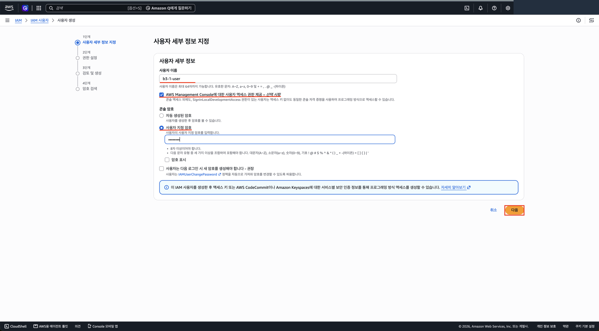

#### ⑤ 권한 설정: 직접 정책 연결 → `b3-1-policy`만 선택

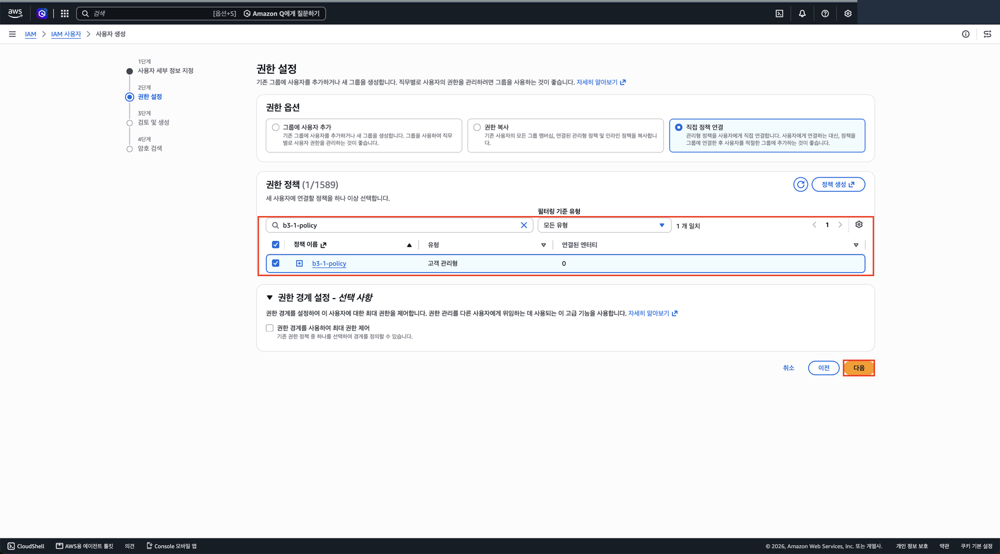

#### ⑤ 검토: 암호 재설정 필요 "아니요", 권한은 `b3-1-policy` 하나

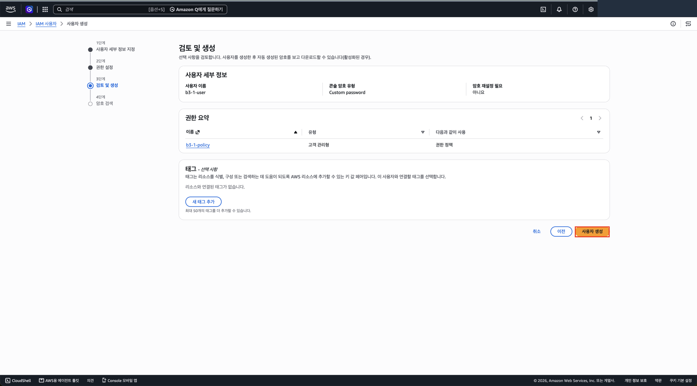

#### ⑤ 생성 완료: 콘솔 로그인 URL은 계정 ID가 들어 있어 가림

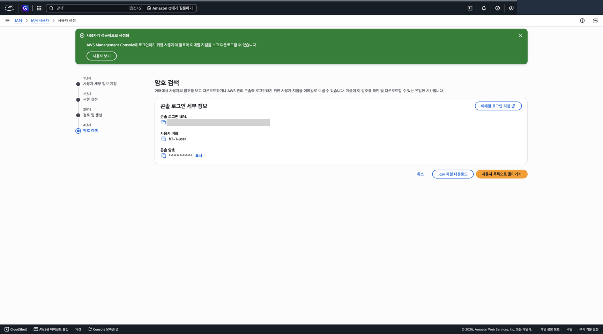

> 계정 ID 등 개인 정보는 이미지에서 가렸습니다.

---

[← 단계 목록](../guide.md) · [다음: 2단계 →](./02-vpc-subnet.md)
