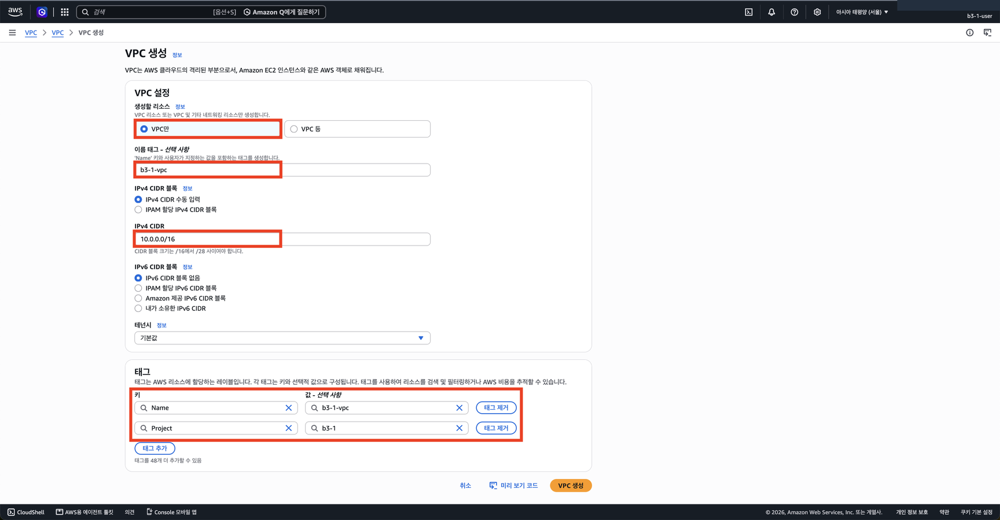
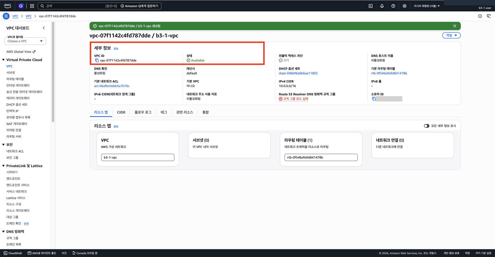

# 2단계. VPC와 Subnet 만들기

[← 단계 목록](../guide.md) · [이전: 1단계](./01-account.md) · [다음: 3단계 →](./03-igw.md)

> **한 줄 요약**: 서버를 놓을 나만의 네트워크(VPC)와 그 안의 구역(Subnet)을 만든다.

## 1. 무엇을, 왜

| 항목 | 내용 |
|---|---|
| 무엇을 | VPC `10.0.0.0/16`, 그 안의 Public Subnet `10.0.1.0/24` |
| 왜 | 서버를 놓을 격리된 공간이 먼저 있어야 함. 서브넷에 퍼블릭 IP 자동 할당을 켜야 서버가 바깥 주소를 받음 |
| 어디서 | 🖱️ AWS 콘솔 → **VPC** 서비스 (`b3-1-user`로 로그인, 리전 서울) |
| `/16`, `/24` 뜻 | `/` 뒤 숫자 = 앞에서부터 고정하는 비트 수. VPC는 `10.0.x.x`(65,536개), 서브넷은 그 안의 `10.0.1.x`(256개). 그림: [CIDR 그림으로 보기](../concepts.md#cidr-그림으로-보기-1000016) |

## 2. 할 일

1. **VPC 생성** → **VPC만** 선택 → 이름 `b3-1-vpc`, IPv4 CIDR `10.0.0.0/16`, 태그 `Project=b3-1`
2. **서브넷 생성** → VPC `b3-1-vpc` → 이름 `b3-1-subnet-public`, AZ `ap-northeast-2a`, CIDR `10.0.1.0/24`
3. 만든 서브넷 선택 → **작업** → **서브넷 설정 편집** → **퍼블릭 IPv4 주소 자동 할당 활성화** → 저장
4. [cleanup-checklist.md](../cleanup-checklist.md)에 VPC ID, Subnet ID 기록

> "VPC 등"이 아니라 **"VPC만"**을 고릅니다. "VPC 등"은 NAT Gateway 같은 과금 리소스까지 만들 수 있습니다.

## 3. 확인과 📸

| 확인할 것 | 📸 |
|---|---|
| 서브넷 상세: CIDR `10.0.1.0/24`, AZ `ap-northeast-2a`, 퍼블릭 IPv4 자동 할당 **예**, VPC가 `b3-1-vpc` | `02-vpc-subnet.png` |

## 4. ✍️ 실제 기록

**상태**: 🟡 진행 중 (VPC 완료, 서브넷 남음) · **날짜**: 2026-10-18

### 4-1. 한 일 한눈에 보기

| 작업 | 실제로 한 일 | 이것이 하는 일 | 확인한 결과 | 📸 |
|---|---|---|---|---|
| ① VPC | `b3-1-vpc`, `10.0.0.0/16`, **VPC만**, 태그 `Name`·`Project=b3-1` | 다른 네트워크와 격리된 내 네트워크. 이 안의 주소 `10.0.0.0`~`10.0.255.255`를 씀 | `vpc-07f1142c4fd787dde`, Available. 오른쪽 위 `b3-1-user`, 서울 | 02a, 02b |
| ② Subnet | (진행 전) | | | |
| ③ 퍼블릭 IP 자동 할당 | (진행 전) | | | |

- VPC를 만들 때 **기본 라우팅 테이블** `rtb-0f546efe9d841478b`이 자동으로 함께 생겼다. 경로는 `local`(VPC 안끼리)뿐이다. 4단계에서는 이것을 고치지 않고 퍼블릭 서브넷 전용 `b3-1-rt-public`을 따로 만들어 `0.0.0.0/0 → IGW`를 넣는다.
- 상세 화면의 "규칙 그룹 로드 실패"(Route 53 DNS 방화벽)는 그 화면을 볼 권한을 주지 않아서 생긴 표시다. 과제 범위 밖이라 권한을 추가하지 않았다.

### 4-2. 막힌 점과 해결

| 항목 | 내용 |
|---|---|
| 증상 1 | VPC를 만든 뒤 스크린샷을 보니 오른쪽 위에 `b3-1-user`가 아니라 계정 이름만 보임. 계정 메뉴에도 IAM 사용자 이름 줄이 없음 |
| 원인 1 | 1단계 끝의 로그인 전환(⑦)을 하지 않아 **루트로** 작업하고 있었음 |
| 해결 1 | 루트로 만든 VPC를 삭제(기본 VPC `172.31.0.0/16`은 그대로 둠) → 로그아웃 → `b3-1-user`로 로그인 → 같은 설정으로 다시 생성. VPC ID가 새로 발급됨 |
| 증상 2 | IAM 사용자 로그인에서 "인증 실패" |
| 원인 2 | "계정 ID 또는 별칭" 칸에 **루트 이메일**을 넣음. 이 칸은 12자리 계정 ID(또는 별칭)만 받음 |
| 해결 2 | 계정 ID를 입력해 로그인. 이후 `https://<계정ID>.signin.aws.amazon.com/console` 주소로 접속 |
| 증상 3 | 로그인 직후 리전이 **시드니**로 열림 |
| 해결 3 | 서울로 변경. 정책이 생성·삭제를 서울(`ap-northeast-2`)로만 허용하므로, 다른 리전에서는 만들기가 거부됨 |
| 배운 점 | 작업 전에 오른쪽 위의 **사용자 이름과 리전**을 먼저 확인한다 |

### 4-3. 스크린샷

> 12자리 계정 ID만 가렸습니다. 오른쪽 위 `b3-1-user`와 리전(서울)이 증빙입니다.

**① VPC 생성 입력**: VPC만, `b3-1-vpc`, `10.0.0.0/16`, 태그 2개

**① VPC 생성 결과**: VPC ID, Available, IPv4 CIDR `10.0.0.0/16`

---

[← 단계 목록](../guide.md) · [이전: 1단계](./01-account.md) · [다음: 3단계 →](./03-igw.md)
