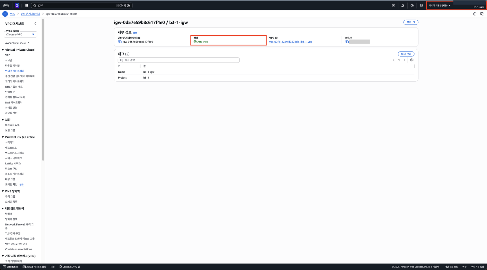

# 3단계. Internet Gateway 연결하기

[← 단계 목록](../guide.md) · [이전: 2단계](./02-vpc-subnet.md) · [다음: 4단계 →](./04-route-table.md)

> **한 줄 요약**: VPC에 인터넷과 연결되는 정문(Internet Gateway)을 단다.

## 1. 무엇을, 왜

| 항목 | 내용 |
|---|---|
| 무엇을 | Internet Gateway `b3-1-igw`를 만들어 `b3-1-vpc`에 연결 |
| 왜 | IGW가 없으면 퍼블릭 IP가 있어도 VPC가 인터넷과 연결되지 않음. 퍼블릭 ↔ 프라이빗 주소 변환도 IGW가 함 |
| 어디서 | 🖱️ AWS 콘솔 → **VPC** 서비스 → 인터넷 게이트웨이 |

## 2. 할 일

1. **인터넷 게이트웨이 생성** → 이름 `b3-1-igw`, 태그 `Project=b3-1`
2. **작업** → **VPC에 연결** → `b3-1-vpc`
3. [cleanup-checklist.md](../cleanup-checklist.md)에 IGW ID 기록

## 3. 확인과 📸

| 확인할 것 | 📸 |
|---|---|
| 상태 `Attached`, VPC ID가 `b3-1-vpc`의 ID와 같음 | `03-igw-attached.png` |

## 4. ✍️ 실제 기록

**상태**: ✅ 완료 · **날짜**: 2026-10-20

### 4-1. 한 일 한눈에 보기

| 작업 | 실제로 한 일 | 이것이 하는 일 | 확인한 결과 | 📸 |
|---|---|---|---|---|
| ① 생성 | 인터넷 게이트웨이 `b3-1-igw` 생성, 태그 `Name`·`Project=b3-1` | VPC와 인터넷을 잇는 **정문**. 퍼블릭 IP ↔ 프라이빗 IP를 바꿔 줌 | `igw-0d57e59b8c617f4e0`, 생성 직후 **Detached** | — |
| ② 연결 | 작업 → **VPC에 연결** → `b3-1-vpc` | 이 VPC에 정문을 닮. IGW는 VPC 하나에만 붙음 | 상태 **Attached**, VPC ID `vpc-07f1142c4fd787dde \| b3-1-vpc` | **03** |

- 목록에 이미 있던 `igw-08108...`(이름 없음)은 **기본 VPC**에 붙은 IGW라 건드리지 않았다.
- 정문은 달렸지만 아직 **트래픽은 흐르지 않는다**. 서브넷이 쓰는 기본 라우팅 테이블에는 `local` 경로만 있어서, 밖으로 가는 길을 IGW로 안내하는 경로가 없다. 4단계에서 `0.0.0.0/0 → b3-1-igw`를 넣는다.

### 4-2. 막힌 점과 해결

| 항목 | 내용 |
|---|---|
| 증상 | 생성 화면에서 태그를 `Name` 한 줄만 넣어 `Project=b3-1`이 빠짐. 태그 관리에서 추가할 때는 키 칸에 추천 목록의 `b3-1-igw`가 잘못 들어감 |
| 해결 | 저장 전에 키를 `Project`로 고쳐 저장 → 태그 (2) 확인 |
| 배운 점 | 키·값 칸은 입력하면 기존 값이 추천으로 뜬다. **저장 전에 두 줄을 다시 확인**한다. 태그가 빠지면 정리할 때 `Project=b3-1`로 찾을 때 누락된다 |

### 4-3. 스크린샷

> 12자리 계정 ID(오른쪽 위, 소유자)만 가렸습니다.

**📸 03 IGW 상세**: 상태 Attached, VPC ID `b3-1-vpc`, 태그 2개, 오른쪽 위 `b3-1-user`·서울

---

[← 단계 목록](../guide.md) · [이전: 2단계](./02-vpc-subnet.md) · [다음: 4단계 →](./04-route-table.md)
