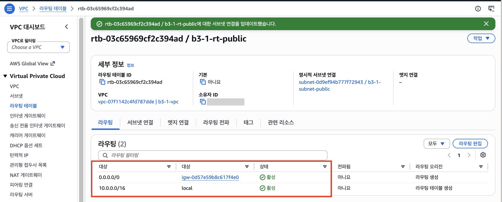

# 4단계. Route Table 설정하기

[← 단계 목록](../guide.md) · [이전: 3단계](./03-igw.md) · [다음: 5단계 →](./05-security-group.md)

> **한 줄 요약**: "VPC 밖으로 가는 트래픽은 IGW로"라는 길을 만들고 서브넷에 연결한다.

## 1. 무엇을, 왜

| 항목 | 내용 |
|---|---|
| 무엇을 | 라우팅 테이블 `b3-1-rt-public`에 `0.0.0.0/0 → b3-1-igw` 경로를 추가하고 서브넷에 연결 |
| 왜 | 기본 경로는 `10.0.0.0/16 → local`(VPC 안)뿐이라, 요청이 들어와도 **응답이 VPC 밖으로 나갈 길이 없음**. 이 경로가 있어야 퍼블릭 서브넷이 됨 |
| 어디서 | 🖱️ AWS 콘솔 → **VPC** 서비스 → 라우팅 테이블 |

## 2. 할 일

1. **라우팅 테이블 생성** → 이름 `b3-1-rt-public`, VPC `b3-1-vpc`, 태그 `Project=b3-1`
2. **라우팅** 탭 → **라우팅 편집** → **라우팅 추가**: 대상 `0.0.0.0/0`, 타겟 **인터넷 게이트웨이** → `b3-1-igw` → 저장
3. **서브넷 연결** 탭 → **서브넷 연결 편집** → `b3-1-subnet-public` 체크 → 저장
4. [cleanup-checklist.md](../cleanup-checklist.md)에 Route Table ID 기록

## 3. 확인과 📸

| 확인할 것 | 📸 |
|---|---|
| 라우팅 탭에 두 줄: `10.0.0.0/16 → local`, `0.0.0.0/0 → igw-...` / 서브넷 연결 탭에 `b3-1-subnet-public` | `04-route-table.png` (두 탭을 각각 찍어 두 장도 가능) |

## 4. ✍️ 실제 기록

**상태**: ✅ 완료 · **날짜**: 2026-10-20

### 4-1. 한 일 한눈에 보기

| 작업 | 실제로 한 일 | 이것이 하는 일 | 확인한 결과 | 📸 |
|---|---|---|---|---|
| ① 생성 | `b3-1-rt-public`, VPC `b3-1-vpc`, 태그 `Name`·`Project=b3-1` | 퍼블릭 서브넷 전용 **안내판**을 새로 만듦 | `rtb-03c65969cf2c394ad`, 기본: 아니요 | — |
| ② 경로 추가 | 라우팅 편집 → `0.0.0.0/0` → 인터넷 게이트웨이 `igw-0d57e59b8c617f4e0` | 안내판에 **무엇을 적을지**: VPC 밖으로 가는 모든 패킷은 정문(IGW)으로 | 경로 2줄 모두 **활성**: `0.0.0.0/0 → igw-...`, `10.0.0.0/16 → local` | 04 |
| ③ 서브넷 연결 | 서브넷 연결 편집 → `b3-1-subnet-public` 체크 → 연결 저장 | 그 안내판을 **어느 구역에 걸지**: 이 서브넷이 이 테이블을 따름 | 명시적 서브넷 연결 `subnet-0d9ef94b777f72943 / b3-1-subnet-public` | 04 |

- **왜 기본 라우팅 테이블을 고치지 않았나**: 기본 테이블(`rtb-0f546efe9d841478b`)은 연결을 지정하지 않은 **모든 서브넷**에 자동 적용된다. 여기에 인터넷 경로를 넣으면 나중에 만드는 서브넷도 모두 퍼블릭이 된다. 그래서 전용 테이블을 만들어 원하는 서브넷에만 연결했다.
- **경로 읽는 법**: 목적지에 맞는 줄 중 **더 좁은(구체적인) 줄**이 이긴다. `10.0.1.25`로 가면 `/16`인 `local`, 내 PC 공인 IP로 가면 `0.0.0.0/0`인 IGW. 서버가 내 PC에 **응답**을 보낼 때 이 IGW 줄을 탄다.
- 이 단계로 `b3-1-subnet-public`이 진짜 **퍼블릭 서브넷**이 되었다. 퍼블릭 서브넷은 따로 있는 설정이 아니라, `0.0.0.0/0 → IGW` 경로가 있는 테이블에 연결된 서브넷이다.

### 4-2. 헷갈렸던 점

| 질문 | 정리 |
|---|---|
| 서브넷 CIDR을 정했고 라우팅도 편집했는데 왜 서브넷 연결을 또 하나? | 셋은 하는 일이 다르다. **CIDR**은 구역에 속한 주소 범위, **라우팅 편집**은 안내판 내용, **서브넷 연결**은 그 안내판을 어느 구역에 걸지. 연결 전에는 서브넷이 여전히 기본 테이블(`local`만)을 따르므로 밖으로 나갈 길이 없다 |

### 4-3. 스크린샷

> 소유자 ID(계정 ID)만 가렸습니다.

**📸 04 라우팅 테이블**: 경로 2줄(`0.0.0.0/0 → igw-...`, `10.0.0.0/16 → local`), 명시적 서브넷 연결 `b3-1-subnet-public`, 기본: 아니요

---

[← 단계 목록](../guide.md) · [이전: 3단계](./03-igw.md) · [다음: 5단계 →](./05-security-group.md)
