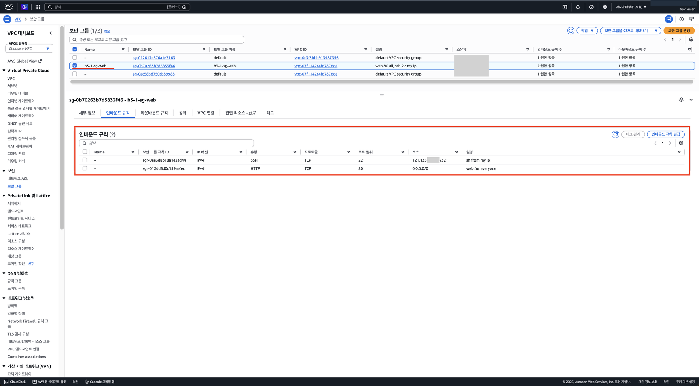

# 5단계. Security Group 만들기

[← 단계 목록](../guide.md) · [이전: 4단계](./04-route-table.md) · [다음: 6단계 →](./06-ec2.md)

> **한 줄 요약**: 서버 앞의 경비원 규칙을 정한다. 웹(80)은 누구나, 관리(22)는 내 IP만.

## 1. 무엇을, 왜

| 항목 | 내용 |
|---|---|
| 무엇을 | 보안 그룹 `b3-1-sg-web`, 인바운드 규칙 두 개 |
| 왜 | 열린 포트는 외부에서 두드릴 수 있는 문. 서비스와 관리에 꼭 필요한 문만 엶 |
| 어디서 | 🖱️ AWS 콘솔 → **EC2** 서비스 → 보안 그룹 |

| 포트 | 소스 | 이유 |
|---|---|---|
| 80 (HTTP) | `0.0.0.0/0` | 누구나 웹에 접속해야 함 |
| 22 (SSH) | 내 IP `/32` | 서버 관리는 나만. 전체에 열면 무차별 대입 공격 대상 |
| 그 외 | 열지 않음 | 쓰지 않는 문은 닫아 둠 |

## 2. 할 일

1. **보안 그룹 생성** → 이름 `b3-1-sg-web`, 설명 아무거나, VPC **`b3-1-vpc`** (기본 VPC가 선택돼 있으면 바꿈)
2. 인바운드 규칙 추가: 유형 **HTTP**, 소스 **Anywhere-IPv4** (`0.0.0.0/0`)
3. 인바운드 규칙 추가: 유형 **SSH**, 소스 **내 IP** (`x.x.x.x/32` 자동 입력)
4. 아웃바운드는 기본값 유지, 태그 `Project=b3-1` → 생성
5. [cleanup-checklist.md](../cleanup-checklist.md)에 SG ID 기록

> 집, 학교 등 인터넷 환경이 바뀌면 내 IP가 바뀌어 SSH가 안 될 수 있습니다. 그때는 22 규칙의 소스를 다시 "내 IP"로 수정합니다.

## 3. 확인과 📸

| 확인할 것 | 📸 |
|---|---|
| 인바운드 규칙이 **정확히 두 줄** (80 전체, 22 내 IP/32) | `05-security-group.png` (내 IP 뒷부분은 가리고 `/32`는 보이게) |

## 4. ✍️ 실제 기록

**상태**: ✅ 완료 · **날짜**: 2026-10-20

### 4-1. 한 일 한눈에 보기

| 작업 | 실제로 한 일 | 이것이 하는 일 | 확인한 결과 | 📸 |
|---|---|---|---|---|
| ① 생성 | `b3-1-sg-web`, VPC **`b3-1-vpc`**, 설명 `web 80 all, ssh 22 my ip`, 태그 `Name`·`Project=b3-1` | 서버 앞 **경비원**. 허용한 것만 들어오고 나머지는 모두 막음 | `sg-0b70263b7d5833f46` | 05 |
| ② 인바운드 HTTP | **HTTP · TCP · 80** ← `0.0.0.0/0` | 누구나 웹에 접속 | 규칙 있음 (`web for everyone`) | 05 |
| ③ 인바운드 SSH | **SSH · TCP · 22** ← 내 IP `/32` | 관리 접속은 **내 IP 하나만** | 규칙 있음 (`sh from my ip`) | 05 |
| ④ 아웃바운드 | 기본값 "모든 트래픽 → `0.0.0.0/0`" 유지 | 서버가 패키지 설치 등으로 밖에 나갈 수 있게 함 | 1개 | — |

- 인바운드 규칙은 **정확히 2개**이고, 전체 포트나 443·DB 포트 규칙은 없다.
- **stateful**: SG는 들어온 요청의 연결을 기억해서 그 응답은 아웃바운드 규칙과 상관없이 내보낸다. 그래서 인바운드 80만 열어도 웹 응답이 나간다.
- 목록의 `default` 보안 그룹 2개는 기본 VPC와 `b3-1-vpc`를 만들 때 자동으로 생긴 것이다. 사용하지 않고 건드리지 않는다(`b3-1-vpc`의 default SG는 VPC를 지우면 함께 사라짐).
- "내 IP"는 **지금 접속한 인터넷의 공인 IP**다. 다른 네트워크(카페, 휴대폰 핫스팟 등)에서 SSH하면 막히므로, 그때는 22 규칙의 소스를 다시 "내 IP"로 바꾼다.

### 4-2. 막힌 점과 해결

| 항목 | 내용 |
|---|---|
| 증상 1 | 첫 규칙 유형을 **HTTPS(443)**로 잘못 고름 |
| 해결 1 | 생성 전에 **HTTP(80)**로 변경. Nginx는 80에서 받고, 이 과제는 HTTPS를 쓰지 않음 |
| 증상 2 | 규칙 설명에 한글을 넣음 / 태그 키에 `b3-1-sg-web`이 들어감 |
| 해결 2 | 설명은 영문으로(한글은 생성 오류), 태그는 `Name`·`Project` 두 줄로 고침. SG 생성 화면에는 "이름 태그" 칸이 따로 없어서 `Name` 태그를 직접 넣어야 목록 Name 칸에 이름이 보임 |
| 남은 것 | SSH 규칙 설명이 `sh from my ip`(s 빠짐). 생성 후 설명만 고치려 하니 에러가 남. 설명 수정 권한(`ModifySecurityGroupRules` 등)을 정책에 넣지 않았기 때문으로 보임. 동작과 무관하므로 그대로 둠 |
| 배운 점 | 경고 배너("0.0.0.0/0은 모든 IP 허용")가 **HTTP 80과 아웃바운드에만** 뜨고 SSH 22에는 뜨지 않는 것이 의도한 상태 |

### 4-3. 스크린샷

> 계정 ID(오른쪽 위, 소유자 칸)와 **내 IP 뒷부분**을 가렸습니다. `/32`는 "IP 하나만 허용"을 보여주므로 남겼습니다.

**📸 05 보안 그룹 인바운드 규칙**: SSH 22 ← `121.135.x.x/32`, HTTP 80 ← `0.0.0.0/0`, 인바운드 규칙 수 2

---

[← 단계 목록](../guide.md) · [이전: 4단계](./04-route-table.md) · [다음: 6단계 →](./06-ec2.md)
