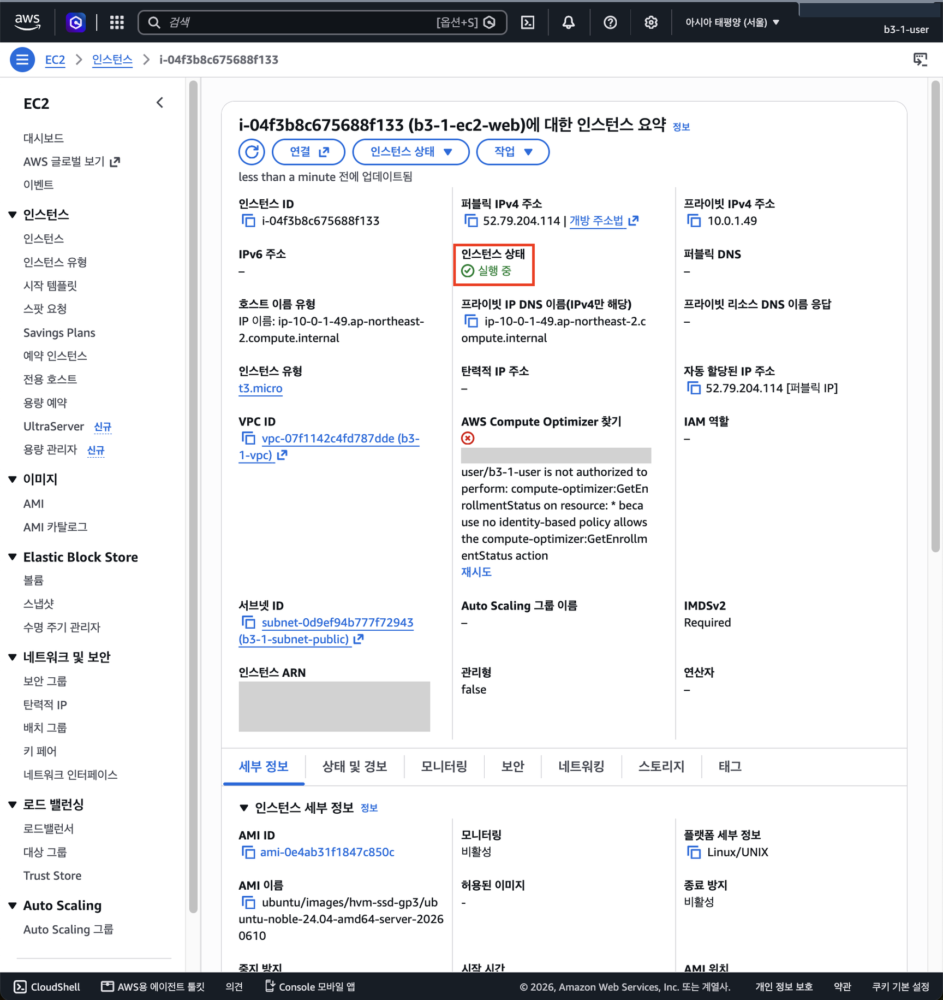
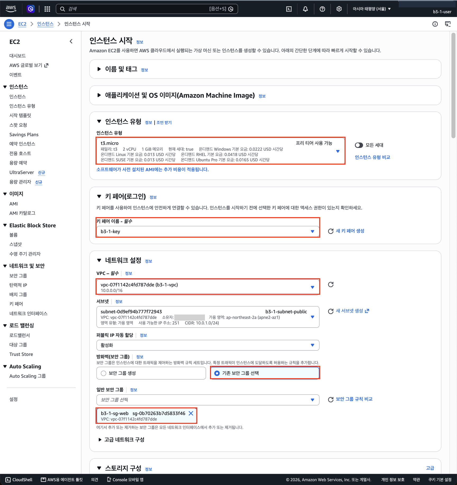
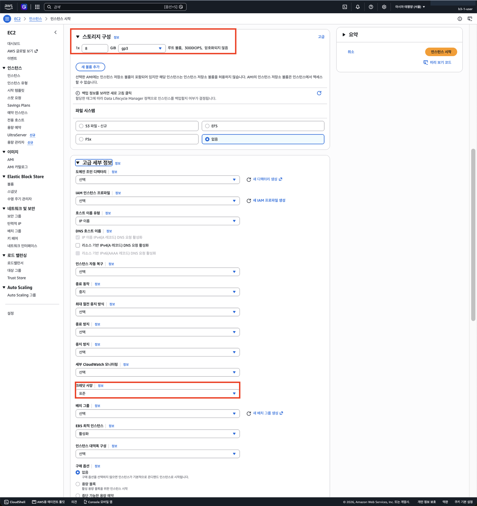
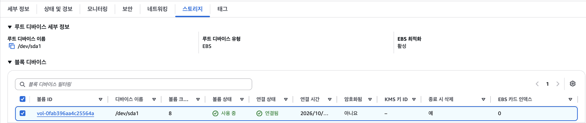

# 6단계. EC2 만들기

[← 단계 목록](../guide.md) · [이전: 5단계](./05-security-group.md) · [다음: 7단계 →](./07-ssh.md)

> **한 줄 요약**: 키 페어를 만들고, Public Subnet에 서버 한 대를 띄운다.

## 1. 무엇을, 왜

| 항목 | 내용 |
|---|---|
| 무엇을 | 키 페어 `b3-1-key`, EC2 `b3-1-ec2-web` (t3.micro, Ubuntu) |
| 왜 | 웹 서버 프로그램을 실행할 컴퓨터가 필요함 |
| 어디서 | 🖱️ AWS 콘솔 → **EC2** 서비스 |

## 2. 할 일

1. **키 페어 생성** → 이름 `b3-1-key`, RSA, `.pem` → 다운로드한 파일은 **레포 밖**에 보관 (재발급 불가)
2. **인스턴스 시작** → 이름 `b3-1-ec2-web`
3. AMI **Ubuntu Server LTS** ("프리 티어 사용 가능" 표시), 유형 **t3.micro**, 키 페어 `b3-1-key`
4. 네트워크 설정 → **편집**: VPC **`b3-1-vpc`**, 서브넷 `b3-1-subnet-public`, 퍼블릭 IP 자동 할당 **활성화**, 기존 보안 그룹 `b3-1-sg-web`
5. 스토리지 8GiB gp3
6. 고급 세부 정보 → 크레딧 사양 **Standard**, 태그 `Project=b3-1` → **인스턴스 시작**
7. [cleanup-checklist.md](../cleanup-checklist.md)에 인스턴스 ID, 볼륨 ID 기록

> 인스턴스 시작 화면은 **기본 VPC가 미리 선택**돼 있습니다. 4번에서 바꾸지 않으면 내 VPC가 아닌 곳에 서버가 생깁니다.

## 3. 확인과 📸

| 확인할 것 | 📸 |
|---|---|
| 상태 `실행 중`, 상태 검사 `2/2 통과`, 서브넷 `b3-1-subnet-public`, 퍼블릭 IPv4 주소, 유형 t3.micro | `06-ec2-instance.png` |

> 이 단계 직후 내 PC에서 `curl -i http://<퍼블릭IP>/health`를 하면 **connection refused**가 나옵니다. 길은 열렸지만 받을 프로그램(Nginx)이 아직 없기 때문입니다.

## 4. ✍️ 실제 기록

**상태**: ✅ 완료 · **날짜**: 2026-10-20

### 4-1. 한 일 한눈에 보기

| 작업 | 실제로 한 일 | 이것이 하는 일 | 확인한 결과 | 📸 |
|---|---|---|---|---|
| ① 키 페어 | `b3-1-key`, RSA, `.pem`, 태그 `Name`·`Project=b3-1` | SSH용 열쇠 한 쌍. 공개키는 서버에, 개인키(`.pem`)는 내 PC에. AWS는 개인키를 보관하지 않아 **재발급 불가** | 키 페어 목록에 생성, `.pem` 다운로드 (레포 밖 보관) | — |
| ② AMI·유형 | Ubuntu Server 24.04 LTS (x86, 프리 티어), **t3.micro** (2 vCPU, 1 GiB) | 서버의 OS와 크기 | 프리 티어 사용 가능 표시 | 06 |
| ③ 네트워크 | **편집**해서 VPC `b3-1-vpc`, 서브넷 `b3-1-subnet-public`, 퍼블릭 IP **활성화**, **기존 보안 그룹** `b3-1-sg-web` | 2~5단계에서 깐 길 끝에 서버를 놓음 | 시작 전 설정 확인 | 06a |
| ④ 스토리지·크레딧 | 8 GiB gp3, 크레딧 사양 **표준(Standard)** | 디스크 크기 / 크레딧을 다 쓰면 느려질 뿐 **추가 과금 없음** | 기본값 "무제한"에서 변경 | 06b |
| ⑤ 시작 | 인스턴스 시작 | 서버 1대 생성 | `i-04f3b8c675688f133`, **실행 중**, 퍼블릭 IPv4 `52.79.204.114`, 프라이빗 `10.0.1.49` | **06** |
| ⑥ 볼륨 | 스토리지 탭 확인 | 서버에 붙은 디스크(EBS) | `vol-0fab396aa4c25564a`, 8 GiB, 연결됨, **종료 시 삭제: 예** | 06c |

- 프라이빗 IP `10.0.1.49`는 서브넷 `10.0.1.0/24` 범위 안에서 받은 주소다. 퍼블릭 IP `52.79.204.114`는 서브넷의 "퍼블릭 IP 자동 할당" 덕분에 붙었고, IGW가 둘을 서로 바꿔 준다.
- 퍼블릭 DNS가 `–`인 것은 VPC의 "DNS 호스트 이름"을 켜지 않았기 때문이다. 이 과제는 IP로 접속하므로 필요 없다.
- "AWS Compute Optimizer 찾기"의 빨간 오류(`not authorized to perform: compute-optimizer:...`)는 그 화면을 볼 권한을 주지 않아서다. 과제 범위 밖이라 권한을 추가하지 않았다(최소 권한).
- 퍼블릭 IP는 EC2를 **중지/시작하면 바뀐다**. 6~9단계 사진의 IP가 같도록 9단계까지 중지하지 않는다.
- 이 단계 직후 밖에서 `/health`로 접속하면 **connection refused**가 난다. 길은 열렸지만 80에서 받을 프로그램(Nginx)이 아직 없다. 실제로 Nginx 설치 전에 확인함 → [09a](../images/09a-refused-before-nginx.png)

### 4-2. 막힌 점과 해결

| 항목 | 내용 |
|---|---|
| 증상 | 인스턴스 시작 화면의 네트워크 설정이 처음에 **기본 VPC**, 서브넷 "기본 설정 없음", 방화벽 **"보안 그룹 생성"**(`launch-wizard-1`, SSH `0.0.0.0/0`)으로 잡혀 있었음. 크레딧 사양도 **무제한**이었음 |
| 해결 | 네트워크 설정 **편집** → `b3-1-vpc` / `b3-1-subnet-public` / 기존 보안 그룹 `b3-1-sg-web`으로 변경. 고급 세부 정보에서 크레딧 사양을 **표준**으로 변경 |
| 배운 점 | 기본값 그대로 시작했다면 SSH가 전 세계에 열린 보안 그룹이 생겨 **"SSH는 내 IP만" 요구를 위반**하고, 무제한 크레딧으로 추가 과금 위험이 생겼다. 시작 전 요약을 반드시 확인한다 |

### 4-3. 스크린샷

> 계정 ID(오른쪽 위, 소유자), 인스턴스 ARN, 오류 메시지 속 IAM ARN을 가렸습니다. 퍼블릭 IP는 실습 당시 주소라 그대로 두었습니다(정리 후 반납됨).

**📸 06 인스턴스 요약**: 실행 중, t3.micro, 퍼블릭 IPv4 `52.79.204.114`, 프라이빗 `10.0.1.49`, VPC `b3-1-vpc`, 서브넷 `b3-1-subnet-public`

**06a 시작 설정: 네트워크** (편집 후): `b3-1-vpc`, `b3-1-subnet-public`, 퍼블릭 IP 활성화, 기존 보안 그룹 `b3-1-sg-web`, t3.micro, 키 페어 `b3-1-key`

**06b 시작 설정: 스토리지·크레딧**: 8 GiB gp3, 크레딧 사양 **표준**

**06c 볼륨**: `vol-0fab396aa4c25564a`, 8 GiB, 종료 시 삭제 **예**

---

[← 단계 목록](../guide.md) · [이전: 5단계](./05-security-group.md) · [다음: 7단계 →](./07-ssh.md)
