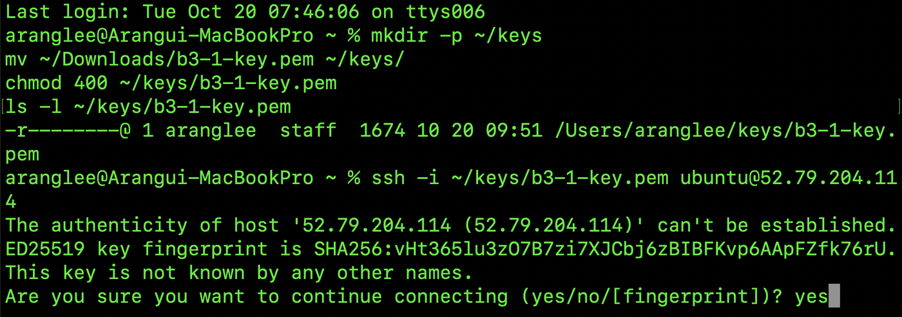

# 7단계. SSH 접속과 아웃바운드 확인

[← 단계 목록](../guide.md) · [이전: 6단계](./06-ec2.md) · [다음: 8단계 →](./08-nginx.md)

> **한 줄 요약**: 내 PC에서 서버에 접속하고, 서버에서 인터넷으로 나갈 수 있는지 확인한다.

## 1. 무엇을, 왜

| 항목 | 내용 |
|---|---|
| 무엇을 | SSH 접속, 서버에서 `curl https://example.com` |
| 왜 | 과제 요구: "SSH 접속 가능", "인스턴스에서 인터넷 아웃바운드 가능" |
| 어디서 | `$` 내 PC 터미널 → 접속 후 `ubuntu@...$` EC2 안 |

## 2. 할 일

내 PC 터미널에서:

```bash
chmod 400 ~/keys/b3-1-key.pem
ssh -i ~/keys/b3-1-key.pem ubuntu@<퍼블릭IP>
```

| 명령 | 하는 일 |
|---|---|
| `chmod 400` | 키 파일을 나만 읽게 함. 권한이 넓으면 ssh가 키를 거부함 |
| `ssh -i 키 ubuntu@IP` | 키로 서버에 접속. Ubuntu의 기본 사용자는 `ubuntu` |

처음 접속 때 `Are you sure you want to continue connecting?`이 나오면 `yes`.

접속한 EC2 안에서:

```bash
curl -I https://example.com
```

## 3. 확인과 📸

| 확인할 것 | 📸 |
|---|---|
| 프롬프트가 `ubuntu@ip-10-0-1-xx:~$`로 바뀜 | `07-ssh-login.png` |
| `curl -I` 첫 줄에 `HTTP/... 200` (서버 → 인터넷 길이 열림) | `08-outbound-curl.png` |

## 4. ✍️ 실제 기록

**상태**: ✅ 완료 · **날짜**: 2026-10-20

### 4-1. 한 일 한눈에 보기

| 작업 | 실제로 한 일 | 이것이 하는 일 | 확인한 결과 | 📸 |
|---|---|---|---|---|
| ① 키 보관 | `.pem`을 `~/keys/`로 옮기고 `chmod 400` | 레포 밖에 두고 나만 읽게 함. 권한이 넓으면 ssh가 키를 거부함 | `-r--------` | 07 |
| ② SSH 접속 | `ssh -i ~/keys/b3-1-key.pem ubuntu@52.79.204.114` → 처음 접속 확인에 `yes` | 내 PC → 인터넷 → IGW → 서브넷 → SG(22, 내 IP `/32`) → EC2 | 프롬프트가 `ubuntu@ip-10-0-1-49:~$`로 바뀜 (서버의 프라이빗 IP `10.0.1.49`) | 07, 08 |
| ③ 아웃바운드 | 서버 안에서 `curl -I https://example.com` | 서버 → 인터넷으로 나가는 길 확인 | **`HTTP/2 200`** | **08** |

- **SSH가 됐다는 것의 의미**: 2~5단계의 길(IGW, 라우팅 `0.0.0.0/0 → IGW`, 퍼블릭 IP)과 SG의 22 규칙(내 IP만)이 모두 맞다는 증거다. 하나라도 틀렸다면 timeout이 났을 것이다.
- **아웃바운드가 된 이유**: 서버가 보낸 요청은 라우팅 테이블의 `0.0.0.0/0 → IGW`를 따라 나가고, SG 아웃바운드 기본값(모든 트래픽)이 허용한다. 8단계에서 `apt`로 Nginx를 설치하려면 이 길이 필요하다.
- 처음 접속 때 나온 `The authenticity of host ... can't be established`는 **이 서버를 처음 본다**는 확인이다. `yes`를 하면 내 PC의 `~/.ssh/known_hosts`에 서버 지문이 저장되고, 다음부터는 묻지 않는다. 같은 IP에 다른 서버가 오면 경고가 나서 가짜 서버를 알아챌 수 있다.

### 4-2. 막힌 점과 해결

없음. 키 권한(`chmod 400`)과 SG의 내 IP가 맞아서 한 번에 접속됐다.

### 4-3. 스크린샷

**📸 07 SSH 접속**: 키 이동·`chmod 400` → `ssh -i ... ubuntu@52.79.204.114` → 호스트 확인 `yes`



**📸 08 아웃바운드**: 프롬프트 `ubuntu@ip-10-0-1-49:~$`(서버 안) → `curl -I https://example.com` → `HTTP/2 200`


---

[← 단계 목록](../guide.md) · [이전: 6단계](./06-ec2.md) · [다음: 8단계 →](./08-nginx.md)
