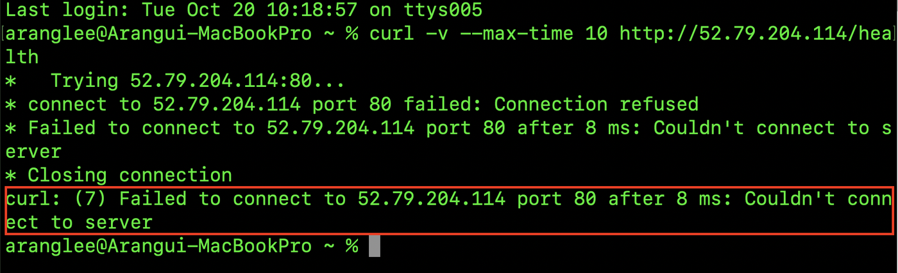
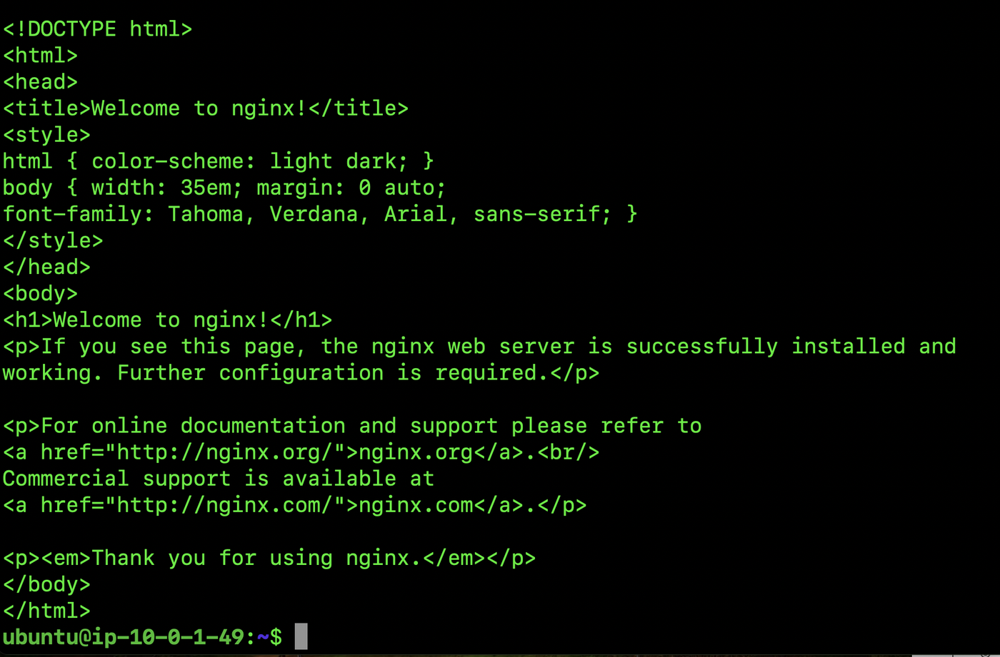

# 8단계. Nginx와 `/health` 만들기

[← 단계 목록](../guide.md) · [이전: 7단계](./07-ssh.md) · [다음: 9단계 →](./09-verify.md)

> **한 줄 요약**: 서버에 웹 서버(Nginx)를 설치하고, `/health` 주소가 `OK`를 돌려주게 만든다.

## 1. 무엇을, 왜

| 항목 | 내용 |
|---|---|
| 무엇을 | Nginx 설치, `/health` 고정 응답 설정 |
| 왜 | 외부 접속 검증을 (B) `/health` 방식으로 하기 때문 |
| 어디서 | `ubuntu@...$` EC2 안 |

## 2. 할 일

**설치와 확인**

```bash
sudo apt update
sudo apt install -y nginx
systemctl status nginx --no-pager
curl -i http://localhost
```

| 명령 | 하는 일 |
|---|---|
| `sudo apt update` | 설치할 수 있는 패키지 목록 새로고침 |
| `sudo apt install -y nginx` | Nginx 설치. 설치 직후 80 포트에서 대기 |
| `systemctl status nginx` | 실행 중인지 확인 (`active (running)`) |
| `curl -i http://localhost` | 서버 안에서 요청. `HTTP/1.1 200 OK` |

**`/health` 추가**

```bash
sudo nano /etc/nginx/sites-available/default
```

`server {` 블록 안, `server_name _;` 줄 아래에 붙여넣고 저장(`Ctrl+O` → `Enter` → `Ctrl+X`):

```nginx
location = /health {
    default_type text/plain;
    return 200 "OK\n";
}
```

```bash
sudo nginx -t
sudo systemctl reload nginx
curl -i http://localhost/health
```

| 명령 | 하는 일 |
|---|---|
| `sudo nginx -t` | 설정 문법 검사. `syntax is ok`, `test is successful` |
| `sudo systemctl reload nginx` | 서버를 끄지 않고 바뀐 설정만 다시 읽음 |
| `curl -i http://localhost/health` | `/health` 응답 확인 |

## 3. 확인과 📸

| 확인할 것 | 📸 |
|---|---|
| `active (running)`, `HTTP/1.1 200 OK`, 마지막 줄 `OK` | `09-localhost-200.png` (`systemctl status`와 `curl`이 함께 보이게) |

## 4. ✍️ 실제 기록

**상태**: ✅ 완료 · **날짜**: 2026-10-20

### 4-1. 한 일 한눈에 보기

| 작업 | 실제로 한 일 | 이것이 하는 일 | 확인한 결과 | 📸 |
|---|---|---|---|---|
| ⓪ 설치 전 | 내 PC에서 `curl -v --max-time 10 http://52.79.204.114/health` | 길은 열렸지만 80에서 받을 프로그램이 없는 상태 확인 | **`Connection refused`** (8 ms 만에 바로 거절) | 09a |
| ① 설치 | `sudo apt update` → `sudo apt install -y nginx` → `curl -i http://localhost` | 80 포트에서 요청을 받아 응답하는 웹 서버. 7단계에서 확인한 아웃바운드 길로 패키지를 받아 옴 | 설치 직후 자동 실행, 기본 페이지 `Welcome to nginx!` | 09b |
| ② `/health` 추가 | `/etc/nginx/sites-available/default`의 **활성 서버 블록**, `server_name _;` 바로 아래에 `location = /health { default_type text/plain; return 200 "OK\n"; }` | `/health`로 오면 파일을 찾지 않고 바로 `200`, 본문 `OK`. 그 밖의 주소는 기존 `location /`가 처리 | — | — |
| ③ 검사·적용 | `sudo nginx -t` → `sudo systemctl reload nginx` | 문법 검사 후, 서버를 끄지 않고 바뀐 설정만 다시 읽음 | `syntax is ok`, `test is successful` | 09 |
| ④ 확인 | `systemctl status nginx` / `curl -i http://localhost/health` | 서버 **안에서** Nginx와 `/health`가 동작하는지 확인 | **`active (running)`** / **`HTTP/1.1 200 OK`**, `Content-Type: text/plain`, 본문 `OK` | **09** |

- `location = /health`의 `=`는 **경로가 정확히 `/health`일 때만** 걸린다. 정확히 일치하는 규칙이 `location /`보다 우선한다.
- **헬스 체크**: 파일·DB와 상관없이 항상 같은 응답을 주므로 "서버까지 길이 열렸고 웹 서버가 살아 있다"만 깔끔하게 확인할 수 있다. 로드밸런서나 모니터링도 이런 주소를 주기적으로 찔러 본다.
- **설치 전 refused의 의미**: 8 ms 만에 거절됐다는 것은 요청이 IGW·라우팅·SG(80)를 모두 지나 **서버까지 도착**했고, 서버가 "80에서 듣는 프로그램이 없다"고 바로 돌려보냈다는 뜻이다. 길이 막혔다면 응답 없이 기다리다 **timeout**이 났을 것이다([트러블슈팅](../troubleshooting.md)의 timeout과 비교).
- 여기까지는 서버 **안**의 확인이다. 밖에서도 되는지는 9단계에서 내 PC로 확인한다.

### 4-2. 막힌 점과 해결

| 항목 | 내용 |
|---|---|
| 증상 | 처음에 `location` 블록을 파일 아래쪽의 **주석 처리된 예시 블록**(`#server { ... server_name example.com;`) 사이에 붙여넣음 |
| 원인 | `#`이 붙은 줄은 Nginx가 읽지 않음. 그 자리의 `location`은 어떤 `server { }`에도 속하지 않아 `nginx -t`에서 `"location" directive is not allowed here` 오류가 났을 것 |
| 해결 | 저장하지 않고 나감(`Ctrl+X` → `N`) → 다시 열어 `Ctrl+W`로 `server_name _`를 찾아 **활성 서버 블록**에 넣음 → `nginx -t` 통과 |
| 배운 점 | 설정 파일에는 `#` 예시가 많다. 넣을 위치는 `#`이 없는 블록인지 먼저 확인하고, 적용 전에 반드시 `nginx -t` |

### 4-3. 스크린샷

**09a 설치 전 (내 PC)**: `Connection refused`



**09b 설치 직후 기본 페이지 (서버 안)**: `curl -i http://localhost` → `Welcome to nginx!`



**📸 09 서버 안 확인**: `nginx -t` 통과, `active (running)`, `curl -i http://localhost/health` → `HTTP/1.1 200 OK`, `OK`


---

[← 단계 목록](../guide.md) · [이전: 7단계](./07-ssh.md) · [다음: 9단계 →](./09-verify.md)
