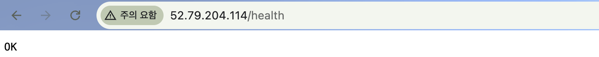

# 9단계. 외부에서 접속 검증하기 (B)

[← 단계 목록](../guide.md) · [이전: 8단계](./08-nginx.md) · [다음: 10단계 →](./10-troubleshoot.md)

> **한 줄 요약**: 서버 바깥(내 PC)에서 `/health`를 불러, 외부 → 서버 전체 경로가 열렸음을 증명한다.

## 1. 무엇을, 왜

| 항목 | 내용 |
|---|---|
| 무엇을 | 내 PC에서 `curl -i http://<퍼블릭IP>/health` |
| 왜 | 서버 안 `localhost` 확인은 Nginx만 증명함. IGW, Route Table, SG까지 모두 열렸는지는 **바깥에서** 확인해야 함 |
| 어디서 | `$` 내 PC 터미널 (SSH 창이 아닌 **새 탭**) |

## 2. 할 일

```bash
curl -i http://<퍼블릭IP>/health
```

기대 결과:

```text
HTTP/1.1 200 OK
Server: nginx/...
Content-Type: text/plain

OK
```

> 브라우저로 볼 때는 주소창에 `http://`를 직접 입력합니다. `https://`로 바뀌면 443은 열지 않았으므로 접속되지 않습니다.

## 3. 확인과 📸

| 확인할 것 | 📸 |
|---|---|
| **내 PC 터미널**에서 `200 OK`와 `OK` | `10-external-health.png` (과제의 "외부 접속 증빙") |

README의 [외부 접속 검증](../../README.md#2-외부-접속-검증) 표에 퍼블릭 IP와 확인 일시를 채웁니다.

## 4. ✍️ 실제 기록

**상태**: ✅ 완료 · **날짜**: 2026-10-20 10:31 (KST)

### 4-1. 한 일 한눈에 보기

| 작업 | 실제로 한 일 | 이것이 하는 일 | 확인한 결과 | 📸 |
|---|---|---|---|---|
| ① 터미널 | **내 PC**(`aranglee@Arangui-MacBookPro`)에서 `curl -i http://52.79.204.114/health` | 인터넷을 거쳐 서버의 `/health`까지 전체 경로를 확인 | **`HTTP/1.1 200 OK`**, `Server: nginx/1.24.0 (Ubuntu)`, `Content-Type: text/plain`, 본문 **`OK`** | **10** |
| ② 브라우저 | 주소창에 `http://52.79.204.114/health` 직접 입력 | 같은 확인을 브라우저로 | 화면에 `OK` | 10b |

- **8단계와 다른 점**: 8단계 `curl localhost`는 서버 **안**에서 자기 자신에게 요청한 것이다. 이번에는 **내 PC → 인터넷 → IGW → 라우팅(`local`) → 서브넷 → SG(80 허용) → EC2 → Nginx**를 지나 응답이 같은 길을 거꾸로(라우팅 `0.0.0.0/0 → IGW`) 돌아왔다. 이것이 과제가 말하는 "누구나 쓰게 하기"의 증명이다.
- **단계별 결과 변화가 예상과 같았다**: 6단계 직후(Nginx 없음) **refused** → 8단계 Nginx 설치 후 **200 OK**. ([09a](../images/09a-refused-before-nginx.png) / 10)
- 브라우저의 "주의 요함"은 HTTPS가 아니라 HTTP로 접속해서 뜨는 표시다. 이 과제는 443(HTTPS)을 쓰지 않으므로 정상이다.

### 4-2. 막힌 점과 해결

외부 검증 직후 **휴대폰 Chrome에서만** timeout이 나는 문제를 겪음. Mac(200 OK)과 삼성 인터넷(OK)으로 서버는 정상임을 확인하고 Chrome 클라이언트 문제로 좁힘 → [트러블슈팅 사례 2](../troubleshooting.md#사례-2-휴대폰-chrome에서만-health-접속-실패-timeout)

### 4-3. 스크린샷

**📸 10 외부 접속 (내 PC 터미널)**: 프롬프트가 내 Mac, `HTTP/1.1 200 OK`, `OK`


**10b 브라우저**: `52.79.204.114/health` → `OK` (북마크 바는 잘라냄)



---

[← 단계 목록](../guide.md) · [이전: 8단계](./08-nginx.md) · [다음: 10단계 →](./10-troubleshoot.md)
