# 11단계. 리소스 정리하기

[← 단계 목록](../guide.md) · [이전: 10단계](./10-troubleshoot.md)

> **한 줄 요약**: 만든 리소스를 **안에 있는 것부터** 지워 과금 요인을 없앤다.

## 1. 무엇을, 왜

| 항목 | 내용 |
|---|---|
| 무엇을 | 만든 리소스를 **안쪽부터 바깥으로** 삭제하고, 남은 과금 요인이 없는지 확인 |
| 왜 | 남은 EC2·EBS·탄력적 IP는 **계속 과금**된다. 또 다른 리소스가 쓰고 있는 것은 AWS가 **삭제를 막는다** (예: EC2가 쓰는 보안 그룹, IGW가 붙은 VPC) |
| 어디서 | 🖱️ AWS 콘솔, `$` 내 PC (`.pem` 삭제) |

> 그림의 번호가 삭제 순서입니다. **만든 순서(2→6단계)의 반대**이고, 상자 안쪽에 있는 것이 먼저입니다.

## 2. 할 일

> **시작 전에** 스크린샷 01~12가 `docs/images/`에 모두 있는지 확인합니다. 지운 뒤에는 다시 찍을 수 없습니다.

| 순서 | 삭제 | 확인 |
|---|---|---|
| 1 | EC2 종료(Terminate) | 상태 `종료됨`. 약 1시간만 보이므로 **바로** 📸 13a |
| 2 | EBS | 볼륨 목록에 남은 볼륨 없음 |
| 3 | Elastic IP | 목록 비어 있음 (할당하지 않음) |
| 4 | 키 페어 `b3-1-key` | 내 PC의 `.pem`도 삭제 |
| 5 | 보안 그룹 `b3-1-sg-web` | — |
| 6 | 서브넷, 라우팅 테이블 | — |
| 7 | 인터넷 게이트웨이 | VPC에서 **분리(Detach)** 후 삭제 |
| 8 | VPC `b3-1-vpc` | — |
| 9 | 전체 확인 | EC2 Global View에서 다른 리전에 남은 것 없음 |

## 3. 확인과 📸

| 확인할 것 | 📸 |
|---|---|
| EC2 `종료됨`, 볼륨·탄력적 IP·키 페어 없음, VPC 목록에 기본 VPC만 | `13a`~ (단계마다 한 장) |

[cleanup-checklist.md](../cleanup-checklist.md)의 모든 항목에 체크하고 정리 일시를 적습니다.

## 4. ✍️ 실제 기록

**상태**: 🟡 진행 중 · **날짜**: 2026-10-20

### 4-1. 한 일 한눈에 보기

| 순서 | 실제로 한 일 | 이것이 하는 일 | 확인한 결과 | 📸 |
|---|---|---|---|---|
| ① EC2 | `b3-1-ec2-web` → 인스턴스 상태 → **종료(삭제)** (중지 아님) | 서버를 완전히 없앰. 중지는 디스크가 남아 과금됨 | 종료 방지 비활성, "종료될 때 루트 EBS 볼륨이 삭제됩니다" 경고 → **종료됨**, 퍼블릭 IP·VPC ID가 `–`로 비워짐 | 13, **13a** |
| ② EBS | EC2 → Elastic Block Store → **볼륨** 확인 | EC2에 붙어 있던 디스크가 함께 지워졌는지 확인 ([EBS란?](../concepts.md#ebs-볼륨-쉽게-보기)) | **"현재 이 리전에 볼륨이 없습니다"** → `vol-0fab396aa4c25564a` 자동 삭제됨 | **13b** |
| ③ Elastic IP | EC2 → 네트워크 및 보안 → **탄력적 IP** 확인 | 만들지 않았어도 **확인**한다. 탄력적 IP는 인스턴스에 연결되지 않은 채 남아 있으면 시간당 과금되고, 실수로 할당했거나 다른 작업에서 남았을 수 있음 | **"이 리전에서 탄력적 IP 주소를 찾을 수 없음"** → 과금 요인 없음 | **13c** |
| ④ 키 페어 | AWS 키 페어 `b3-1-key` 삭제 → 내 PC `rm -f ~/keys/b3-1-key.pem` → `ssh-keygen -R 52.79.204.114` | SSH용 열쇠(개인키)·자물쇠(공개키)를 모두 없앰 ([키 페어란?](../concepts.md#키-페어-쉽게-보기)). 무료지만 **보안** 때문에 정리: 쓸 곳 없는 열쇠가 남으면 재사용·유출 위험 | "1개의 키 페어 삭제 완료", "표시할 키 페어 없음" / `ls -l ~/keys/` → `total 0` / `known_hosts updated` (이 IP 기록 3줄 제거, 원본은 `known_hosts.old`로 보관) | 13d, **13e**, 13f, 13g |
| ⑤ 보안 그룹 | VPC → 보안 → 보안 그룹 → `b3-1-sg-web`만 선택 → 작업 → 보안 그룹 삭제 | 서버 앞 경비원(방화벽)을 없앰. EC2가 완전히 종료돼 더 이상 쓰는 곳이 없어 삭제 가능. `default` 2개는 그대로 둠(`b3-1-vpc`의 default는 VPC와 함께 자동 삭제) | "보안 그룹(sg-0b70263b7d5833f46 \| b3-1-sg-web)이 삭제되었습니다" → 새로 고침 후 **보안 그룹 (2)**, `default` 2개만 남음 | 13h, 13i, **13j** |
| ⑥ 서브넷 | VPC → 서브넷 → `b3-1-subnet-public`만 선택 → 작업 → 서브넷 삭제 → `삭제` 입력 | 서버를 놓던 구역을 없앰. 안의 EC2가 사라져 빈 구역이라 삭제 가능. 지우면 라우팅 테이블 `b3-1-rt-public`과의 연결도 풀림 | 확인 창에 "리소스 공유를 로드하지 못했습니다"(`ram:GetResourceShareAssociations` 권한 없음)가 뜸 → 아래 참고. → **"subnet-0d9ef94b777f72943 삭제 완료"**, 서브넷 (4) = 기본 VPC(`vpc-0c3f...`) 서브넷만 남음 | 13k0, 13k, **13l** |
| ⑦ 라우팅 테이블 | VPC → 라우팅 테이블 → `b3-1-rt-public`만 선택 → 작업 → 라우팅 테이블 삭제 | `0.0.0.0/0 → IGW` 안내판을 없앰. 서브넷 연결이 풀려야 삭제 가능. **기본: 예**인 2개는 그대로 둠(`b3-1-vpc`의 기본 테이블은 VPC와 함께 자동 삭제) | 처음엔 "연결이 있으며 삭제할 수 없습니다"로 막힘 → 새로 고침 후 삭제 → **"rtb-03c65969cf2c394ad / b3-1-rt-public 삭제 완료"**, 라우팅 테이블 (2) = 기본 테이블만 | 13m0~13m2, **13m** |
| ⑧ IGW | `b3-1-igw`만 선택 → 작업 → **VPC에서 분리** → 작업 → 인터넷 게이트웨이 삭제 | VPC의 정문을 없앰. 붙어 있으면 삭제 메뉴가 비활성이라 **분리가 먼저**. 이름 없는 `igw-08108...`(기본 VPC용)는 그대로 둠 | 분리 전 삭제 메뉴 회색 → "인터넷 게이트웨이를 VPC에서 분리 완료", 상태 **Detached**, VPC ID `–` (삭제 진행 중) | 13n0, **13n** |
| ⑨ VPC | (진행 전) | | | |
| ⑩ 전체 확인 | (진행 전) | | | |

### 4-2. 막힌 점과 해결

| 항목 | 내용 |
|---|---|
| 증상 | ⑦ 라우팅 테이블 삭제 시 "라우팅 테이블에는 연결이 있으며 삭제할 수 없습니다". 삭제 버튼 비활성 |
| 원인 | 서브넷은 이미 삭제(11:57)했지만, 콘솔 목록이 그 전에 불러온 정보("Last updated 7 minutes ago")를 들고 있어 **지워진 서브넷과의 연결이 남아 있는 것처럼** 판단함. 실제 AWS에서는 서브넷 삭제 시 연결도 함께 풀림 |
| 해결 | 새로 고침 후 다시 삭제 → 확인 창이 정상으로 바뀌고 삭제 완료 |
| 배운 점 | 콘솔 화면은 자동으로 최신이 되지 않는다. 앞 단계에서 무언가를 지운 뒤에는 **새로 고침부터** 하고 판단한다 (⑤ 보안 그룹에서도 삭제 직후 목록에 그대로 보였던 것과 같은 현상) |

### 4-3. 스크린샷

> 계정 ID와 오류 메시지 속 ARN을 가렸습니다.

**① 종료 확인 창**: 대상 `b3-1-ec2-web`, 종료 방지 비활성, 루트 EBS 볼륨 함께 삭제 안내

**📸 13a EC2 종료됨**: "종료(삭제) 처리됨", 상태 **종료됨** (종료된 인스턴스는 약 1시간만 목록에 보임)

**📸 13b EBS 볼륨 없음**: "현재 이 리전에 볼륨이 없습니다"

**📸 13c 탄력적 IP 없음**: 할당하지 않았지만 과금 요인이므로 비어 있음을 확인

**④ 키 페어 정리** ([키 페어란?](../concepts.md#키-페어-쉽게-보기))

AWS 쪽: `b3-1-key` 선택 → 작업 → 삭제

**📸 13e 키 페어 없음**: "1개의 키 페어 삭제 완료", "표시할 키 페어 없음"

내 PC 쪽: 삭제 전 `b3-1-key.pem`이 있었고(`-r--------`), 삭제 후 `total 0`

(선택) 반납될 IP의 서버 지문 기록 제거: `ssh-keygen -R 52.79.204.114` → `known_hosts updated`

**⑤ 보안 그룹 삭제**: `b3-1-sg-web` 선택 → 작업 → 보안 그룹 삭제 (소유자 계정 ID 가림)

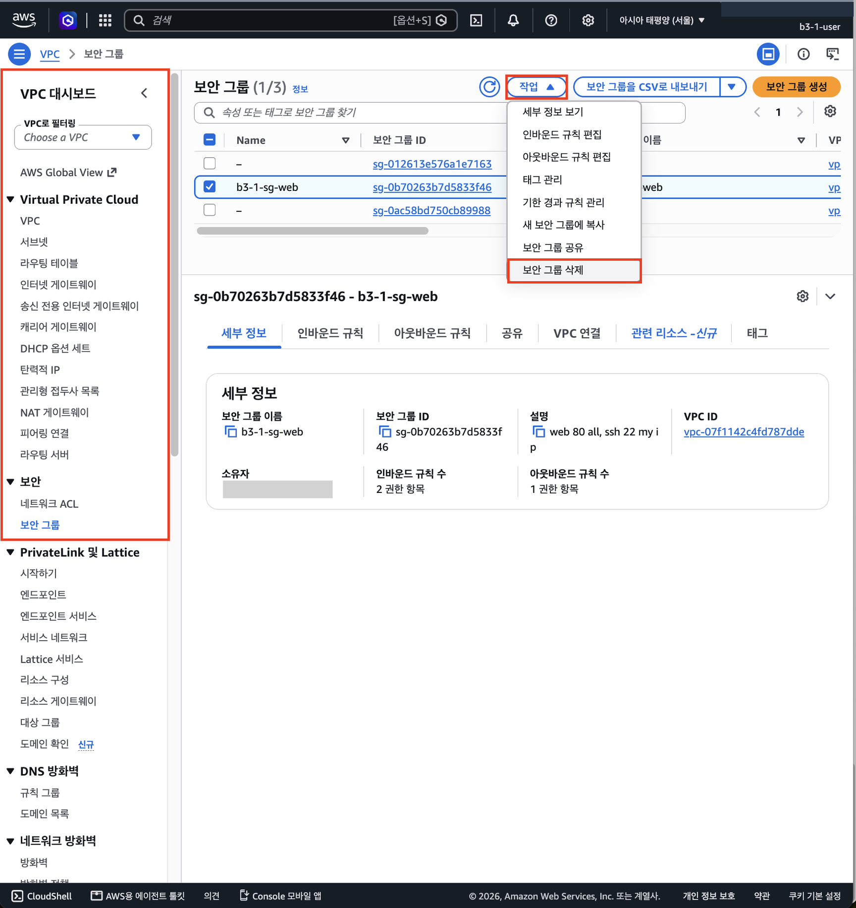

삭제 완료 배너

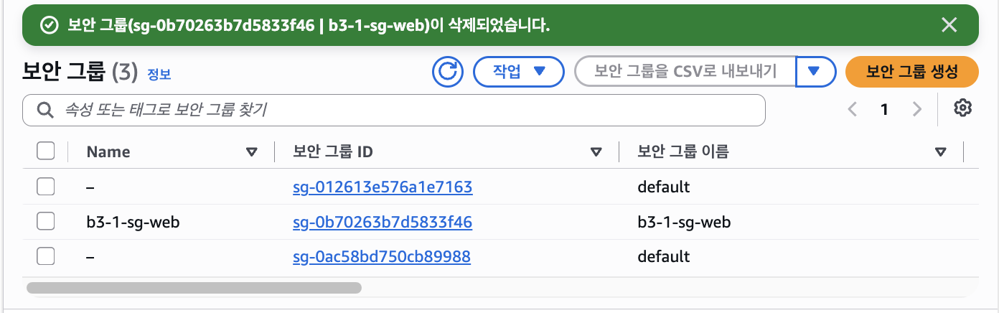

**📸 13j 새로 고침 후 목록**: 보안 그룹 (2), `default`만 남음

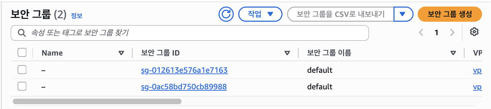

**⑥ 서브넷 선택**: 기본 VPC 서브넷 4개(`–`)는 두고 `b3-1-subnet-public`만 체크 → 작업 → 서브넷 삭제 (서브넷 ARN 가림)

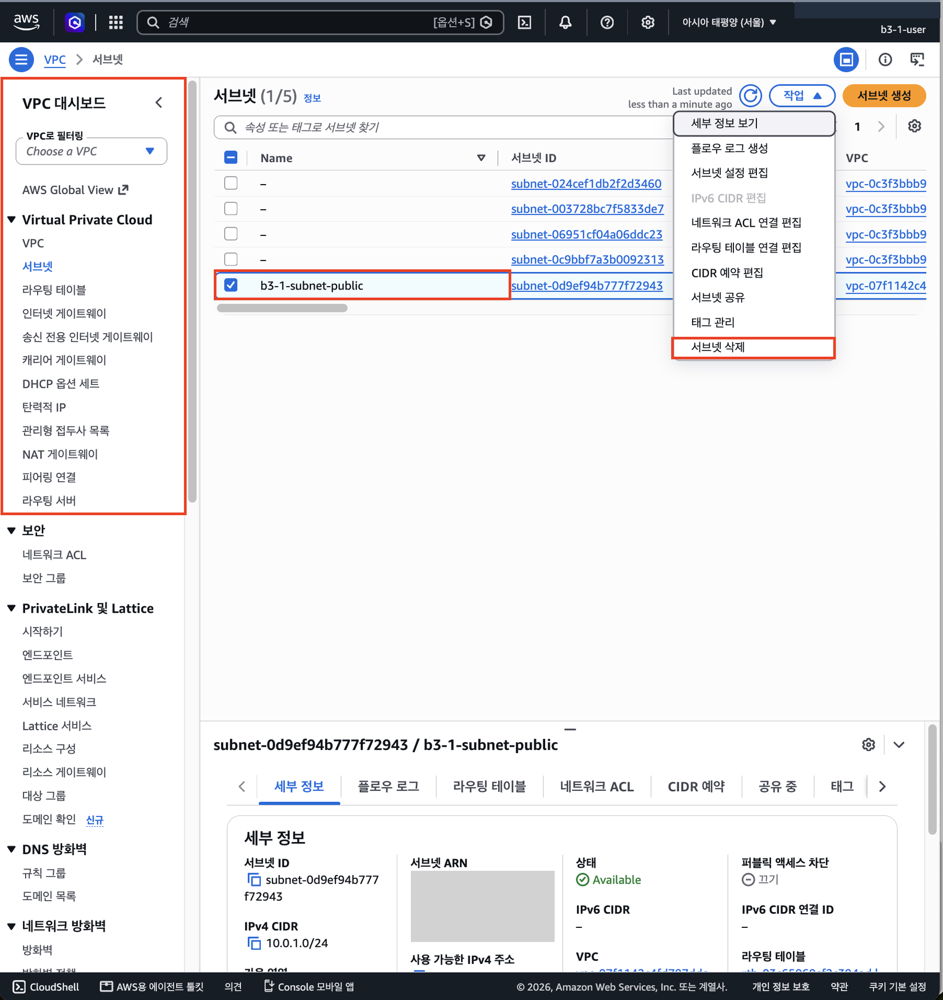

**⑥ 서브넷 삭제 확인 창**: `b3-1-subnet-public` (계정 ID 가림)

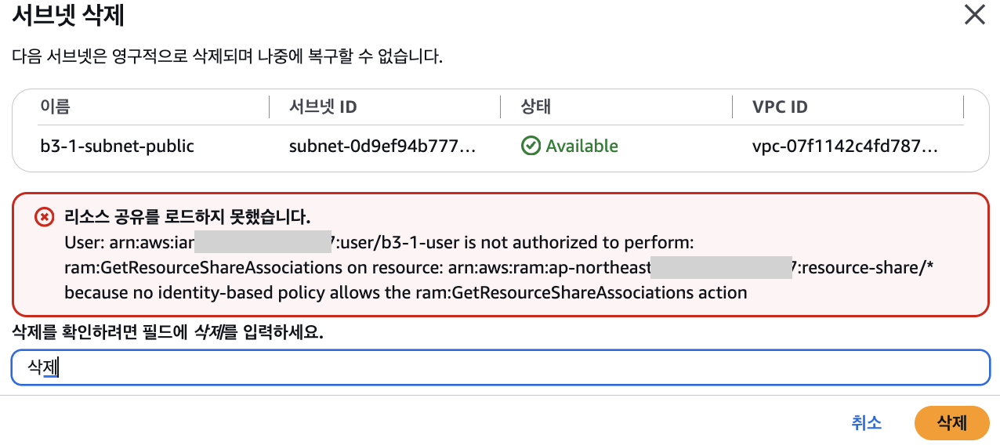

> **"리소스 공유를 로드하지 못했습니다"는 무시해도 된다.** RAM(Resource Access Manager)은 서브넷을 **다른 AWS 계정과 공유**하는 기능이다. 콘솔이 삭제 전에 "이 서브넷을 공유 중인지" 조회하려다 그 조회 권한이 없어서 뜬 안내다. 이 과제에서는 공유한 적이 없고, 삭제에 필요한 권한(`ec2:DeleteSubnet`)은 정책에 있으므로 삭제는 된다. 최소 권한이라 이런 **조회용** 오류가 콘솔 곳곳에 뜬다(Compute Optimizer, DNS 방화벽과 같은 종류).

**📸 13l 서브넷 삭제 완료**: 서브넷 (4), 모두 기본 VPC 서브넷

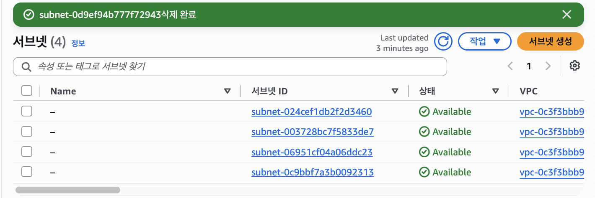

**⑦ 라우팅 테이블 삭제**

처음 시도: 목록이 **7분 전 정보**("Last updated 7 minutes ago")였고, 상세에도 방금 지운 서브넷 연결이 남아 있었다 (소유자 ID 가림)

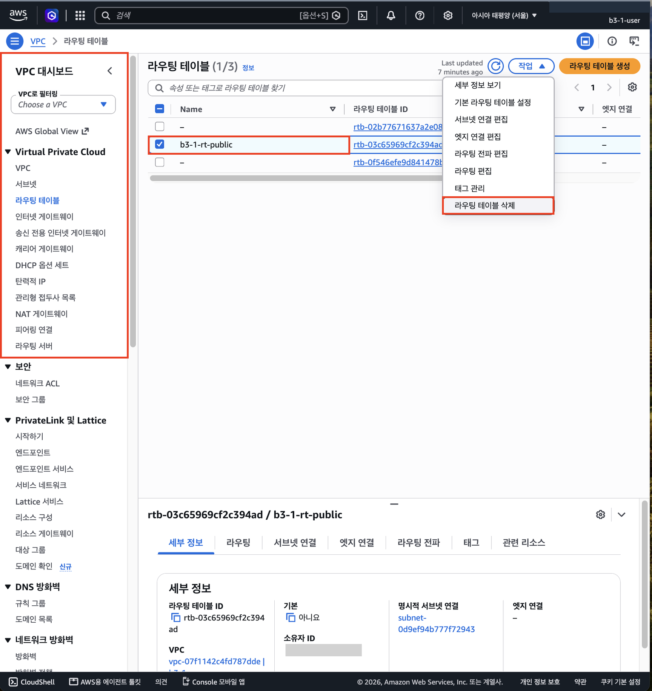

그래서 "라우팅 테이블에는 연결이 있으며 삭제할 수 없습니다"로 막힘

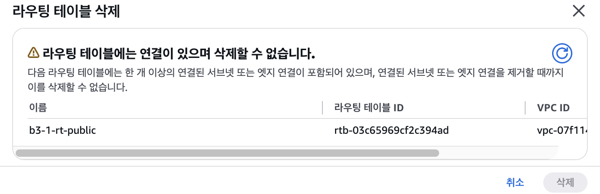

새로 고침 후 다시 시도 → 삭제 가능

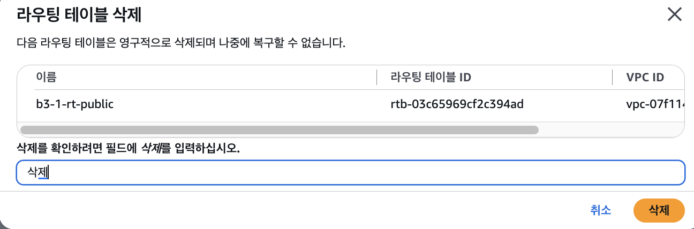

**📸 13m 라우팅 테이블 삭제 완료**: 라우팅 테이블 (2), 둘 다 명시적 서브넷 연결 없음

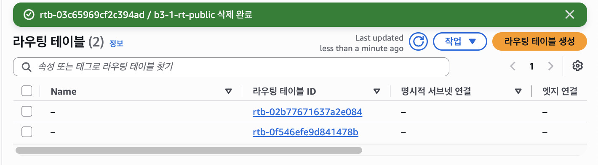

**⑧ IGW 분리**: Attached 상태에서는 "인터넷 게이트웨이 삭제"가 **회색(비활성)**, "VPC에서 분리"만 가능 (소유자 ID 가림)

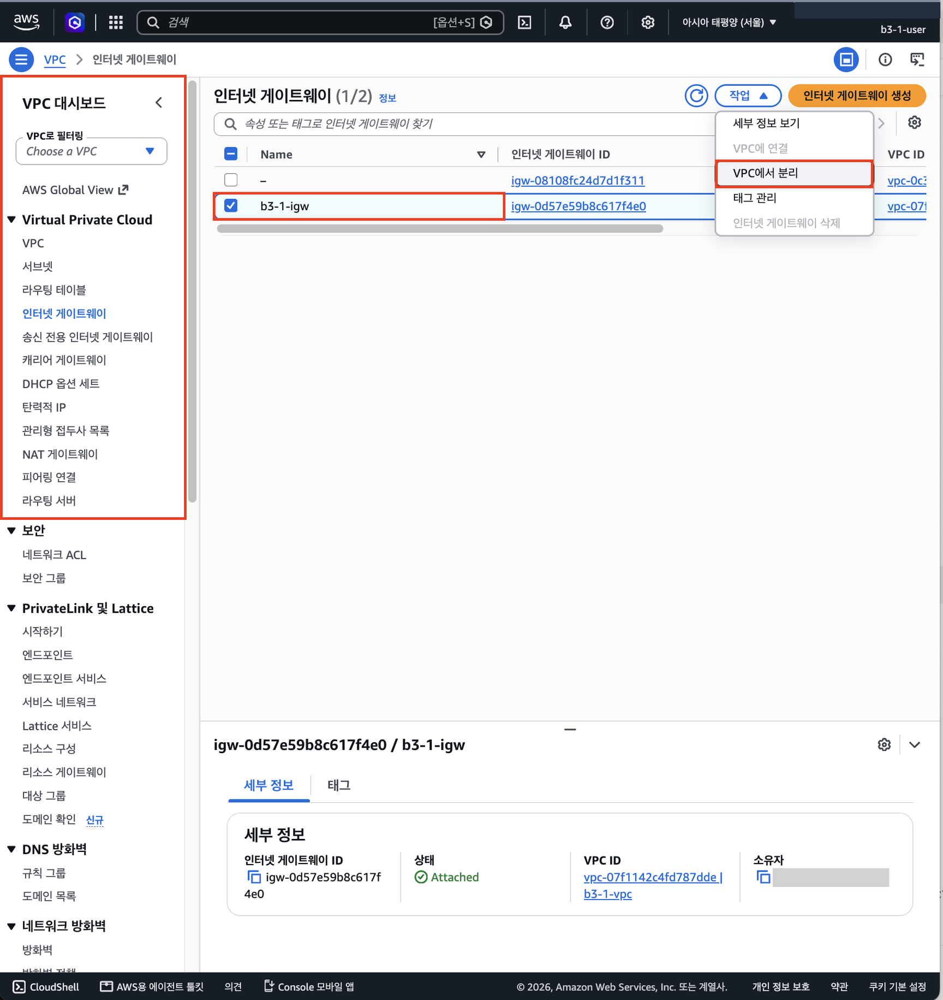

**📸 13n 분리 완료**: `b3-1-igw` 상태 **Detached**, 기본 VPC의 IGW는 Attached 그대로

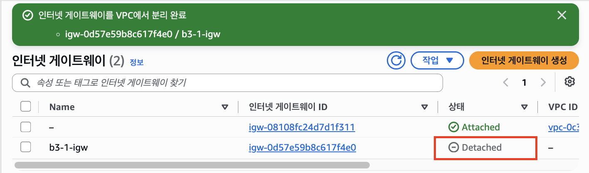

---

[← 단계 목록](../guide.md) · [이전: 10단계](./10-troubleshoot.md)
