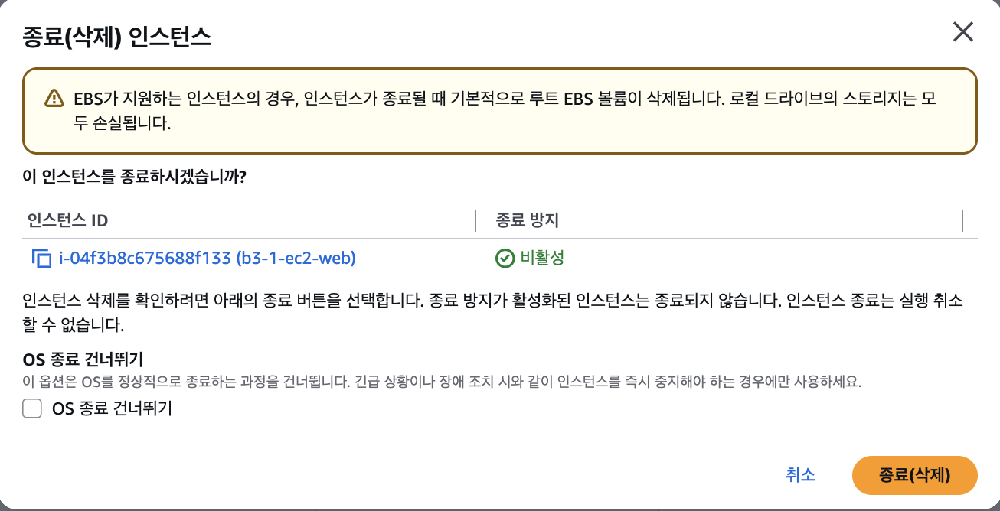
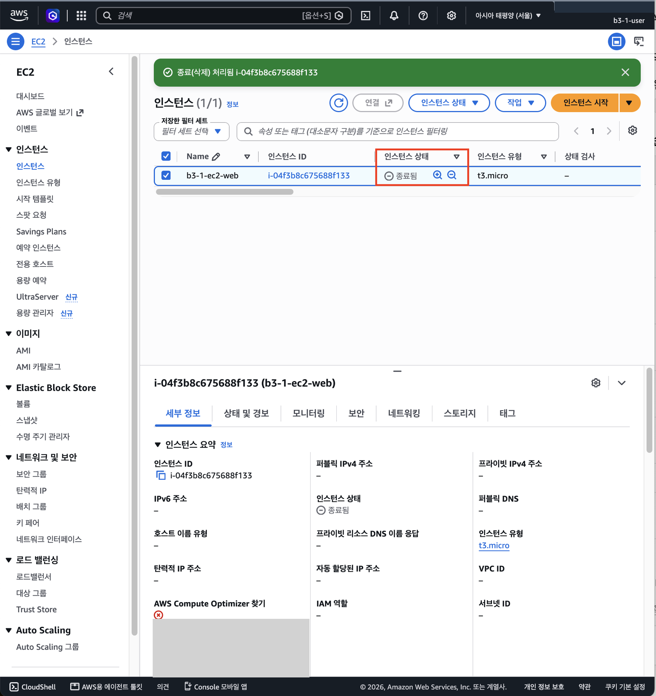
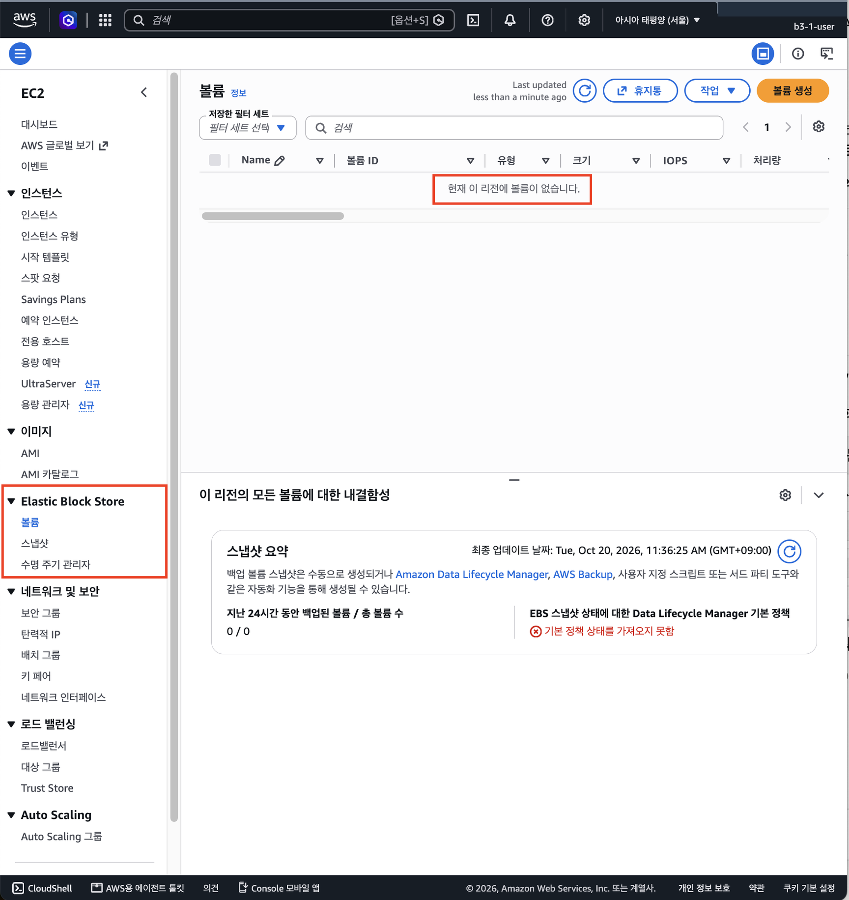
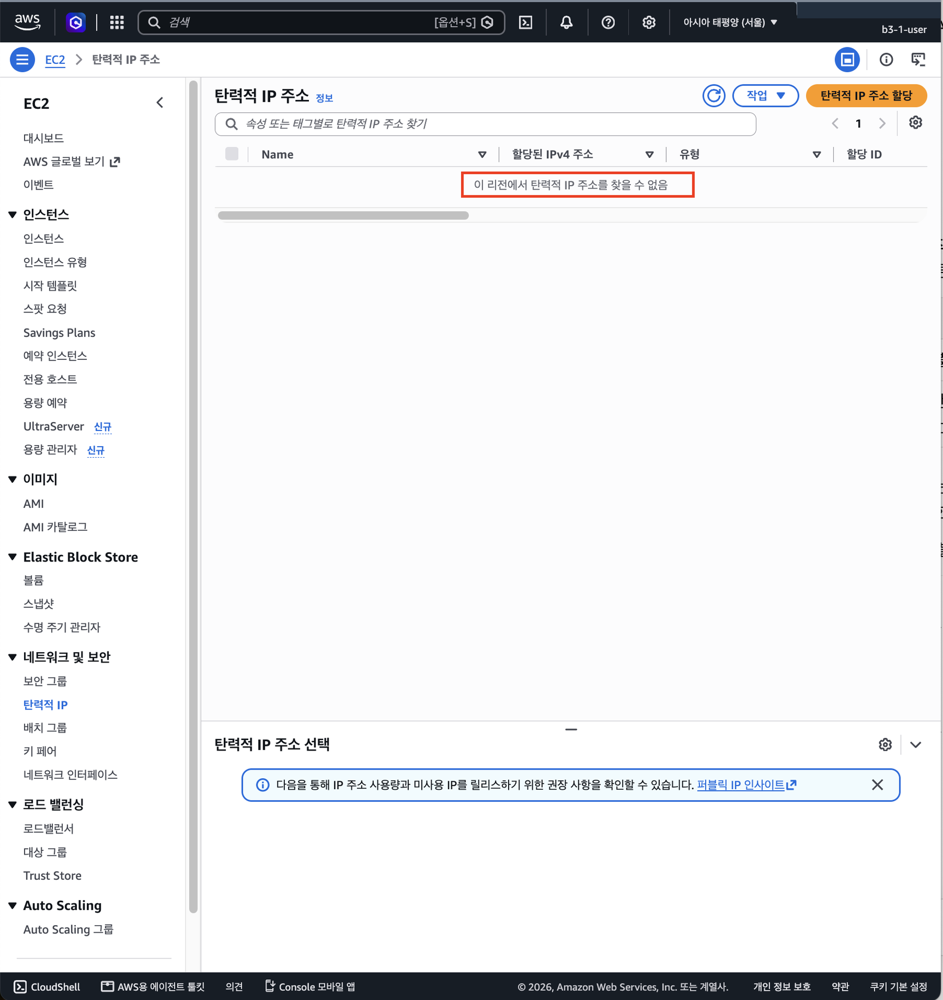
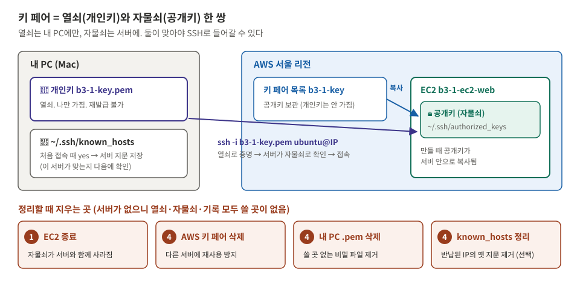
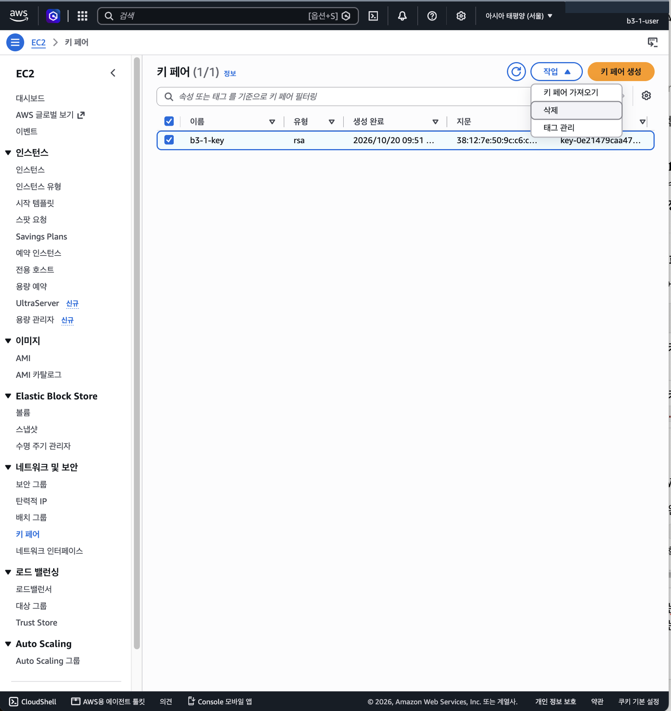
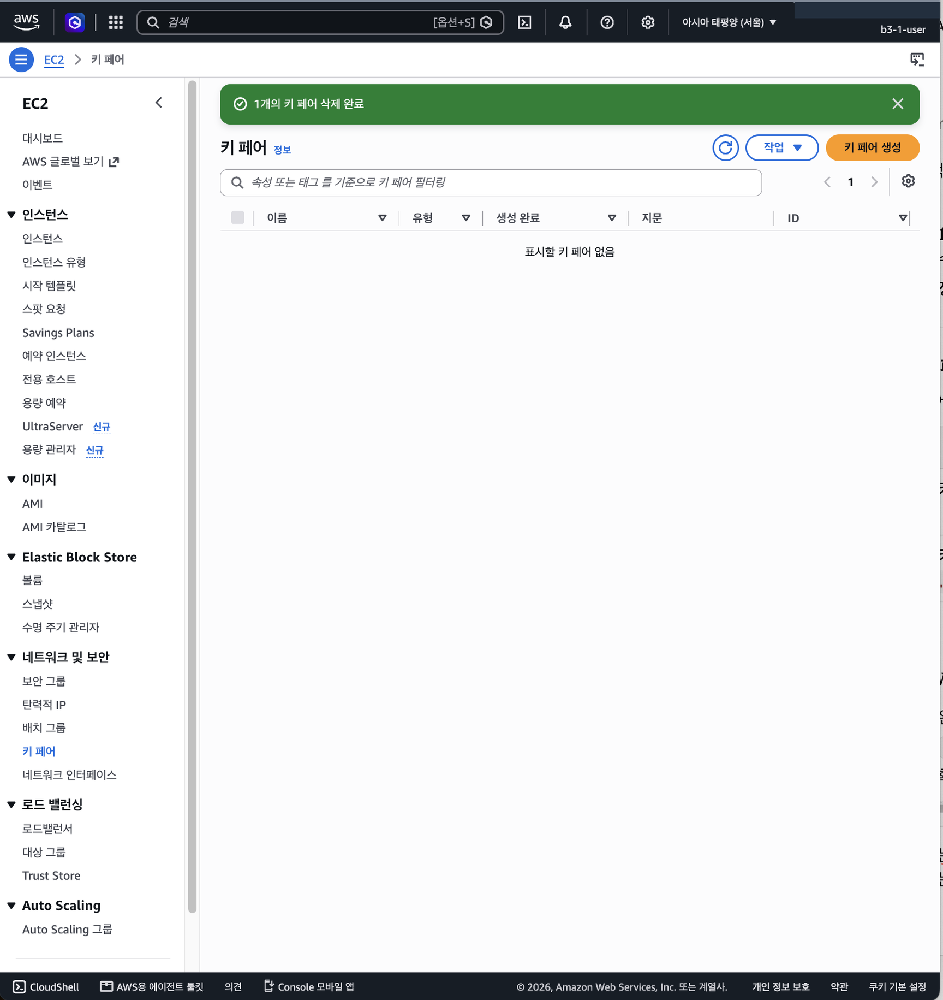
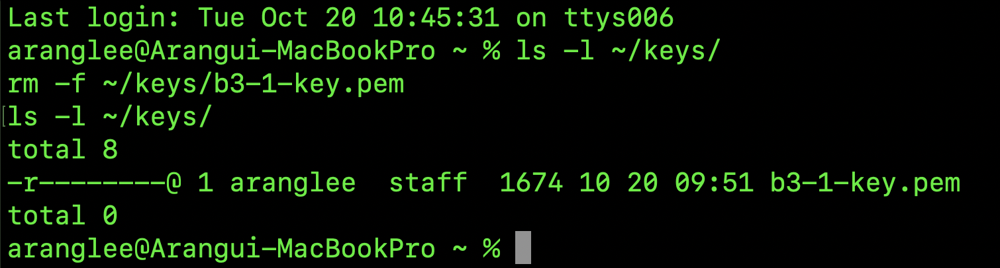
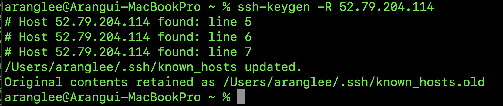

# 11단계. 리소스 정리하기

[← 단계 목록](../guide.md) · [이전: 10단계](./10-troubleshoot.md)

> **한 줄 요약**: 만든 리소스를 **안에 있는 것부터** 지워 과금 요인을 없앤다.

## 1. 무엇을, 왜

| 항목 | 내용 |
|---|---|
| 무엇을 | 만든 리소스를 **안쪽부터 바깥으로** 삭제하고, 남은 과금 요인이 없는지 확인 |
| 왜 | 남은 EC2·EBS·탄력적 IP는 **계속 과금**된다. 또 다른 리소스가 쓰고 있는 것은 AWS가 **삭제를 막는다** (예: EC2가 쓰는 보안 그룹, IGW가 붙은 VPC) |
| 어디서 | 🖱️ AWS 콘솔, `$` 내 PC (`.pem` 삭제) |

> 그림의 번호가 삭제 순서입니다. **만든 순서(2→6단계)의 반대**이고, 상자 안쪽에 있는 것이 먼저입니다.

## 2. 할 일

> **시작 전에** 스크린샷 01~12가 `docs/images/`에 모두 있는지 확인합니다. 지운 뒤에는 다시 찍을 수 없습니다.

| 순서 | 삭제 | 확인 |
|---|---|---|
| 1 | EC2 종료(Terminate) | 상태 `종료됨`. 약 1시간만 보이므로 **바로** 📸 13a |
| 2 | EBS | 볼륨 목록에 남은 볼륨 없음 |
| 3 | Elastic IP | 목록 비어 있음 (할당하지 않음) |
| 4 | 키 페어 `b3-1-key` | 내 PC의 `.pem`도 삭제 |
| 5 | 보안 그룹 `b3-1-sg-web` | — |
| 6 | 서브넷, 라우팅 테이블 | — |
| 7 | 인터넷 게이트웨이 | VPC에서 **분리(Detach)** 후 삭제 |
| 8 | VPC `b3-1-vpc` | — |
| 9 | 전체 확인 | EC2 Global View에서 다른 리전에 남은 것 없음 |

## 3. 확인과 📸

| 확인할 것 | 📸 |
|---|---|
| EC2 `종료됨`, 볼륨·탄력적 IP·키 페어 없음, VPC 목록에 기본 VPC만 | `13a`~ (단계마다 한 장) |

[cleanup-checklist.md](../cleanup-checklist.md)의 모든 항목에 체크하고 정리 일시를 적습니다.

## 4. ✍️ 실제 기록

**상태**: 🟡 진행 중 · **날짜**: 2026-10-20

### 4-1. 한 일 한눈에 보기

| 순서 | 실제로 한 일 | 이것이 하는 일 | 확인한 결과 | 📸 |
|---|---|---|---|---|
| ① EC2 | `b3-1-ec2-web` → 인스턴스 상태 → **종료(삭제)** (중지 아님) | 서버를 완전히 없앰. 중지는 디스크가 남아 과금됨 | 종료 방지 비활성, "종료될 때 루트 EBS 볼륨이 삭제됩니다" 경고 → **종료됨**, 퍼블릭 IP·VPC ID가 `–`로 비워짐 | 13, **13a** |
| ② EBS | EC2 → Elastic Block Store → **볼륨** 확인 | EC2에 붙어 있던 디스크가 함께 지워졌는지 확인 ([EBS란?](../concepts.md#ebs-볼륨-쉽게-보기)) | **"현재 이 리전에 볼륨이 없습니다"** → `vol-0fab396aa4c25564a` 자동 삭제됨 | **13b** |
| ③ Elastic IP | EC2 → 네트워크 및 보안 → **탄력적 IP** 확인 | 만들지 않았어도 **확인**한다. 탄력적 IP는 인스턴스에 연결되지 않은 채 남아 있으면 시간당 과금되고, 실수로 할당했거나 다른 작업에서 남았을 수 있음 | **"이 리전에서 탄력적 IP 주소를 찾을 수 없음"** → 과금 요인 없음 | **13c** |
| ④ 키 페어 | AWS 키 페어 `b3-1-key` 삭제 → 내 PC `rm -f ~/keys/b3-1-key.pem` → `ssh-keygen -R 52.79.204.114` | SSH용 열쇠(개인키)·자물쇠(공개키)를 모두 없앰 ([키 페어란?](../concepts.md#키-페어-쉽게-보기)). 무료지만 **보안** 때문에 정리: 쓸 곳 없는 열쇠가 남으면 재사용·유출 위험 | "1개의 키 페어 삭제 완료", "표시할 키 페어 없음" / `ls -l ~/keys/` → `total 0` / `known_hosts updated` (이 IP 기록 3줄 제거, 원본은 `known_hosts.old`로 보관) | 13d, **13e**, 13f, 13g |
| ⑤ 보안 그룹 | (진행 전) | | | |
| ⑥ 서브넷 | (진행 전) | | | |
| ⑦ 라우팅 테이블 | (진행 전) | | | |
| ⑧ IGW | (진행 전) | | | |
| ⑨ VPC | (진행 전) | | | |
| ⑩ 전체 확인 | (진행 전) | | | |

### 4-2. 스크린샷

> 계정 ID와 오류 메시지 속 ARN을 가렸습니다.

**① 종료 확인 창**: 대상 `b3-1-ec2-web`, 종료 방지 비활성, 루트 EBS 볼륨 함께 삭제 안내

**📸 13a EC2 종료됨**: "종료(삭제) 처리됨", 상태 **종료됨** (종료된 인스턴스는 약 1시간만 목록에 보임)

**📸 13b EBS 볼륨 없음**: "현재 이 리전에 볼륨이 없습니다"

**📸 13c 탄력적 IP 없음**: 할당하지 않았지만 과금 요인이므로 비어 있음을 확인

**④ 키 페어 정리** ([키 페어란?](../concepts.md#키-페어-쉽게-보기))

AWS 쪽: `b3-1-key` 선택 → 작업 → 삭제

**📸 13e 키 페어 없음**: "1개의 키 페어 삭제 완료", "표시할 키 페어 없음"

내 PC 쪽: 삭제 전 `b3-1-key.pem`이 있었고(`-r--------`), 삭제 후 `total 0`

(선택) 반납될 IP의 서버 지문 기록 제거: `ssh-keygen -R 52.79.204.114` → `known_hosts updated`

---

[← 단계 목록](../guide.md) · [이전: 10단계](./10-troubleshoot.md)
