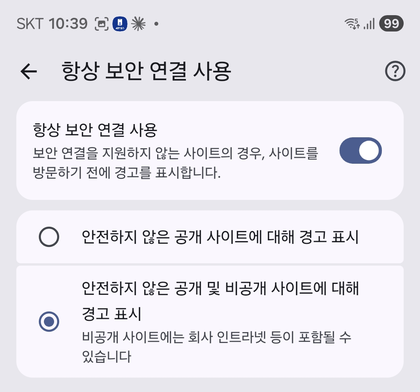
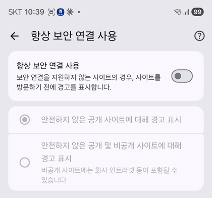
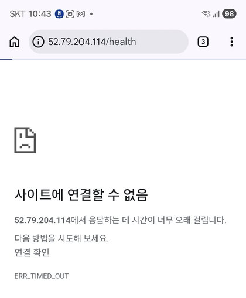
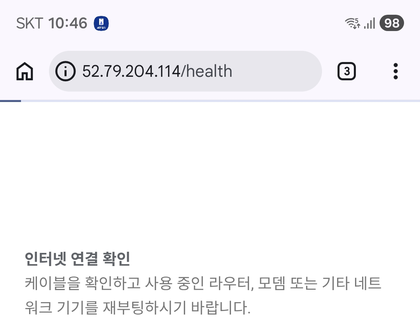
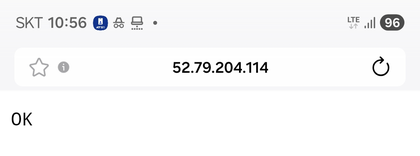

# 트러블슈팅 보고서

> 실습 중 **실제로 겪은 장애**를 기록했다. 원인을 모르는 상태에서 출발해, 근거로 범위를 하나씩 좁혀 원인을 확정했다. 서버 설정은 바꾸지 않았다.

## 요약

| 항목 | 내용 |
|---|---|
| 일시 | 2026-10-20 10:36 ~ 10:57 (KST), 9단계 외부 검증 직후 |
| 증상 | 휴대폰(Android) **Chrome**에서 `52.79.204.114/health` 접속 시 `ERR_TIMED_OUT`. 같은 시간 Mac에서는 정상 |
| 원인 | **Chrome 클라이언트 문제** (서버·SG·네트워크는 정상) |
| 조치 | 서버는 바꾸지 않음. **443을 열지 않음.** 다른 브라우저(삼성 인터넷)로 접속 |
| 결과 | 휴대폰 LTE(집과 다른 외부망)에서도 `OK` → "누구나 접속" 확인 |


---

## 1. 어떻게 접근했나 (원칙)

| 원칙 | 이유 |
|---|---|
| **서버부터 고치지 않는다** | Mac에서 되는 서버를 건드리면 멀쩡한 설정을 망가뜨릴 수 있다. "어디까지 정상인가"를 먼저 가린다 |
| **같은 요청을 다른 클라이언트로** 해 본다 | 하나라도 되면 서버는 정상이다. 바뀐 조건(기기·네트워크·브라우저)만 의심하면 된다 |
| **한 번에 하나만** 바꾼다 | 여러 개를 동시에 바꾸면 무엇 때문에 결과가 달라졌는지 알 수 없다 |
| **실패 형태를 읽는다** | refused는 서버까지 와서 거절된 것, **timeout은 응답 자체가 없는 것**. 어디서 막혔는지 힌트가 된다 |

## 2. 진행 과정 (시간순)

### ① 10:36 증상 발견

- **본 것**: 휴대폰 Chrome에 `52.79.204.114/health`를 입력하면 접속되지 않음. 주소에서 `s`를 지워도 `https://`가 자동으로 다시 붙음
- **생각한 것 (가설 1)**: 브라우저가 HTTPS(443)로 먼저 접속한다. 우리 SG는 443을 열지 않았으니 막힌다
- **다음 행동**: 이 가설을 직접 확인하려고 Chrome의 HTTPS 강제 설정을 끄기로 함

### ② 10:39 Chrome "항상 보안 연결 사용" 끄기

| 켜져 있던 상태 | 끈 상태 |
|---|---|
|  |  |

- **왜**: 가설 1이 맞다면 이 설정을 끄는 것만으로 해결되어야 함

### ③ 10:43 그래도 `ERR_TIMED_OUT`



- **본 것**: 설정을 꺼도 "52.79.204.114에서 응답하는 데 시간이 너무 오래 걸립니다", `ERR_TIMED_OUT`
- **판단**: 가설 1만으로는 설명되지 않음. 실패 형태가 refused가 아니라 **timeout**이므로 요청이 어디선가 응답 없이 사라지고 있음
- **다음 행동**: 서버 쪽 문제인지부터 가르기로 함

### ④ 10:45 Mac에서 같은 요청 → 200 OK (서버 쪽 제외)

```text
aranglee@Arangui-MacBookPro ~ % curl -i --max-time 10 http://52.79.204.114/health
HTTP/1.1 200 OK
Server: nginx/1.24.0 (Ubuntu)
Date: Tue, 20 Oct 2026 01:45:31 GMT
Content-Type: text/plain
Content-Length: 3
Connection: keep-alive

OK
```

- **왜 이걸 했나**: 서버·SG·라우팅·Nginx 중 하나라도 문제면 Mac에서도 실패해야 한다. 가장 빠르게 서버 쪽을 가르는 방법
- **판단**: 같은 시각 200 OK, SG의 80 규칙도 그대로 → **서버 쪽(가설 ①) 제외.** 문제는 휴대폰·휴대폰 네트워크·Chrome 중 하나

### ⑤ 10:46 Chrome이 실제로 어디로 접속하는지 확인



- **본 것**: "세부정보"에는 일반 안내("인터넷 연결 확인")만 나옴. 주소창 아이콘이 자물쇠가 아니라 **ⓘ**(`http://` 접속 표시)
- **판단**: Chrome은 http로 시도하고 있는데도 실패함 → 원인 후보를 **네트워크**와 **Chrome 자체**로 좁힘

### ⑥ 10:50 와이파이를 끄고 LTE로 (네트워크 제외)

- **왜**: 휴대폰이 연결된 와이파이가 80번이나 IP 직접 접속을 막는지 가르기 위해
- **결과**: LTE에서도 Chrome은 실패. 전환 직후 시크릿 탭의 `ERR_NETWORK_CHANGED`는 네트워크가 바뀌는 순간 요청이 끊긴 것이라 판단에서 제외
- **판단**: 와이파이든 LTE든 실패 → **네트워크(가설 ②) 제외.** 남은 것은 휴대폰 안의 **Chrome**

### ⑦ 10:55 다른 브라우저(삼성 인터넷) 시도 → 주소 오타 발견

- **왜**: 같은 휴대폰·같은 LTE에서 **브라우저만** 바꾸면 Chrome 문제인지 확정할 수 있음
- **결과**: 첫 시도 실패. 입력한 주소를 다시 보니 `52.79.204.`**`144`** (정답은 `.114`)
- **판단**: 이 실패는 오타 때문이라 결론에 쓰지 않음. 주소를 고쳐 다시 시도

### ⑧ 10:56 삼성 인터넷 `.114` → `OK` (원인 확정)



- **결과**: LTE 상태에서 `52.79.204.114` → **`OK`**
- **판단**: 같은 휴대폰, 같은 네트워크, 같은 주소인데 브라우저만 바꾸니 됨 → **Chrome에서만 실패**로 확정

## 3. 원인

| 구분 | 내용 |
|---|---|
| **확정** | Chrome 클라이언트 문제. 서버(Mac 200), 네트워크(LTE에서 삼성 인터넷 OK), 휴대폰 자체(삼성 인터넷 OK)는 모두 정상 |
| **추정** | Chrome은 보안 연결 설정을 꺼도 내부적으로 `https://`를 먼저 시도하는 기능이 남아 있다. SG는 허용하지 않은 443 패킷을 **거절하지 않고 조용히 버리므로**, Chrome이 빨리 실패하고 http로 내려가지 못해 timeout으로 끝난 것으로 보인다. Chrome 내부 동작이라 직접 확인하지는 못했다 |

## 4. 조치와 그 이유

| 고려한 조치 | 선택 | 이유 |
|---|---|---|
| SG에 **443을 연다** | ✕ | HTTPS 인증서가 없어 열어도 제대로 동작하지 않고, "필요한 포트만 연다"는 SG 원칙과 과제 요구에 어긋남. 증상만 없애는 해결 |
| Nginx·서버 설정 변경 | ✕ | 서버는 Mac에서 정상. 멀쩡한 쪽을 바꿀 이유 없음 |
| 다른 브라우저로 접속 | ○ | 서버를 그대로 두고 확인 가능. 삼성 인터넷으로 `OK` 확인 |

## 5. 결과와 배운 점

- **결과**: 집 와이파이(Mac)와 **다른 네트워크**(휴대폰 LTE)에서도 `/health` → `OK`. 서버가 "누구나 접속 가능"한 상태임을 다시 확인
- **처음 가설(HTTPS 설정)은 틀렸다.** 설정을 꺼서 직접 확인했기 때문에 틀린 가설에 매달리지 않고 다음 단계로 넘어갈 수 있었다
- 실패 원인을 찾을 때는 **바뀐 조건을 하나씩 되돌려 본다**: 서버(→ Mac) → 네트워크(→ LTE) → 브라우저(→ 삼성 인터넷)
- **주소 오타**도 실제로 일어난다. 결과가 이상하면 입력값부터 다시 본다

## 점검 기준 (이 실습에서 쓴 판단 근거)

| 결과 | 의미 | 먼저 볼 곳 |
|---|---|---|
| timeout | 응답 자체가 없음. 서버까지 못 갔거나, 중간에서 패킷이 버려짐 | Route Table, SG, 퍼블릭 IP, 그리고 클라이언트(브라우저·네트워크) |
| connection refused | 서버까지 왔지만 그 포트에서 듣는 프로그램이 없음 | Nginx 실행 여부, 80 포트 대기 |
| 200 OK | 정상 | — |

이 실습에서 실제로 본 두 결과:

| 언제 | 결과 | 뜻 |
|---|---|---|
| Nginx 설치 전, 내 PC → 80 | **Connection refused** (8 ms) | 요청은 서버까지 왔고, 80에서 듣는 프로그램이 없음 → [09a](images/09a-refused-before-nginx.png) |
| 휴대폰 Chrome (위 사례) | **ERR_TIMED_OUT** | 응답이 오지 않음. 서버는 정상이었으므로 클라이언트 쪽 문제 |
